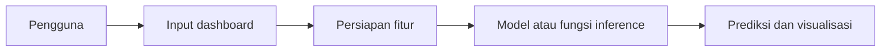
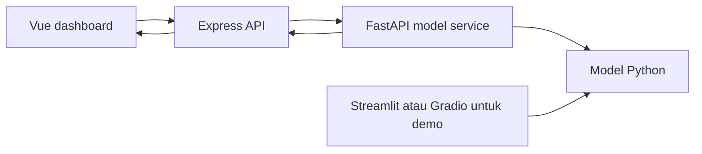

# AI Dashboard

Streamlit dan Gradio membantu membuat antarmuka aplikasi AI dengan Python. Keduanya dapat menerima input, memanggil fungsi inference, lalu menampilkan hasil di browser.

## Alur aplikasi

Dashboard menangani interaksi dan tampilan. Model tetap bertugas menghasilkan prediksi. Mulai dengan [AI Inference](../ai-systems/ai-inference.md) untuk memahami tahap yang dipanggil dashboard.

## Pilih sesuai bentuk aplikasi

| Kebutuhan | Pilihan awal |
| --- | --- |
| Panel sensor, tabel, filter, grafik, dan kontrol analisis | Streamlit |
| Demo model dengan pasangan input dan output yang jelas | Gradio `Interface` |
| Alur demo dengan beberapa komponen dan event | Gradio `Blocks` |

Ini titik awal, bukan batas kemampuan framework. Streamlit juga memiliki komponen chat; Gradio dapat menyusun aplikasi yang lebih kompleks.

## Hubungan dengan backend dan AI

Untuk eksplorasi, aplikasi Streamlit atau Gradio dapat memuat model Python dan menjalankan inference secara langsung. Pada sistem yang sudah memiliki Express.js, dashboard Vue dapat memanggil Express, lalu Express meneruskan request ke layanan AI Python seperti FastAPI.

Jalur belajar: mulai dari [Streamlit](streamlit.md) untuk dashboard data, lalu [Gradio](gradio.md) untuk demo fungsi model. Bagian [Backend](../../backend/overview.md) menjelaskan Express.js dan jembatannya ke FastAPI.

Rujukan: [konsep dasar Streamlit](https://docs.streamlit.io/get-started/fundamentals/main-concepts), [Quickstart Gradio](https://www.gradio.app/guides/quickstart).

## What's next

[:lucide-chart-line: **Streamlit untuk data sensor** Buat panel dari pembacaan sensor. Tambahkan widget untuk memilih data yang ingin dilihat.](streamlit.md){ .ai-practice-start }

[:lucide-flask-conical: **Gradio untuk demo model** Buat antarmuka dengan satu masukan dan keluaran untuk mencoba fungsi model.](gradio.md)

