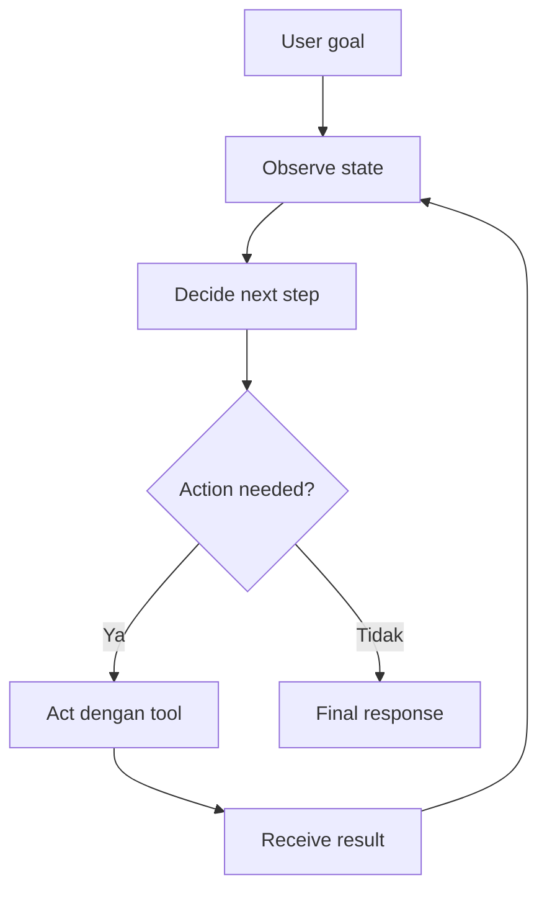
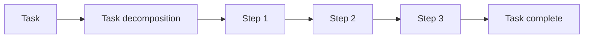
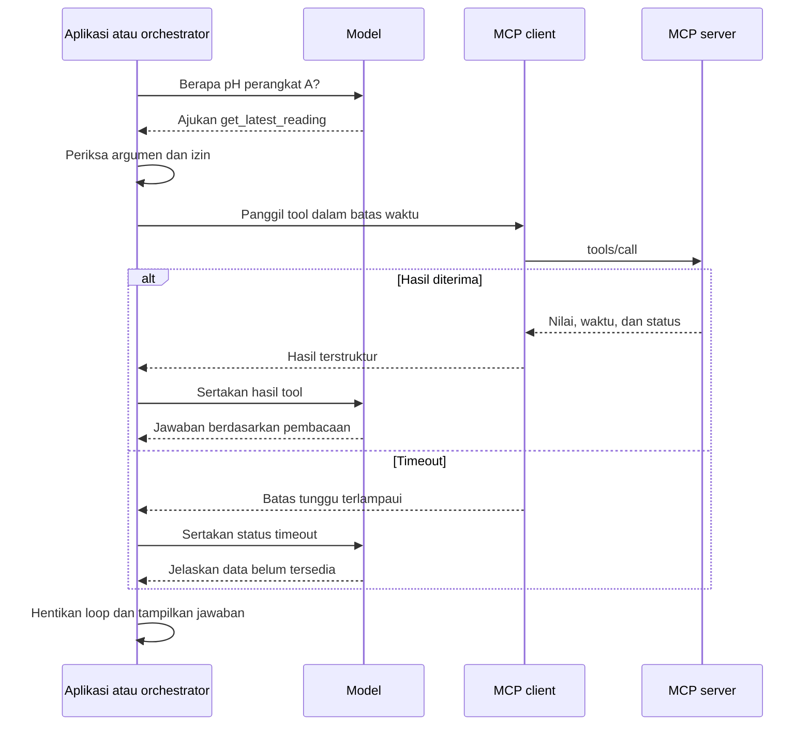

# AI Agents

AI agent adalah sistem yang menggunakan model untuk memilih langkah dan menjalankan tindakan berdasarkan tujuan. Agent dapat memakai tools, menyimpan state, dan mengulang proses sampai tujuan tercapai atau kondisi berhenti terpenuhi.

## Konsep Dasar

LLM terutama menghasilkan dan memahami bahasa. Agent menambahkan loop, tools, state, aturan, dan hasil eksekusi sehingga model menjadi bagian dari sistem yang dapat mengambil tindakan.

Chatbot biasanya merespons percakapan. Agent dapat merencanakan langkah dan berinteraksi dengan sistem eksternal. Agent tetap membutuhkan batasan yang jelas karena keputusan model dapat salah atau menghasilkan langkah yang tidak diharapkan.

## Tool Calling

Agent memilih tool berdasarkan tujuan dan context. Sistem menerima tool call, memvalidasi arguments, menjalankan tool, lalu memberikan tool result kepada model. Detail mekanisme ini dibahas pada halaman Tools dan Function Calling.

## Agent Loop

Agent loop mengatur siklus observe, decide, act, dan menerima result. Loop berhenti ketika model menghasilkan jawaban akhir, tujuan terpenuhi, jumlah langkah mencapai batas, atau terjadi error yang tidak dapat dipulihkan.

## Agent State

Conversation state menyimpan percakapan yang diperlukan model. Task state menyimpan tujuan, progress, dan langkah yang sudah selesai. Tool state menyimpan request, status, result, dan error dari tool.

Short-term memory digunakan selama task berjalan. Long-term memory menyimpan informasi lintas sesi setelah aplikasi memiliki aturan penyimpanan, penghapusan, dan permission yang jelas.

## Planning dan Orchestration

Planning dapat memecah tujuan menjadi beberapa langkah berurutan. Orchestration mengatur agent loop, tool router, workflow, state management, dan termination condition. Dependensi antar langkah perlu dicatat agar langkah berikutnya tidak berjalan sebelum data yang dibutuhkan tersedia.

## Reliability

Tool errors dan invalid arguments perlu ditangani dengan pesan error yang dapat diproses model. Retry harus memiliki batas dan aturan backoff. Timeout mencegah loop menunggu layanan yang tidak merespons.

Guardrails membatasi tool, parameter, dan jenis tindakan yang dapat dilakukan agent. Human approval diperlukan untuk tindakan berisiko seperti mengubah konfigurasi, menghapus data, atau menyalakan actuator yang dapat membahayakan perangkat.

## Single dan Multi-Agent

Single-agent architecture cukup ketika satu agent dapat mengatur model, tools, dan state dengan alur yang sederhana. Multi-agent architecture membagi pekerjaan ke agent yang memiliki spesialisasi berbeda, misalnya agent retrieval, agent analisis, dan agent eksekusi.

Multi-agent menambah komunikasi, state, latency, dan titik kegagalan. Gunakan pendekatan ini ketika pembagian tanggung jawab memberikan manfaat yang dapat diukur dan setiap agent memiliki batas tugas yang jelas.

## Hands-on

Buat agent dengan satu tool pembaca sensor. Tampilkan state setiap langkah, batasi jumlah iterasi, dan hentikan loop ketika data yang diminta sudah tersedia.

Tambahkan tool kedua untuk memberi rekomendasi. Uji multi-step task, error handling, timeout, dan kasus ketika agent tidak boleh menjalankan actuator tanpa persetujuan pengguna.

### Telusuri satu panggilan MCP

> **AI Generated, need human review**

Ikuti permintaan untuk membaca pH terbaru. Model mengusulkan fungsi, sedangkan aplikasi memeriksa izin dan menjalankan panggilan lewat MCP client. Setelah menerima hasil atau timeout, aplikasi memberi konteks itu kepada model untuk menyusun respons.

Pada skenario ini, batasnya satu panggilan pembacaan. Tandai langkah terakhir yang berhasil pada kedua cabang, lalu periksa hasil nyata dengan [praktik MCP](../../hands-on/mcp-sensor.md).
