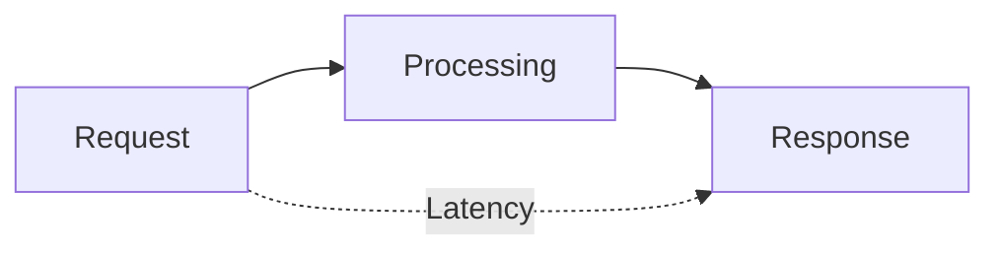
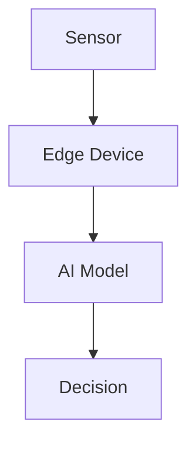
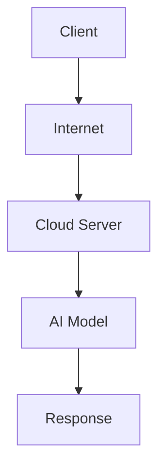
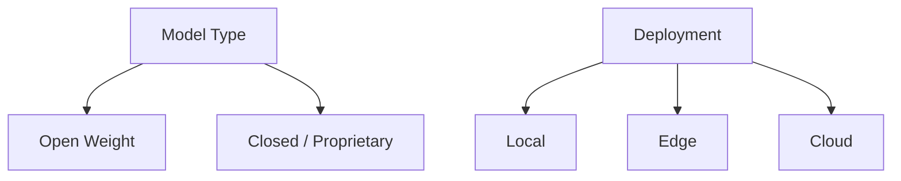
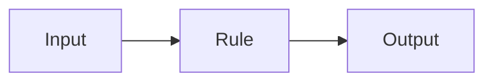
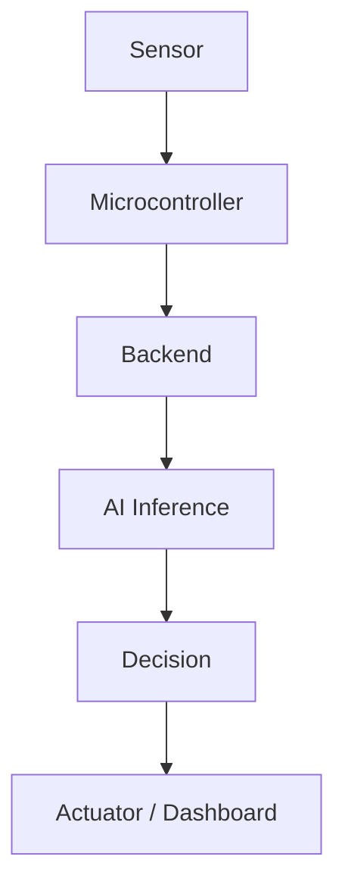
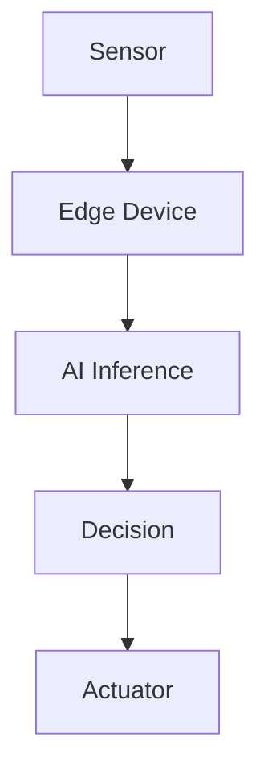

# AI Inference

AI Inference adalah proses ketika sebuah model AI digunakan untuk menghasilkan output berdasarkan input yang diberikan. Output tersebut dapat berupa prediksi, klasifikasi, rekomendasi, teks, gambar, atau bentuk informasi lainnya sesuai dengan tujuan model dan sistem yang dibangun.

Inference merupakan salah satu tahap penting dalam sistem AI karena pada tahap inilah model yang telah dikembangkan digunakan untuk memproses data baru dan menghasilkan keluaran yang dapat digunakan oleh pengguna maupun komponen sistem lainnya.

## Tujuan

Setelah mempelajari materi ini, peserta diharapkan memahami bagaimana model AI digunakan dalam sebuah sistem, bagaimana input diproses menjadi output, serta faktor yang perlu dipertimbangkan ketika inference dijalankan.

## Konsep yang Dipelajari

- **Inference**: Proses menggunakan model AI untuk menghasilkan output berdasarkan input.
- **Input**: Data yang diberikan kepada model untuk diproses.
- **Output**: Hasil yang dihasilkan oleh model setelah memproses input.
- **Prompt dan Context**: Instruksi dan informasi tambahan yang diberikan kepada model, terutama pada sistem berbasis LLM.
- **Context Window**: Batas jumlah token yang dapat diproses model dalam satu sesi atau request.
- **Latency**: Waktu yang dibutuhkan sistem untuk menghasilkan atau mulai menghasilkan output.
- **Throughput**: Jumlah pekerjaan atau data yang dapat diproses oleh sistem dalam periode waktu tertentu.
- **Local dan Cloud Inference**: Dua pendekatan dalam menjalankan model AI berdasarkan lokasi komputasinya.
- **Deterministic dan Probabilistic Output**: Perbedaan karakteristik output yang dihasilkan oleh sistem AI.

## Inference dalam Sistem AI

Inference adalah proses penggunaan model AI yang telah tersedia untuk memproses input baru.

Satu pola inference yang sama dapat menerima input berbeda, menjalankannya pada model yang sesuai, lalu mengembalikan output yang dibutuhkan sistem.


Bentuk output bergantung pada tujuan model. Beberapa contoh inference antara lain:

| Jenis | Input | Output |
| --- | --- | --- |
| Classification | Gambar | Kelas objek |
| Regression | Data sensor | Nilai prediksi |
| Anomaly Detection | Data sensor | Status anomali |
| Recommendation | Data pengguna | Rekomendasi |
| Text Generation | Prompt | Teks |
| Image Generation | Prompt | Gambar |

Ketika kalian mengirim pertanyaan ke platform AI seperti ChatGPT, Gemini, atau Claude, sistem tersebut juga melakukan inference. Input yang diberikan dapat berupa prompt beserta context, kemudian model memprosesnya dan menghasilkan output berupa respons.

Training dan inference merupakan dua proses yang berbeda.

Training digunakan untuk membangun atau menyesuaikan model berdasarkan data, sedangkan inference menggunakan model tersebut untuk menghasilkan output dari input baru.

## Input dan Output dalam Inference

Setiap inference membutuhkan input yang dapat diproses oleh model. Bentuk input bergantung pada jenis model dan sistem yang digunakan.

Beberapa contoh input:

- Teks
- Gambar
- Audio
- Video
- Data numerik
- Data sensor
- JSON
- Embedding
- Prompt dan context

Output yang dihasilkan juga dapat memiliki berbagai bentuk, misalnya:

- Label klasifikasi
- Nilai prediksi
- Skor probabilitas
- Rekomendasi
- Teks
- Gambar
- Embedding
- Keputusan untuk komponen sistem

Model melakukan sejumlah perhitungan berdasarkan parameter yang telah diperoleh selama proses training. Hasil perhitungan tersebut kemudian digunakan untuk menghasilkan output sesuai dengan kemampuan dan tujuan model.

Namun, model tidak selalu menghasilkan "jawaban yang benar". Output model perlu dipahami dalam konteks jenis model, data yang digunakan, serta tujuan sistem.

## Prompt dan Context

Pada sistem AI berbasis LLM, input tidak hanya berupa pertanyaan sederhana. Model dapat menerima prompt dan context untuk membantu menentukan output yang dihasilkan.

Prompt adalah instruksi, pertanyaan, atau permintaan yang diberikan kepada model.

Contoh:

Jelaskan kondisi tanaman berdasarkan data sensor berikut.

Sedangkan context adalah informasi tambahan yang diberikan kepada model agar dapat memahami situasi atau latar belakang dari permintaan tersebut.

Contoh context:

```json
{
  "plant": "tomato",
  "soil_moisture": 31,
  "temperature": 29,
  "humidity": 72
}
```

Prompt dan context menjadi input bagi LLM. Model memproses keduanya lalu menghasilkan output teks, seperti pada alur inference di atas.

Dengan context yang sesuai, model dapat menghasilkan output yang lebih relevan terhadap kondisi yang sedang dianalisis.

## Context Window

Model AI memiliki batas jumlah token yang dapat diproses dalam satu kali inference. Batas tersebut disebut context window.

Sebagai contoh, apabila sebuah model memiliki context window tertentu, seluruh input yang diberikan harus dapat ditampung di dalam batas tersebut.

Context yang terlalu besar dapat menyebabkan:

Input tidak dapat diproses seluruhnya.
Sebagian informasi perlu dipotong atau diringkas.
Biaya dan waktu inference dapat meningkat pada layanan tertentu.
Sistem perlu menggunakan strategi seperti summarization, retrieval, atau context selection.

Karena itu, membangun sistem AI bukan hanya tentang memberikan sebanyak mungkin informasi kepada model, tetapi juga tentang memilih informasi yang relevan untuk diberikan.

## Latency dan Throughput

### Latency

Latency adalah waktu yang dibutuhkan sistem untuk memproses sebuah request dan menghasilkan output.

Secara sederhana:



Pada AI generatif, latency dapat memiliki beberapa bentuk pengukuran. Misalnya:

- **Time to First Token (TTFT)**: waktu dari request dikirim sampai token pertama mulai dihasilkan.
- **Time to Completion**: waktu sampai seluruh output selesai dihasilkan.

Latency penting ketika sistem membutuhkan respons cepat, seperti:

- AI assistant interaktif.
- Sistem monitoring real-time.
- Edge AI.
- Sistem kontrol IoT.

Semakin kecil latency, semakin cepat sistem dapat merespons. Namun, latency bukan satu-satunya ukuran performa sistem AI.

### Throughput

Throughput menunjukkan seberapa banyak pekerjaan yang dapat diproses oleh sistem dalam periode tertentu.

Contohnya:

10 requests / second

atau pada inference LLM:

50 tokens / second

Throughput menjadi penting ketika sebuah sistem harus menangani banyak request secara bersamaan.

Latency dan throughput memiliki fokus yang berbeda:

| Metric | Fokus |
| --- | --- |
| Latency | Seberapa cepat satu request mendapatkan respons |
| Throughput | Seberapa banyak pekerjaan yang dapat diproses |

Sebuah sistem dapat memiliki latency rendah tetapi throughput yang rendah, atau sebaliknya. Karena itu, keduanya perlu dipertimbangkan berdasarkan kebutuhan sistem.

## Local vs Cloud Inference

Inference dapat dijalankan di berbagai lokasi, mulai dari perangkat pengguna hingga server cloud.

### Local Inference

Local inference adalah inference yang dijalankan pada perangkat atau infrastruktur yang dikendalikan secara lokal, seperti:

- Laptop
- Smartphone
- Edge device
- Industrial computer
- Perangkat IoT

Contoh sederhana:



Keuntungan local inference antara lain:

Tidak selalu membutuhkan koneksi internet.
Data dapat tetap berada di perangkat.
Dapat memberikan respons dengan latency jaringan yang rendah.
Dapat digunakan pada lingkungan dengan koneksi terbatas.

Namun, perangkat lokal biasanya memiliki keterbatasan pada:

CPU/GPU/NPU
Memory
Storage
Konsumsi daya

Karena itu, model yang digunakan pada perangkat lokal sering kali perlu disesuaikan dengan kemampuan perangkat.

### Cloud Inference

Cloud inference adalah inference yang dijalankan pada server atau infrastruktur cloud.

Contoh:



Cloud inference memungkinkan sistem menggunakan sumber daya komputasi yang lebih besar dan dapat menangani kebutuhan yang lebih kompleks.

Keuntungannya antara lain:

Dapat menggunakan hardware dengan kemampuan komputasi tinggi.
Lebih mudah melakukan scaling.
Model berukuran besar dapat dijalankan tanpa membutuhkan hardware besar pada client.
Infrastruktur dapat dikelola secara terpusat.

Namun, cloud inference juga memiliki beberapa pertimbangan:

Membutuhkan koneksi jaringan.
Network latency dapat memengaruhi waktu respons.
Data perlu dikirim ke server.
Penggunaan resource dapat menimbulkan biaya operasional.

## Local dan Cloud Bukan Jenis Model

Perlu diperhatikan bahwa local/cloud inference menunjukkan lokasi inference, bukan jenis model yang digunakan.

Model Open Weight dapat dijalankan secara lokal maupun di cloud.

Begitu pula model yang disediakan melalui layanan tertutup dapat digunakan melalui server atau infrastruktur tertentu sesuai layanan yang tersedia.

Dengan demikian:



Keduanya merupakan konsep yang berbeda dan dapat dikombinasikan.

## Deterministic vs Probabilistic Output

Sistem AI dapat menghasilkan output dengan karakteristik yang berbeda.

### Deterministic

Sistem deterministic menghasilkan output yang sama ketika diberikan input dan kondisi yang sama.

Contoh sederhana adalah sistem berbasis aturan:

```text
IF temperature > 35°C
THEN status = "Hot"
```

Untuk input yang sama dan kondisi yang sama, hasilnya akan selalu sama.



Pendekatan deterministic umum ditemukan pada:

- Rule-based system
- Threshold sensor
- Validasi data
- Logic program

### Probabilistic

Sistem probabilistic menghasilkan output berdasarkan distribusi kemungkinan.

Contohnya, model klasifikasi dapat menghasilkan:

```text
Healthy   : 0.80
Diseased  : 0.15
Unknown   : 0.05
```

Model kemudian dapat memilih kelas berdasarkan probabilitas tersebut.

Pada LLM, proses generation juga melibatkan probabilitas dalam pemilihan token. Karena itu, dengan konfigurasi tertentu, input yang sama tidak selalu menghasilkan output teks yang identik.

Namun, probabilistic tidak berarti "acak sepenuhnya". Output tetap dipengaruhi oleh:

- Input
- Parameter model
- Sampling strategy
- Model configuration
- Context

Perlu diperhatikan bahwa deterministic vs probabilistic bukan berarti semua AI dapat dimasukkan secara mutlak ke salah satu kategori tersebut. Karakteristik output juga dapat bergantung pada bagaimana model dan inference engine dikonfigurasi.

## Inference dalam AIoT

Dalam sistem AIoT, inference dapat ditempatkan pada beberapa bagian arsitektur.

Contoh sederhana:



Inference juga dapat dipindahkan lebih dekat ke sumber data:



Pemilihan lokasi inference bergantung pada kebutuhan sistem, seperti:

- Latency
- Ketersediaan koneksi
- Kapasitas perangkat
- Ukuran model
- Privasi data
- Biaya operasional
- Kebutuhan real-time

Karena itu, tidak ada satu pendekatan inference yang selalu paling baik. Pengembang perlu memilih arsitektur berdasarkan kebutuhan sistem.

## What's next

<div class="ai-resource-grid ai-practice-grid" markdown="1">

[<span class="ai-practice-icon" aria-hidden="true">:lucide-message-square:</span> **Large Language Model** <span class="ai-practice-description">Ikuti apa yang terjadi saat model bahasa menerima prompt. Lihat bagaimana token berikutnya dipilih.</span>](llm.md){ .ai-practice-start }

</div>
