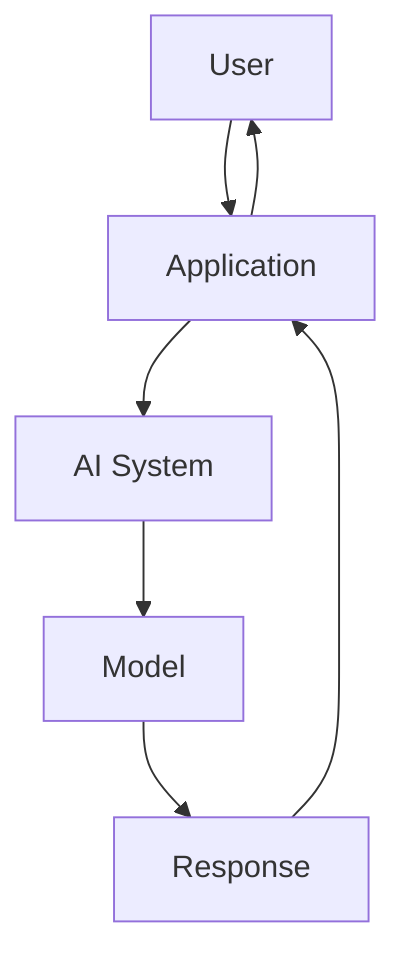
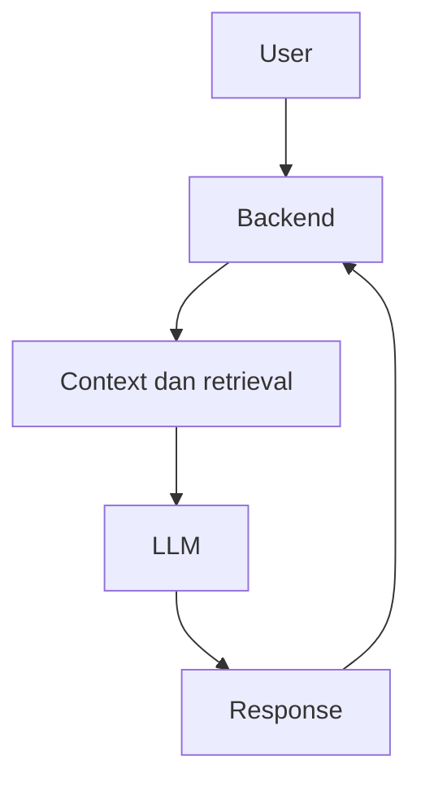
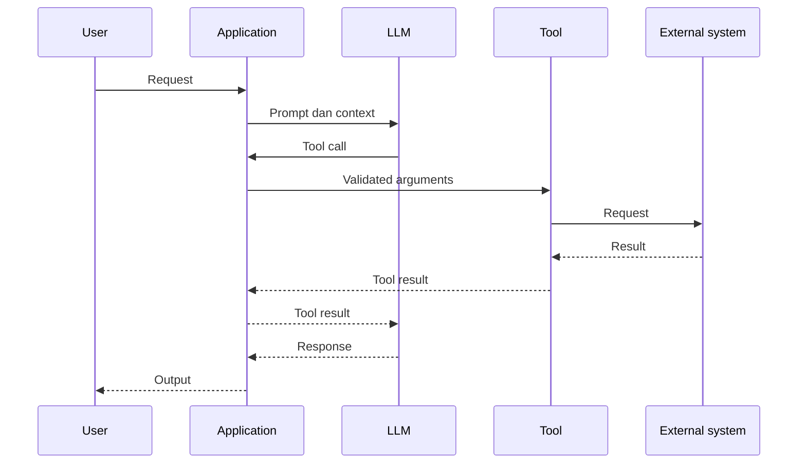
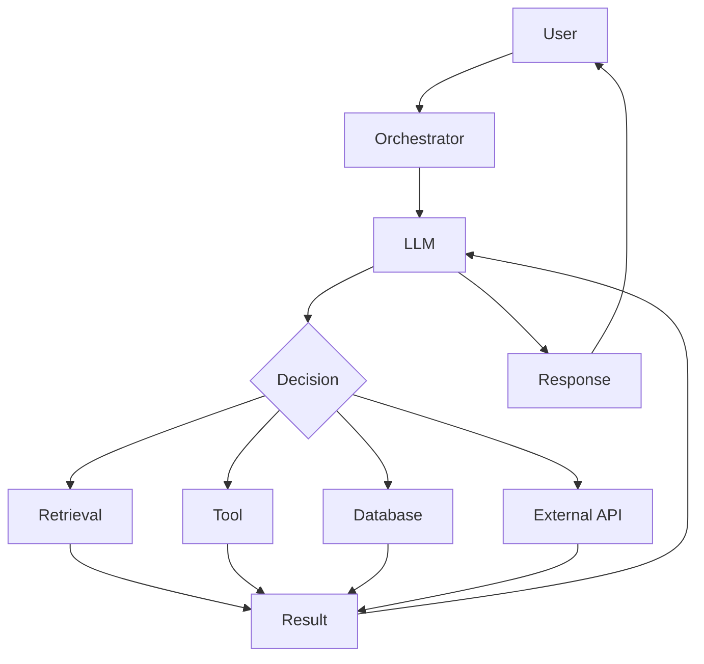
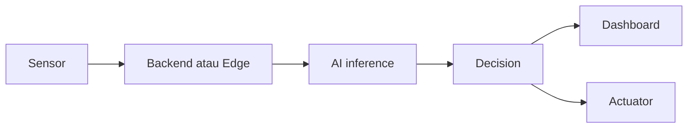

# AI Application Architecture

AI application adalah sistem yang menggabungkan model dengan interface, backend, data, tools, dan operasi. Model menjalankan bagian tertentu dari proses; aplikasi menyediakan alur, aturan, penyimpanan, dan kontrol yang membuat fitur dapat digunakan.

## Konsep Dasar

Pemisahan tanggung jawab membantu setiap komponen memiliki fungsi yang dapat diuji. User interface menerima input dan menampilkan output. Application backend mengatur autentikasi, validasi, orchestration, dan komunikasi. Model memproses input berdasarkan prompt dan context.

Knowledge, retrieval, database, tools, memory, dan monitoring mendukung kebutuhan sistem. Component-based architecture memungkinkan komponen diganti atau diskalakan tanpa mengubah seluruh aplikasi.

## Komponen AI Application

Komponen yang umum digunakan meliputi:

- User Interface untuk menerima permintaan dan menampilkan respons.
- Application Backend untuk mengatur request, permission, dan alur aplikasi.
- AI Model untuk melakukan inference.
- Prompt dan context untuk memberi instruksi serta informasi tambahan.
- Knowledge dan retrieval untuk mengambil informasi yang relevan.
- Tools untuk berinteraksi dengan layanan eksternal.
- Database untuk menyimpan data aplikasi dan hasil operasi.
- Memory untuk menyimpan state yang diperlukan.
- Orchestrator untuk mengatur beberapa langkah.
- Monitoring untuk mengamati latency, error, biaya, dan kualitas output.

## Basic Architecture

Application menerima input, menerapkan aturan, lalu meneruskan data yang diperlukan ke AI system. Response perlu divalidasi sebelum ditampilkan atau digunakan oleh komponen lain.

## Context-Aware Architecture

Context-aware architecture menambahkan sumber informasi yang relevan sebelum model dipanggil.

## Tool-Enabled Architecture

Tool-enabled application memungkinkan model meminta tindakan pada external system melalui backend.

## Agentic Architecture

Agentic architecture memakai orchestrator untuk mengatur keputusan, retrieval, tools, database, dan external API. Setiap langkah perlu memiliki status dan kondisi berhenti.

## Data Flow

Input flow membawa data dari user, device, atau service menuju backend. Context flow membawa prompt, history, dan informasi tambahan ke model. Retrieval flow mengambil knowledge yang relevan. Tool flow mengirim request ke sistem eksternal dan membawa result kembali.

Output flow meneruskan hasil terverifikasi ke user atau komponen lain. State flow menyimpan progress, status operasi, dan metadata yang dibutuhkan untuk melanjutkan proses.

## System Design Considerations

Latency dan throughput menentukan pengalaman pengguna serta kapasitas sistem. Scalability menentukan cara backend, model, database, dan queue menangani pertumbuhan beban. Cost dipengaruhi oleh model, token, storage, jaringan, dan waktu komputasi.

Reliability membutuhkan timeout, retry, fallback, dan validasi. Security dan privacy membutuhkan authentication, authorization, perlindungan secret, serta pembatasan data yang dikirim ke model. Observability membutuhkan log, metric, trace, dan pencatatan versi model atau prompt.

Model selection dan deployment perlu disesuaikan dengan kualitas, lisensi, data, resource, latency, dan kebutuhan local, edge, atau cloud inference.

### Diagnosis kegagalan pembacaan sensor

> **AI Generated, need human review**

Dashboard meminta pH terbaru saat operator membuka panel. Gunakan tiga catatan ilustratif untuk menentukan apakah nilai layak ditampilkan sebagai kondisi saat ini. Kolom tahap menunjukkan tempat pertama yang perlu diperiksa.

| Kasus | Catatan | Pertanyaan |
| --- | --- | --- |
| Normal | `request_id=01 stage=sensor_query status=ok elapsed_ms=38 age_min=5` | Nilai dan metadata apa yang perlu tampil? |
| Timeout | `request_id=02 stage=sensor_query status=timeout elapsed_ms=2000` | Apakah dashboard punya nilai terverifikasi untuk permintaan ini? |
| Data kedaluwarsa | `request_id=03 stage=freshness_check status=stale elapsed_ms=42 age_min=30` | Apakah umur data masih memungkinkan status terkini ditampilkan? |

Pilih respons untuk tiap kasus. Hasil normal menampilkan pembacaan dan waktunya. Jika terjadi timeout, tampilkan bahwa permintaan gagal dan beri opsi mencoba lagi. Jika data kedaluwarsa, tampilkan waktu pembacaan terakhir dengan penanda bahwa kondisi saat ini belum diketahui.

## AI Application Patterns

Simple LLM application cocok untuk percakapan atau generation tanpa sumber eksternal. RAG application menambahkan retrieval. Tool-using application menambahkan fungsi yang dapat dipanggil model. Agentic application mengatur beberapa langkah dan keputusan.

AI + IoT application menghubungkan data sensor, backend, inference, dashboard, dan actuator. Pemilihan pattern bergantung pada kebutuhan alur dan tingkat risiko tindakan.

## AIoT Integration

AIoT dapat menempatkan inference di backend, edge device, atau keduanya. Sensor mengirim data ke backend atau edge, model menganalisis data, lalu sistem menghasilkan keputusan untuk dashboard atau actuator.

Real-time inference membutuhkan perhatian pada sampling, queue, latency, koneksi, dan fallback ketika model atau jaringan tidak tersedia. Cloud AI memudahkan penggunaan model besar, sedangkan edge AI dapat mengurangi network latency dan menjaga data tetap dekat dengan sumbernya.

## What's next

[:lucide-panels-top-left: **AI Dashboard** Pilih cara menampilkan hasil inference dan status kegagalan untuk pengguna aplikasi.](../ai-dashboard/overview.md){ .ai-practice-start }

