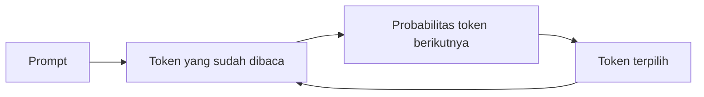
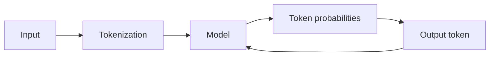
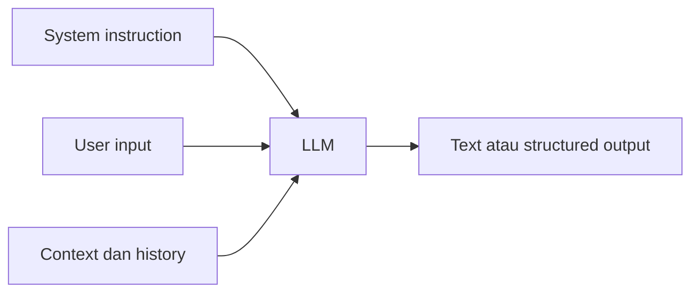

# LLM (Large Language Model)

[Buka Lab Demo Cara Kerja LLM · Gemma 4](../../labs/llm-gemma.md){ .md-button .llm-demo-button }

## Konsep Dasar

### Apa itu LLM?

LLM (Large Language Model) adalah bagian dari pengembangan Deep Learning yang fokus pada pemrosesan bahasa alami (Natural Language Processing/NLP). LLM dilatih menggunakan dataset teks yang sangat besar untuk memahami konteks dan semantik bahasa. Dengan kemampuan ini, LLM dapat melakukan berbagai tugas NLP seperti penerjemahan bahasa, menjawab pertanyaan, dan menghasilkan teks.

LLM menghasilkan teks dengan memprediksi token berikutnya berdasarkan token yang sudah dibaca. Token dapat berupa kata, bagian kata, tanda baca, atau karakter tertentu. Karena model memproses urutan token, susunan input dan konteks memengaruhi output yang dihasilkan.

**Rujukan riset:** [Vaswani et al., “Attention Is All You Need” (2017), *Advances in Neural Information Processing Systems*](https://proceedings.neurips.cc/paper/7181--attention-is-all-you-need.pdf), memperkenalkan arsitektur Transformer berbasis attention yang menjadi dasar banyak LLM modern.

### Language model dan probabilitas token

Pada setiap langkah generation, model memberikan probabilitas untuk beberapa token yang mungkin muncul berikutnya. Model kemudian memilih token berdasarkan probabilitas tersebut dan memasukkannya kembali sebagai bagian dari input pada langkah berikutnya.

Probabilitas membantu model memilih kelanjutan yang sesuai dengan pola bahasa dan konteks. Nilai probabilitas bukan jaminan bahwa sebuah token atau jawaban benar, sehingga output tetap perlu diperiksa sesuai kebutuhan aplikasi.

### Tokenization

Tokenization mengubah teks menjadi token yang dapat diproses model. Satu kata dapat menjadi satu token atau beberapa token, bergantung pada kosakata tokenizer. Spasi, tanda baca, angka, dan potongan kata juga dapat memengaruhi jumlah token.

Jumlah token memengaruhi ukuran context yang dapat dikirim, latency, dan biaya pada layanan yang menghitung penggunaan berdasarkan token. Karena itu, aplikasi perlu menghindari context yang tidak diperlukan.

### Context window dan parameters

Context window adalah jumlah maksimum token yang dapat diproses model dalam satu request. Isinya dapat mencakup system instruction, prompt pengguna, conversation history, hasil retrieval, dan ruang untuk output.

Parameters adalah nilai yang dipelajari model selama training. Jumlah parameter menggambarkan kapasitas model, tetapi tidak menjadi satu-satunya ukuran kualitas. Data training, arsitektur, cara evaluasi, dan kecocokan model dengan tugas juga memengaruhi hasil.

### Pre-training dan fine-tuning

Pre-training melatih model pada dataset besar agar model mempelajari pola bahasa dan hubungan antarkata. Setelah itu, fine-tuning dapat menyesuaikan model dengan tugas, format, domain, atau gaya respons tertentu menggunakan dataset yang lebih terarah.

Fine-tuning tidak selalu menjadi solusi ketika model kekurangan informasi terbaru. Informasi yang sering berubah biasanya lebih tepat diberikan melalui context atau retrieval pada saat inference.

### Inference

Inference adalah proses menjalankan model untuk menghasilkan output dari input baru. Pada LLM, inference mencakup tokenization, pemrosesan model, pemilihan token, dan penggabungan token menjadi output.

## Cara LLM Menghasilkan Output

Alur dasar generation berjalan secara autoregressive. Model membaca input, memprediksi token berikutnya, menambahkan token tersebut ke urutan, lalu mengulanginya sampai mencapai batas output atau kondisi berhenti.

Next-token prediction membuat output dibangun sedikit demi sedikit. Sampling menentukan cara sistem memilih token dari distribusi probabilitas. Temperature mengatur seberapa datar atau tajam distribusi tersebut; nilai lebih rendah cenderung menghasilkan pilihan yang lebih konsisten, sedangkan nilai lebih tinggi membuka lebih banyak variasi.

Top-k membatasi pilihan pada sejumlah token dengan probabilitas tertinggi. Top-p memilih kumpulan token dengan probabilitas kumulatif sampai nilai tertentu. Parameter ini dapat digunakan bersama temperature sesuai kebutuhan tugas, tetapi nilai yang lebih tinggi juga dapat meningkatkan risiko output yang tidak sesuai.

### Ikuti satu langkah Transformer

> **AI Generated, need human review**

Saat model membaca “Suhu air naik”, setiap token dipetakan ke deretan angka yang disebut *embedding*. Model juga memakai informasi posisi agar dapat membedakan urutan “air naik” dari “naik air”. Ilustrasi ini memperlakukan tiap kata sebagai satu token, sehingga perhitungan dapat diikuti tanpa melihat tokenizer tertentu.

Pada *self-attention*, token “naik” membuat *query* dari representasinya. Query dibandingkan dengan *key* milik token yang terlihat, lalu hasil perbandingan menentukan bobot untuk menggabungkan *value*. *Causal mask* menutup akses ke posisi masa depan, sehingga prediksi hanya memakai token yang sudah tersedia.

| Posisi yang dapat dilihat dari “naik” | Bobot ilustratif | Satu komponen value | Kontribusi |
| --- | ---: | ---: | ---: |
| Suhu | 0,2 | 1 | 0,2 |
| air | 0,5 | 4 | 2,0 |
| naik | 0,3 | 2 | 0,6 |

Jumlah kontribusinya 2,8 untuk satu komponen. Representasi dari beberapa lapisan akhirnya diubah menjadi skor token lanjutan, lalu softmax mengubah skor menjadi probabilitas. Bobot di tabel sengaja dipilih sebagai ilustrasi.

Proyeksi `q_proj` membentuk query, sedangkan `v_proj` membentuk value. Keduanya dapat menjadi sasaran adapter pada latihan [LoRA](fine-tuning.md#lora). [Makalah Transformer](https://proceedings.neurips.cc/paper/7181-attention-is-all-you-need)

## Prompt dan Context

Prompt berisi instruksi atau pertanyaan yang ingin diproses model. System instruction menetapkan aturan dan peran model, user input membawa permintaan pengguna, sedangkan context menambahkan informasi yang diperlukan untuk menyelesaikan permintaan.

Conversation history dapat membantu model menjaga kesinambungan percakapan. Namun, history yang terlalu panjang menghabiskan context window. Aplikasi dapat memilih bagian yang relevan atau merangkum percakapan lama.

Structured output meminta model menghasilkan format tertentu, misalnya JSON dengan field yang sudah ditentukan. Format ini memudahkan backend memvalidasi dan meneruskan hasil ke komponen lain.

### Periksa keluaran sebelum menjalankan fungsi

> **AI Generated, need human review**

Anggap model menghasilkan JSON `{"device_id":"esp32-99","sensor_type":"ph"}`. Nilai itu dapat lolos skema karena bentuknya benar, tetapi aplikasi hanya mengenal `esp32-01` dan `esp32-02`. Periksa data perangkat setelah pemeriksaan format.

Jika `esp32-02` terdaftar tetapi akun peserta hanya boleh membaca `esp32-01`, langkah berikutnya menolak panggilan pada pemeriksaan izin. Bedakan kegagalan format, perangkat yang tidak ditemukan, dan akses yang ditolak agar aplikasi dapat mengirim respons yang sesuai.

| Keluaran contoh | Pemeriksaan pertama yang gagal |
| --- | --- |
| `{"device_id":42,"sensor_type":"ph"}` | Format. ID perangkat harus berupa teks. |
| `{"device_id":"esp32-99","sensor_type":"ph"}` | Aturan aplikasi. Perangkat tidak terdaftar. |
| `{"device_id":"esp32-02","sensor_type":"ph"}` | Izin. Akun contoh tidak memiliki akses. |

Ganti ID pada tiga keluaran dengan string `"esp32-01"`. Prediksi apakah tiap contoh kini dapat diteruskan ke tool. [Tools dan Function Calling](tools.md#tool-schema-dan-arguments)

## Model dan Deployment

Open weight model menyediakan bobot yang dapat dijalankan atau disesuaikan sesuai lisensinya. Closed atau proprietary model diakses melalui layanan yang mengelola model dan infrastrukturnya. Pilihan model perlu mempertimbangkan lisensi, kualitas, privasi, biaya, dan kemampuan perangkat.

Local inference menjalankan model di laptop, server sendiri, smartphone, atau edge device. API inference mengirim input ke layanan model melalui jaringan. Local inference dapat mengurangi ketergantungan pada jaringan, sedangkan API inference dapat memberikan akses ke model dan hardware yang lebih besar.

Ukuran model memengaruhi memory, storage, dan kemampuan komputasi yang dibutuhkan. Quantization mengurangi presisi bobot agar model membutuhkan resource lebih kecil. CPU, GPU, dan accelerator lain memiliki karakteristik berbeda dalam latency, throughput, dan konsumsi daya.

## Batasan LLM

LLM dapat menghasilkan informasi yang terdengar meyakinkan tetapi tidak didukung fakta. Gejala ini disebut hallucination. Knowledge cutoff membatasi informasi yang tersedia dari data training, sedangkan context limitation membatasi informasi yang dapat diberikan pada satu request.

LLM juga memiliki keterbatasan dalam reasoning, terutama ketika tugas membutuhkan perhitungan, aturan ketat, atau data eksternal. Output dapat bersifat non-deterministic karena sampling. Biaya dan latency meningkat ketika model, context, atau output menjadi lebih besar.

Aplikasi yang membutuhkan keandalan perlu menambahkan validasi, retrieval, aturan bisnis, batas output, logging, dan mekanisme persetujuan manusia sesuai risiko tugasnya.
