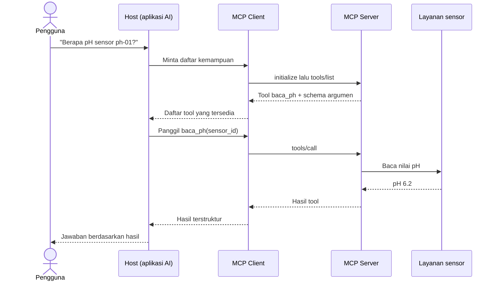

# Model Context Protocol (MCP)

## Definisi

**Model Context Protocol (MCP)** adalah protokol terbuka yang menstandarkan cara aplikasi AI terhubung ke sumber konteks dan kemampuan eksternal. Server MCP dapat menyediakan **tools** untuk melakukan aksi, **resources** untuk menyediakan data, dan **prompts** sebagai pola instruksi. MCP mengatur pertukaran pesan; aplikasi tetap menentukan akses, persetujuan, dan cara memakai hasil.

Contoh berikut menghubungkan aplikasi AI ke layanan pembacaan pH.

## Alur komunikasi



Host adalah aplikasi AI yang mengelola sesi. Client MCP berada di host dan berkomunikasi dengan server. Server mengekspos kemampuan melalui protokol. Model dapat mengusulkan tool dan argumen, tetapi host/client mengatur pemanggilan sesuai kebijakan aplikasi.

## Siapa melakukan apa?

| Bagian | Tugas dalam contoh |
| --- | --- |
| Host | Aplikasi AI yang mengatur interaksi pengguna dan koneksi ke server. |
| Client MCP | Bagian dari host yang menghubungi server, melihat daftar tool, dan mengirim panggilan. |
| Server MCP | Menyediakan tool `baca_ph` yang menerima ID sensor dan mengembalikan hasil. |

Urutan praktisnya: client membangun koneksi, menemukan tool beserta schema, mengirim pemanggilan, menerima hasil, lalu host menyampaikan hasil itu ke model atau pengguna.

Pada tool calling, model bisa mengusulkan nama tool dan argumen. Aplikasi memutuskan apakah panggilan dijalankan. Jika tool disediakan lewat MCP, client mengirim panggilan itu ke server MCP dan menerima hasilnya.

## Praktik membaca pH contoh

Buat `sensor_mcp.py` dalam folder latihan. Nilai pH di bawah adalah data contoh. Server berjalan lewat `stdio`, yaitu komunikasi melalui masukan dan keluaran standar proses.

```python
from typing import TypedDict

from mcp.server.fastmcp import FastMCP

mcp = FastMCP("sensor-latihan")


class Pembacaan(TypedDict):
    status: str
    sensor_id: str
    ph: float | None


@mcp.tool()
def baca_ph(sensor_id: str) -> Pembacaan:
    """Baca pH contoh berdasarkan ID sensor."""
    if sensor_id != "ph-01":
        return {"status": "sensor_tidak_dikenal", "sensor_id": sensor_id, "ph": None}
    return {"status": "ok", "sensor_id": sensor_id, "ph": 6.2}


if __name__ == "__main__":
    mcp.run(transport="stdio")
```

Dengan Node.js dan `uv` terpasang, jalankan Inspector dari folder latihan. Contoh memakai API SDK Python 1.x.

```powershell
npx @modelcontextprotocol/inspector uv run --with "mcp>=1,<2" python sensor_mcp.py
```

Buka alamat yang ditampilkan Inspector. Hubungkan server, buka **Tools**, lalu pilih `baca_ph`. Kirim `sensor_id` bernilai `ph-01` dan periksa bahwa hasil berisi `ph: 6.2`. Ulangi dengan `ph-99` dan periksa bahwa statusnya `sensor_tidak_dikenal` dan nilai pH-nya `null`.

Rujukan [pengantar MCP](https://modelcontextprotocol.io/docs/getting-started/intro), [panduan membuat server](https://modelcontextprotocol.io/docs/develop/build-server), dan [MCP Inspector](https://modelcontextprotocol.io/docs/tools/inspector).

## Praktik dengan riwayat sensor

> **AI Generated, need human review**

Contoh `baca_ph` memberi satu nilai tetap sehingga panggilan tool mudah diperiksa. Di [Praktik MCP dengan Data Sensor PostgreSQL](../../hands-on/mcp-sensor.md), hasil tool mengikuti data yang benar-benar ada di tabel. Praktik tersebut mencakup seeding dengan `uv`, pemanggilan tool di Inspector, dan pembandingan hasil dengan SQL.
