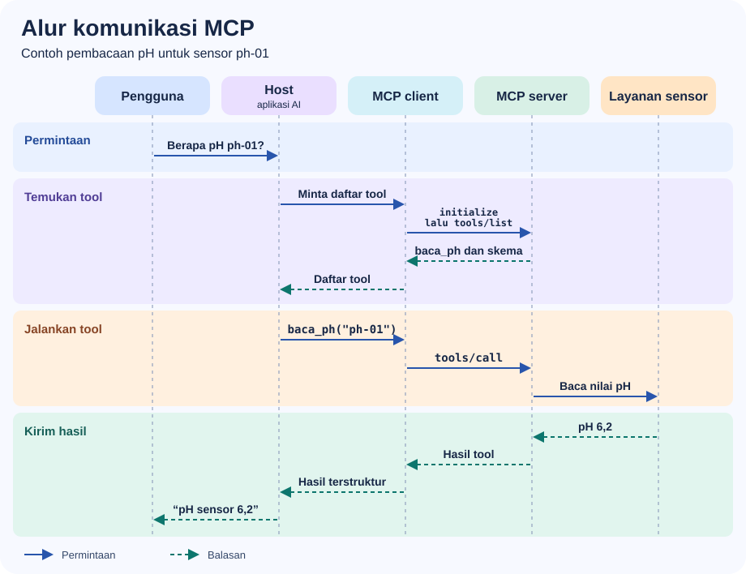

# Model Context Protocol (MCP)

!!! note "AI Generated content"

    Materi dan contoh praktik pada halaman ini perlu ditinjau oleh pengajar.

## Definisi

**Model Context Protocol (MCP)** adalah protokol terbuka yang menstandarkan cara aplikasi AI terhubung ke sumber konteks dan kemampuan eksternal. Server MCP dapat menyediakan **tools** untuk melakukan aksi, **resources** untuk menyediakan data, dan **prompts** sebagai pola instruksi. MCP mengatur pertukaran pesan; aplikasi tetap menentukan akses, persetujuan, dan cara memakai hasil.

Contoh berikut menghubungkan aplikasi AI ke layanan pembacaan pH.

## Alur komunikasi

Diagram ini mengikuti alur MCP *legacy*, yaitu koneksi yang dimulai dengan `initialize`. Pada revisi `2026-07-28`, client menyertakan versi protokol di setiap permintaan agar server dapat memeriksa kompatibilitasnya. Client juga dapat memanggil `server/discover` untuk mengetahui versi yang didukung sebelum memanggil tool. [Versioning and Compatibility](https://modelcontextprotocol.io/specification/2026-07-28/basic/versioning)

[](../../assets/images/mcp-communication-flow.svg)

Host adalah aplikasi AI yang mengelola sesi. Client MCP berada di host dan berkomunikasi dengan server. Server mengekspos kemampuan melalui protokol. Model dapat mengusulkan tool dan argumen, tetapi host/client mengatur pemanggilan sesuai kebijakan aplikasi.

## Siapa melakukan apa?

| Bagian | Tugas dalam contoh |
| --- | --- |
| Host | Aplikasi AI yang mengatur interaksi pengguna dan koneksi ke server. |
| Client MCP | Bagian dari host yang menghubungi server, melihat daftar tool, dan mengirim panggilan. |
| Server MCP | Menyediakan tool `baca_ph` yang menerima ID sensor dan mengembalikan hasil. |

Pada alur legacy, client membuka sesi sebelum menemukan dan memanggil tool. Setelah hasil diterima, host menyampaikannya ke model atau pengguna.

Pada tool calling, model bisa mengusulkan nama tool dan argumen. Aplikasi memutuskan apakah panggilan dijalankan. Jika tool disediakan lewat MCP, client mengirim panggilan itu ke server MCP dan menerima hasilnya.

## Praktik membangun MCP Server

Kita akan membuat server yang menyediakan tool `baca_ph` dengan data simulasi. Kelas `FastMCP` berasal dari SDK MCP Python. Dekorator `@mcp.tool()` mendaftarkan fungsi dan memakai tipe parameternya untuk membentuk skema yang dibaca client.

### Jalankan server SSE

Latihan ini memakai *Server-Sent Events* (SSE) agar pola koneksinya sama dengan Smart Hydroponic MCP. Server membuka aliran balasan di `/sse` dan menerima pesan client lewat endpoint POST yang diumumkan di aliran tersebut.

1. Siapkan `uv` dan Postman Desktop yang mendukung respons SSE.
2. Buka PowerShell tanpa profil di folder latihan kosong.
3. Inisialisasi proyek Python.

    ```powershell
    uv init --bare
    ```

4. Pasang SDK MCP Python.

    ```powershell
    uv add "mcp>=1,<2"
    ```

5. Simpan kode berikut sebagai `sensor_mcp.py`.

    ```python
    from argparse import ArgumentParser
    from typing import TypedDict

    from mcp.server.fastmcp import FastMCP

    mcp = FastMCP(
        "sensor-latihan",
        host="127.0.0.1",
        port=8001,
        json_response=True,
        stateless_http=True,
    )


    class Pembacaan(TypedDict):
        status: str
        sensor_id: str
        ph: float | None


    @mcp.tool()
    def baca_ph(sensor_id: str) -> Pembacaan:
        """Baca pH contoh berdasarkan ID sensor."""
        if sensor_id != "ph-01":
            return {"status": "sensor_tidak_dikenal", "sensor_id": sensor_id, "ph": None}
        return {"status": "ok", "sensor_id": sensor_id, "ph": 6.2}


    if __name__ == "__main__":
        parser = ArgumentParser()
        parser.add_argument(
            "--transport",
            choices=("sse", "stdio", "streamable-http"),
            default="sse",
        )
        mcp.run(transport=parser.parse_args().transport)
    ```

6. Jalankan server dari folder latihan.

    ```powershell
    uv run python sensor_mcp.py
    ```

### Amati permintaan dan balasan di Postman

Gunakan dua tab **HTTP Request** agar kedua arah komunikasi terlihat. Tab pertama menerima event dari server. Tab kedua mengirim pesan MCP berbentuk JSON. [Respons SSE di Postman](https://learning.postman.com/docs/use/send-requests/response-data/responses/)

1. Buat request `GET` ke `http://127.0.0.1:8001/sse` pada tab pertama.
2. Tambahkan header `Accept: text/event-stream`.
3. Klik **Send**.
4. Salin nilai `data` dari event `endpoint`.
5. Biarkan koneksi `GET` tetap terbuka.
6. Buat request `POST` ke alamat yang diumumkan pada event itu di tab kedua.
7. Pilih **Body → raw → JSON**.

Nilai `data` dari event `endpoint` berupa path seperti `/messages/?session_id=...`. Tempel path lengkap tersebut setelah `http://127.0.0.1:8001`. Gunakan ID sesi yang muncul pada koneksi saat ini karena sesi baru menghasilkan ID baru.

Kirim satu body pada satu waktu sesuai urutan tabel. Periksa balasan pada tab `GET` untuk permintaan yang memiliki `id`. Status `202 Accepted` pada tab `POST` menunjukkan bahwa pesan diterima untuk diproses.

| Urutan | Body JSON untuk tab POST | Yang diperiksa pada tab GET |
| --- | --- | --- |
| Buka sesi MCP | `{"jsonrpc":"2.0","id":1,"method":"initialize","params":{"protocolVersion":"2024-11-05","capabilities":{},"clientInfo":{"name":"postman","version":"1.0"}}}` | Balasan dengan `id: 1` memuat informasi server. |
| Beri tahu server bahwa client siap | `{"jsonrpc":"2.0","method":"notifications/initialized"}` | Notifikasi ini tidak memiliki balasan. |
| Temukan tool | `{"jsonrpc":"2.0","id":2,"method":"tools/list"}` | Balasan memuat `baca_ph` dan argumen `sensor_id`. |
| Panggil tool | `{"jsonrpc":"2.0","id":3,"method":"tools/call","params":{"name":"baca_ph","arguments":{"sensor_id":"ph-01"}}}` | Balasan memuat `status: ok` dan `ph: 6.2`. |

Ulangi panggilan terakhir dengan `id` baru dan `sensor_id` bernilai `ph-99`. Periksa bahwa balasan menampilkan `sensor_tidak_dikenal` dan `ph: null`. [Siklus koneksi MCP legacy](https://modelcontextprotocol.io/specification/2025-11-25/basic/lifecycle)

## Bandingkan transport MCP

Transport menentukan cara pesan bergerak antara client dan server. Fungsi `baca_ph` dan skema argumennya tetap sama, sehingga hasilnya dapat dibandingkan dengan dua transport lain.

| Transport | Cara client terhubung | Cocok untuk |
| --- | --- | --- |
| SSE | `GET /sse` membuka aliran balasan, lalu client mengirim pesan ke endpoint POST untuk sesi tersebut. | Mempelajari alur Smart Hydroponic MCP dan terhubung ke server yang masih memakai SSE lama. |
| `stdio` | Client memulai proses server dan bertukar pesan lewat masukan serta keluaran standar proses. | Tool lokal yang dijalankan langsung oleh host atau Inspector. |
| Streamable HTTP | Client memakai satu endpoint MCP, `/mcp` pada contoh ini. Respons bisa berupa JSON atau aliran SSE. | Server baru yang perlu diakses lewat HTTP. |

Untuk mencoba `stdio`, siapkan Node.js 24.22.1 atau versi 24.x yang lebih baru. Jalankan perintah berikut dari folder latihan, lalu buka **Tools** di Inspector untuk memanggil `baca_ph`.

```powershell
npx.cmd @modelcontextprotocol/inspector@2.16.0 uv run python sensor_mcp.py --transport stdio
```

Untuk mencoba Streamable HTTP, hentikan server SSE dengan `Ctrl+C` agar port `8001` tersedia. Jalankan kembali server dengan transport berikut.

```powershell
uv run python sensor_mcp.py --transport streamable-http
```

Buat request bertipe **MCP** di Postman. Pilih **HTTP**. Masukkan `http://127.0.0.1:8001/mcp`. Pilih **Load Capabilities** untuk menemukan `baca_ph`. [MCP Request di Postman](https://learning.postman.com/docs/use/send-requests/protocols/mcp-requests/create)

Pilih `baca_ph` dan isi `sensor_id` dengan `ph-01`. Klik **Run**. Cocokkan nilai pH dengan hasil latihan SSE. [Menjalankan tool di Postman](https://learning.postman.com/docs/use/send-requests/protocols/mcp-requests/interact)

Pada contoh Streamable HTTP ini, server mengirim respons JSON dan memproses setiap permintaan tanpa menyimpan sesi. Streamable HTTP menggantikan transport HTTP+SSE lama, sehingga lebih sesuai untuk proyek HTTP baru. [Spesifikasi transport MCP](https://modelcontextprotocol.io/specification/2025-11-25/basic/transports) · [MCP Inspector](https://modelcontextprotocol.io/docs/tools/inspector)

## Hubungan dengan Smart Hydroponic MCP

Server Smart Hydroponic juga mengimpor `FastMCP` dari `mcp.server.fastmcp`. Tool `get_latest_sensor_data` membaca telemetri terbaru, sedangkan `get_sensor_data_summary` menghitung rata-rata pembacaan per interval waktu. Saat membaca kode proyek, cari dekorator `@mcp.tool()` untuk melihat fungsi mana yang dikenalkan ke client. [Kode Smart Hydroponic MCP](https://github.com/ksm-aiot-upnvj/smart-hydroponic-mcp/blob/main/main.py)

Smart Hydroponic memasang transport SSE lewat `mcp.sse_app()`. Gunakan alur Postman di atas untuk mengenali dua koneksinya pada server latihan. Di proyek, fungsi tool mengambil pembacaan dari database, sehingga hasilnya mengikuti kondisi perangkat.

## Praktik dengan riwayat sensor

Contoh `baca_ph` memberi satu nilai tetap sehingga panggilan tool mudah diperiksa. Di [Praktik MCP dengan Data Sensor PostgreSQL](../../hands-on/mcp-sensor.md), hasil tool mengikuti data yang benar-benar ada di tabel. Praktik tersebut mencakup seeding dengan `uv`, pemanggilan tool di Inspector, dan pembandingan hasil dengan SQL.

## What's next

<div class="ai-resource-grid ai-practice-grid" markdown="1">

[<span class="ai-practice-icon" aria-hidden="true">:lucide-database:</span> **Praktik MCP dengan PostgreSQL** <span class="ai-practice-description">Isi database latihan dengan data sensor. Cocokkan hasil tool MCP dengan query SQL.</span>](../../hands-on/mcp-sensor.md){ .ai-practice-start }

[<span class="ai-practice-icon" aria-hidden="true">:lucide-workflow:</span> **AI Agents** <span class="ai-practice-description">Jika sudah memahami satu panggilan tool, ikuti cara agent memakai hasilnya dan berhenti saat tugas selesai atau waktu habis.</span>](ai-agent.md)

</div>
