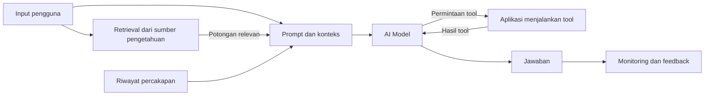
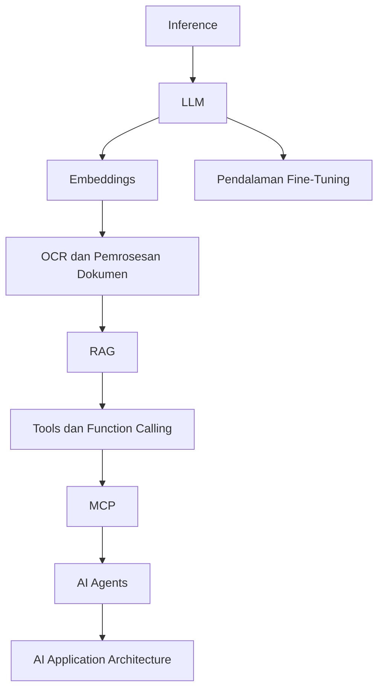

# AI Systems

## Tujuan

Memahami bagaimana sebuah model AI dikembangkan menjadi sistem yang dapat menerima input, menggunakan konteks dan pengetahuan, berinteraksi dengan tools, serta menghasilkan output yang dapat digunakan dalam aplikasi nyata.

Pada bagian ini, kalian tidak hanya mempelajari model AI, tetapi juga berbagai komponen di sekitarnya yang bekerja sebagai sebuah sistem, seperti data, knowledge, tools, dan feedback. 

## Apa Itu AI System?

AI System adalah sebuah sistem yang menggunakan teknologi AI untuk memproses data, membuat keputusan, dan memberikan output yang berguna dalam aplikasi nyata. Sebuah AI System dapat melibatkan:

- Model
- Input
- Prompt dan Context
- Knowledge
- Retrieval
- Tools
- Memory
- Monitoring dan Feedback

> **AI Generated, need human review**

Ketika aplikasi menjawab pertanyaan dari dokumen, aplikasi mengambil potongan yang relevan dan memasukkannya ke konteks sebelum model menyusun jawaban. Jika model meminta pembacaan sensor, aplikasi menjalankan tool dan mengirim hasilnya kembali ke model agar jawaban dapat menyertakan nilai yang terbaca.

Tujuan AI Systems adalah memahami bagaimana komponen-komponen tersebut dapat digabungkan untuk menghasilkan sistem yang lebih berguna daripada model yang berdiri sendiri.

## Capaian Belajar

Setelah menyelesaikan materi ini, kalian diharapkan mampu:

- Memahami perbedaan antara AI model dan AI system.
- Memahami konsep inference dalam aplikasi AI.
- Memahami peran prompt, context, dan knowledge.
- Menjelaskan konsep embedding dan semantic search.
- Memahami konsep Retrieval-Augmented Generation (RAG).
- Memahami cara AI berinteraksi dengan tools dan external systems.
- Memahami konsep AI agent dan agentic workflow.
- Memahami peran orchestration dalam AI system.
- Merancang arsitektur AI sederhana untuk sebuah aplikasi.
- Menghubungkan AI system dengan aplikasi atau perangkat IoT.

## Peta Pembelajaran

> **AI Generated, need human review**

[Embeddings](embedding.md) menjadi dasar pencarian potongan dengan makna yang serupa. Sebelum potongan dibuat, [OCR dan Pemrosesan Dokumen](ocr.md) memperlihatkan cara menyiapkan teks dari halaman scan atau foto untuk [RAG](rag.md).

Ketika rujukan sering berubah, RAG memungkinkan dokumen diperbarui sebelum pertanyaan berikutnya. Jika tugas membutuhkan pola keluaran yang konsisten dan tersedia contoh pelatihan yang memadai, pelajari [Fine-Tuning](fine-tuning.md) sebagai pendalaman LLM.
