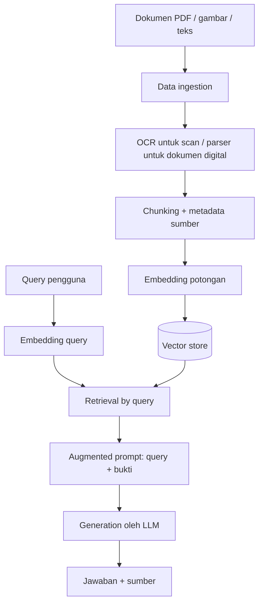
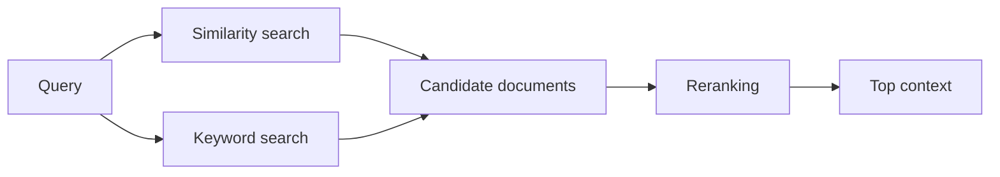

# Retrieval-Augmented Generation

RAG (*Retrieval-Augmented Generation*) adalah salah satu pendekatan untuk menggabungkan kemampuan LLM (*Large Language Model*) dengan memori eksternal. Hal ini didasari oleh kelemahan LLM yaitu berhalusinasi, mengapa LLM bisa berhalusinasi? pada dasarnya LLM adalah model *generatif* yang dilatih untuk memprediksi kata berikutnya berdasarkan konteks sebelumnya. Saat LLM tidak tahu jawaban yang benar, ia akan menebak jawaban berdasarkan konteks yang tersedia, sehingga bisa menghasilkan jawaban yang salah atau tidak akurat.

Mengapa hal tersebut bisa terjadi? karena ingatan atau informasi yang dimiliki hanya terbatas pada data yang digunakan untuk melatih model atau bisa kita sebut sebagai knowledge cut-off. Pengetahuan yang dimiliki LLM pada akhirnya tetap akan terpaku hanya data yang dia pelajari. Contoh Gemini 4 Hydrogen memiliki [knowledge cut-off pada Maret 2026](https://deepmind.google/models/model-cards/gemini-4-hydrogen/#:~:text=The%20knowledge%20cutoff%20for%20Gemini%204%20Hydrogen%20is%20March%202026) yang berarti model ini tidak memiliki pengetahuan tentang peristiwa yang terjadi setelah Maret 2026.

RAG mengatasi keterbatasan ini dengan menambahkan memori eksternal (bisa disebut *knowledge base* atau *vector store*) yang berisi dokumen yang relevan dengan pertanyaan pengguna. Dokumen ini diambil dari berbagai sumber, seperti PDF, gambar, atau teks. RAG memanfaatkan tahapan retrieval untuk mengambil dokumen yang relevan, lalu menggabungkannya dengan query pengguna untuk membentuk prompt yang lebih kaya informasi. Prompt ini kemudian digunakan oleh LLM untuk menghasilkan jawaban yang lebih akurat dan berbasis bukti.

## RAG Pipeline

Pipeline dari RAG dapat digambarkan sebagai berikut:



Buka [Lab Workflow RAG Interaktif](../../labs/rag-workflow.md) untuk memeriksa node, input, dan output, lalu jalankan alur langkah demi langkah atau otomatis.

**Rujukan riset:** [Lewis et al., “Retrieval-Augmented Generation for Knowledge-Intensive NLP Tasks” (2020), *Advances in Neural Information Processing Systems*](https://papers.nips.cc/paper/2020/hash/6b493230205f780e1bc26945df7481e5-Abstract.html). Makalah ini merumuskan RAG sebagai gabungan parameter model generatif dan memori eksternal yang diakses melalui retrieval.

## Data ingestion

*Data ingestion* merupakan tahapan mengambil dokumen dari berbagai sumber, mengekstrak teks, memotong dokumen menjadi potongan yang lebih kecil (*chunk*), lalu menyimpan potongan tersebut dalam vector store. Pada tahap ini, kita tidak hanya menyimpan teks dalam bentuk vektor, tetapi juga menyimpan metadata sumber agar dapat menelusuri kembali ke dokumen asal. Metadata ini bisa berupa nama dokumen, halaman, heading, atau URL. Urutan alur pada tahap ini adalah sebagai berikut:

1. Ekstraksi teks dari dokumen digital atau gambar.
2. Chunking (memotong dokumen) menjadi potongan yang lebih kecil.
3. Storing (menyimpan data) potongan teks, embedding, dan metadata sumber ke vector store.

### Ekstraksi teks

- **Parser**: teknik membaca dokumen digital seperti PDF berbasis teks, DOCX, HTML, Markdown, JSON, dan source code. Parser dapat mempertahankan susunan elemen seperti judul dan tabel.
- **OCR**: teknik mengenali tulisan pada scan atau gambar (melibatkan model machine learning atau deep learning).

### Chunking (memotong dokumen)

LLM memiliki *context window*, yaitu batas jumlah token yang dapat diproses pada satu permintaan. Jika dokumen lebih panjang dari batas ini, dokumen perlu dipotong menjadi potongan yang lebih kecil (*chunk*). Chunking dapat dilakukan dengan beberapa cara:

- Length-Based Chunking: memotong dokumen menjadi potongan dengan jumlah token tertentu. Contoh: 512 token per chunk.
- Text Structure-Based Chunking: memotong dokumen berdasarkan struktur teks, misalnya per baris, kata, paragraf, heading, atau halaman. Contoh: satu chunk per paragraf.
- Document Structure-Based Chunking: memotong dokumen berdasarkan struktur dokumen seperti Markdown heading, HTML section, JSON atau Source Code.

Ukuran chunk tidak memiliki satu nilai terbaik untuk semua dokumen. Paper Wang et al. menguji beberapa ukuran pada corpus Lyft 2021 dan melaporkan skor berikut.

| Ukuran chunk | Faithfulness rata-rata | Relevancy rata-rata |
| ---: | ---: | ---: |
| 2048 | 80.37 | 91.11 |
| 1024 | 94.26 | 95.56 |
| 512 | 97.59 | 97.41 |
| 256 | 97.22 | 97.78 |
| 128 | 95.74 | 97.22 |

- **Faithfulness** mengukur konsistensi jawaban dengan informasi pada konteks yang diberikan. Skor tinggi berarti klaim jawaban didukung konteks, bukan asumsi atau informasi yang dibuat-buat oleh model.
- **Relevancy** mengukur seberapa tepat jawaban menanggapi pertanyaan pengguna. Jawaban yang relevan berfokus pada inti pertanyaan dan tidak melebar ke hal yang tidak diperlukan.

### Storing (menyimpan data)

Setelah chunk dibuat, model embedding mengubah teks menjadi vektor angka berdimensi tetap. Untuk chunk $c_i$, prosesnya dapat ditulis $v_i = f_\theta(c_i)$, dengan $f_\theta$ sebagai model embedding dan $v_i \in \mathbb{R}^d$. Model menghasilkan representasi berdasarkan pola yang dipelajari saat training.


Satu record biasanya menyimpan **ID**, **embedding**, **teks chunk asli**, dan **metadata sumber** seperti dokumen, halaman, atau heading. Pada saat penyimpanan, vector store tidak hanya menyimpan embedding, tetapi juga teks utuh yang nantinya digunakan oleh LLM untuk menjawab pertanyaan.

Contoh vector store yang umum dipakai:

- **FAISS** adalah library untuk membangun index dan mencari kemiripan vektor. Aplikasi mengatur sendiri penyimpanan teks serta metadata.
- **ChromaDB** menyediakan penyimpanan collection berisi embedding, dokumen, dan metadata.
- **Pinecone** adalah vector database terkelola.
- **pgvector** menambahkan tipe vektor dan pencarian kemiripan ke PostgreSQL, sehingga data relasional, metadata, dan embedding dapat dikelola dalam satu basis data. Ia mendukung pencarian nearest-neighbor eksak maupun aproksimasi ([dokumentasi pgvector](https://github.com/pgvector/pgvector)).
- **Elasticsearch** mendukung pencarian leksikal dan pencarian vektor, sehingga keduanya dapat digabungkan untuk retrieval hybrid ([vector search](https://www.elastic.co/docs/solutions/search/vector), [hybrid search](https://www.elastic.co/docs/solutions/search/hybrid-search)).

??? note "Tiap model memiliki dimensi embedding berbeda"
    Model embedding yang berbeda menghasilkan vektor dengan dimensi berbeda. Contoh: model OpenAI `text-embedding-3-small` menghasilkan vektor berdimensi 1.536, sedangkan `text-embedding-3-large` berdimensi 3.072. Model embedding lain seperti `all-MiniLM-L6-v2` dari Hugging Face menghasilkan vektor berdimensi 384.

## Retrieval

Retrieval adalah proses memilih potongan yang berkaitan dengan query. Pencarian dapat memakai kemiripan embedding, kata kunci, atau gabungan keduanya, kita tidak hanya mengandalkan retrieval saja. Namun bisa menambahkan reranking atau HyDE untuk meningkatkan kualitas hasil retrieval. Harap diingat bahwa pendekatan-pendekatan tersebut perlu pengujian langsung pada tiap studi kasus. Apalagi HyDE yang memanfaatkan kemampuan LLM untuk menghasilkan dokumen sintetis yang relevan dengan query, kualitas LLM juga memengaruhi kualitas dokumen sintetis yang dihasilkan. Jika LLM yang digunakan tidak cukup baik, dokumen sintetis yang dihasilkan juga tidak relevan dengan query.



Kualitas hasil dipengaruhi oleh ukuran chunk, model embedding, dan cara pencarian. Uji pilihan tersebut pada query dan dokumen yang mewakili penggunaan sebenarnya. Teknik seperti hybrid search, reranking, atau HyDE dapat membantu meningkatkan kualitas retrieval, namun belum tentu selalu lebih baik.

## Augmentation

Augmentation menggabungkan instruksi, konteks terambil, dan query menjadi satu prompt. Contoh:

```text
Kamu adalah Nexo yang membantu user menjawab pertanyaan. Kamu memiliki beberapa ketentuan dalam menjawab pertanyaan, yaitu:
1. Jawaban harus berdasarkan konteks yang diberikan.
2. Jawaban harus jelas, ringkas, dan mudah dipahami.
3. **JAWABAN HARUS MENYERTAKAN SUMBER/SITASI DARI KONTEKS YANG DIBERIKAN**
4. Jika konteks tidak cukup, jawab dengan jujur bahwa kamu tidak tahu.
Berikut adalah konteks yang relevan dengan pertanyaan user:
[Hasil retrieval]

Pertanyaan user: [Query user]
```

## Generation

Pada generation, LLM menyusun jawaban dari prompt augmented. Kualitas jawaban dipengaruhi oleh:

- Instruksi yang menjelaskan cara memakai konteks dan apa yang harus dilakukan jika bukti kurang.
- Model yang sesuai dengan batas biaya, latensi, dan panjang konteks aplikasi.
- Parameter generasi seperti batas panjang keluaran dan temperature.

Tidak ada nilai terbaik untuk semua kasus, jadi perlu eksplorasi dan pengujian untuk menemukan kombinasi yang tepat.

Penasaran dengan penggunaan RAG? Coba hands-on berikut:

- [RAG sederhana](../../hands-on/rag-simple.md)
- [RAG lanjutan dengan HyDE + Browse Tool](../../hands-on/rag-advanced.md)

## Evaluasi dari halaman sampai jawaban

> **AI Generated, need human review**

Jawaban seperti `5 bar (hlm. 1)` bisa salah meski retrieval menemukan halaman yang tepat. Periksa apakah kesalahan muncul saat OCR membaca halaman, saat pencarian memilih potongan, atau saat penjawab menyusun klaim. Hasil di satu tahap membantu menentukan apa yang perlu diperbaiki. [Makalah Ragas](https://arxiv.org/abs/2309.15217)

| Yang diperiksa | Bukti yang dibandingkan | Contoh gagal |
| --- | --- | --- |
| Ekstraksi | Teks keluaran dan halaman asli | `0,5 bar` terbaca `5 bar` |
| Retrieval | Hasil teratas dan potongan rujukan | Pencarian mengambil manual sensor lain |
| Jawaban | Klaim, potongan yang disitasi, dan halaman asli | Jawaban menambah batas garansi yang tidak tertulis |

Jalankan baseline ekstraktif di bawah untuk melatih pemeriksaan ini. Penjawab mengambil nilai tekanan dari potongan teratas jika ada bukti yang cocok. Setelah memahami hasilnya, pakai dua pertanyaan yang sama pada [RAG berbasis LLM](../../hands-on/rag-simple.md) dan cek kembali dukungan untuk setiap klaim.

1. Selesaikan [praktik OCR](ocr.md#praktik-membandingkan-tiga-input).
2. Simpan [evaluate_rag.py](../../assets/ai-labs/evaluate_rag.py) di proyek OCR.
3. Jalankan baseline dengan teks dari PDF digital.

    ```powershell
    uv run python evaluate_rag.py hasil-ocr/manual-digital.txt
    ```

4. Ulangi pemeriksaan dengan teks hasil OCR gambar miring.

    ```powershell
    uv run python evaluate_rag.py hasil-ocr/manual-miring.txt
    ```

Pada PDF digital, hasil yang diharapkan adalah `0,5 bar` dengan rujukan `manual-ps01, hlm. 1`. Pertanyaan tentang tenggat garansi semestinya menghasilkan keterangan bahwa informasi tidak tersedia. Jika OCR membaca angka dengan benar, gunakan [simulasi kesalahan OCR](../../labs/rag-workflow.md#dari-halaman-ke-jawaban) untuk menelusuri dampak angka yang keliru.
