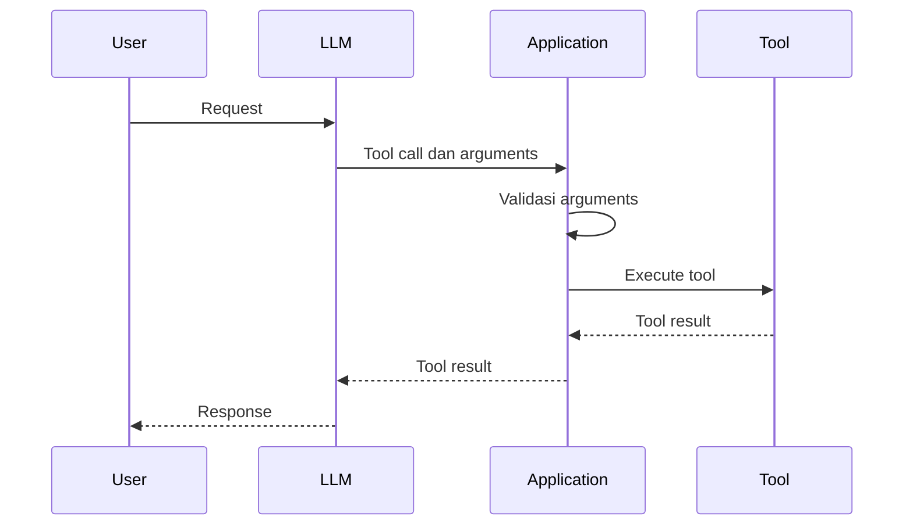
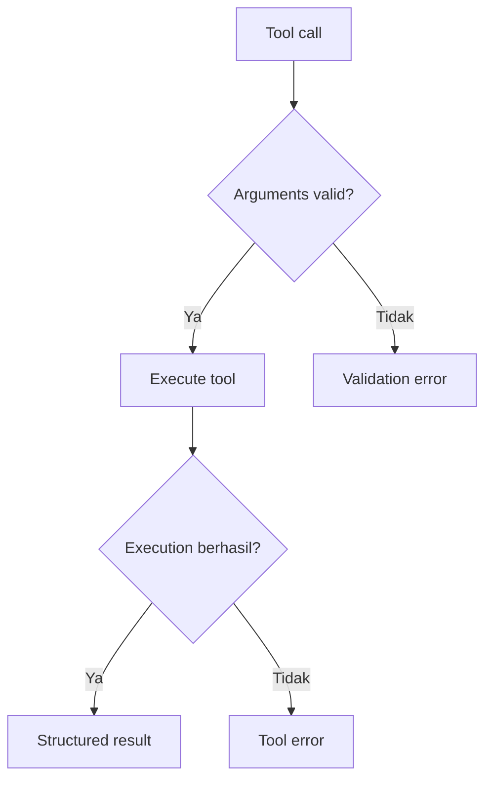

# Tools dan Function Calling

Setelah memahami tool calling, coba [praktik menguji server MCP](mcp.md).

Tools adalah fungsi atau layanan yang dapat dipanggil oleh AI system untuk melakukan pekerjaan di luar kemampuan generation. Contohnya adalah membaca data sensor, mencari dokumen, menghitung nilai, menyimpan data, atau mengirim perintah ke actuator.

## Konsep Dasar

LLM menghasilkan keputusan atau argumen untuk tool. Aplikasi tetap menjalankan tool, memeriksa argumen, dan mengirimkan hasilnya kembali kepada model. Pemisahan ini membuat akses ke sistem eksternal dapat dikontrol oleh backend.

Function calling adalah mekanisme yang memungkinkan model memilih fungsi berdasarkan schema yang diberikan. Tool schema menjelaskan nama tool, tujuan, parameter, tipe data, dan field yang wajib diisi.



## Tool Schema dan Arguments

Schema membantu model menghasilkan arguments dengan bentuk yang konsisten. Backend tetap perlu memvalidasi tipe, nilai, permission, dan hubungan antarfield karena model dapat mengirim nilai yang salah atau tidak lengkap.

Contoh schema sederhana:

```json
{
  "name": "get_soil_moisture",
  "description": "Membaca kelembapan tanah dari device",
  "parameters": {
    "type": "object",
    "properties": {
      "device_id": {"type": "string"}
    },
    "required": ["device_id"]
  }
}
```

## Tool Execution

Aplikasi menerima tool call, memeriksa apakah tool tersebut tersedia, memvalidasi arguments, lalu menjalankan fungsi dengan timeout. Tool result sebaiknya memiliki format terstruktur agar model dan aplikasi dapat memproses status berhasil atau gagal dengan jelas.



Tool yang membaca data perlu membatasi scope query. Tool yang mengubah data atau mengendalikan actuator perlu permission, idempotency, audit log, dan konfirmasi tambahan ketika dampaknya besar.

## Reliability dan Security

Tool errors, network failure, invalid arguments, dan timeout harus menghasilkan error yang dapat dipahami. Retry hanya aman untuk operasi yang idempotent atau memiliki request identifier yang mencegah efek ganda.

Backend perlu membatasi tool yang tersedia untuk setiap pengguna dan memeriksa input sebelum membentuk query atau perintah. Secret, credential, dan detail internal tidak boleh diberikan ke model sebagai context atau tool result.

## Hands-on

Buat satu tool untuk membaca data sensor dari API lokal. Berikan schema kepada LLM, validasi `device_id` di backend, dan kembalikan result dalam JSON.

Tambahkan tool kedua untuk mengambil rekomendasi penyiraman. Uji arguments yang hilang, device yang tidak ditemukan, timeout, dan respons API yang tidak valid. Catat setiap tool call agar alur dapat diperiksa.

## What's next

<div class="ai-resource-grid ai-practice-grid" markdown="1">

[<span class="ai-practice-icon" aria-hidden="true">:lucide-plug:</span> **Model Context Protocol** <span class="ai-practice-description">Lihat bagaimana aplikasi menemukan dan memanggil tool pembaca sensor lewat server MCP.</span>](mcp.md){ .ai-practice-start }

</div>
