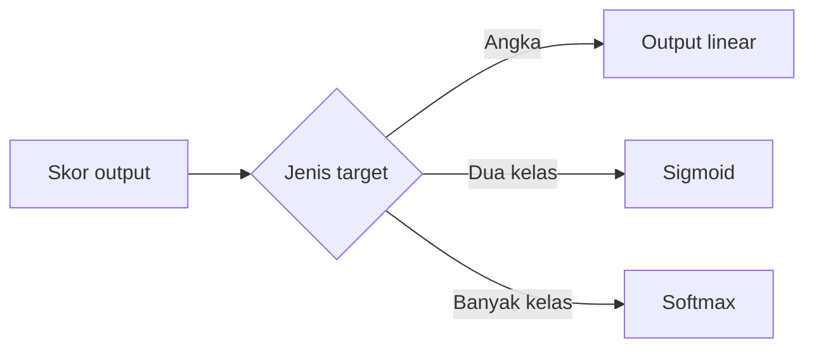

# Fungsi Aktivasi

Fungsi aktivasi memberi kemampuan non-linear pada neural network. Tanpa fungsi aktivasi, beberapa layer linear tetap setara dengan satu transformasi linear dan tidak dapat mempelajari pola yang kompleks.

## ReLU

ReLU sering digunakan pada hidden layer:

$$
\operatorname{ReLU}(z) = \max(0, z)
$$

Nilai negatif menjadi nol, sedangkan nilai positif diteruskan. ReLU sederhana dan murah dihitung, sehingga cocok untuk model yang akan dijalankan pada gateway atau perangkat edge.

Fungsi aktivasi ReLu memiliki kelemahan pada input negatif. Neuron yang menerima input negatif akan selalu menghasilkan nol, sehingga perubahan nilai gradien saat training tidak akan memengaruhi bobot neuron tersebut. Hal ini dapat menyebabkan beberapa neuron menjadi "mati" dan tidak berkontribusi pada pembelajaran.

**Rujukan riset:** [Nair & Hinton, “Rectified Linear Units Improve Restricted Boltzmann Machines” (2010), *Proceedings of ICML*](https://icml.cc/2010/papers/432.pdf). Makalah konferensi ini membahas unit rectifier dalam pembelajaran jaringan.

## Leaky ReLU

Leaky ReLU mempertahankan kemiringan kecil saat masukan negatif:

$$
f(z) = \begin{cases} z, & z > 0 \\ \alpha z, & z \le 0 \end{cases}
$$

Untuk masukan negatif, keluarannya adalah $\alpha z$ dan turunannya $\alpha$, bukan nol. Grafik memakai $\alpha = 0.1$ agar kemiringannya terlihat; lab neuron memakai $\alpha = 0.01$.

**Rujukan riset:** [Xu et al., “Empirical Evaluation of Rectified Activations in Convolutional Network” (2015), arXiv:1505.00853](https://arxiv.org/abs/1505.00853). Makalah ini membandingkan ReLU, Leaky ReLU, PReLU, dan RReLU; sumbernya preprint, bukan artikel jurnal.

## Sigmoid

Sigmoid menghasilkan nilai antara 0 dan 1:

$$
\sigma(z) = \frac{1}{1 + e^{-z}}
$$

Fungsi ini dapat digunakan pada output klasifikasi biner, misalnya peluang bahwa pompa perlu diperiksa. Sigmoid pada banyak hidden layer dapat mengalami vanishing gradient.

## Tanh

Tanh menghasilkan nilai antara -1 dan 1:

$$
\tanh(z) = \frac{e^z - e^{-z}}{e^z + e^{-z}}
$$

Tanh masih dapat muncul pada model sequence, termasuk bagian tertentu dari LSTM dan GRU.

## Softmax

Softmax mengubah skor beberapa kelas menjadi distribusi probabilitas:

$$
p(y=i \mid x) = \frac{e^{z_i}}{\sum_{j=1}^{K} e^{z_j}}
$$

Gunakan softmax pada output klasifikasi multi-kelas, misalnya kondisi tanaman `sehat`, `kering`, atau `tergenang`.

Pada contoh logits `[2, 1, 0]`, softmax menghasilkan probabilitas sekitar `[0.67, 0.24, 0.09]`. Jumlahnya mendekati 1. Nilai itu menunjukkan pembagian skor relatif antarkelas; probabilitas tersebut belum tentu terkalibrasi sebagai tingkat keyakinan nyata.

**Rujukan riset:** [Bridle, “Probabilistic Interpretation of Feedforward Classification Network Outputs, with Relationships to Statistical Pattern Recognition” (1990), *Neurocomputing*](https://doi.org/10.1016/B978-0-444-88714-2.50015-8), membahas interpretasi probabilistik output jaringan klasifikasi.

## Panduan Pemilihan

- Hidden layer: mulai dengan ReLU.
- Klasifikasi biner: sigmoid pada output.
- Klasifikasi multi-kelas: softmax pada output.
- Regresi: output linear.
- Model sequence: pahami fungsi aktivasi yang sudah digunakan arsitektur sebelum menggantinya.

Pilihan aktivasi harus sesuai dengan target dan loss function. Nilai probabilitas tidak otomatis berarti model memiliki tingkat kepastian yang benar.

## What's next

[:lucide-arrow-right-left: **Forward dan Backward Pass** Ikuti satu prediksi sampai bobotnya diperbarui. Perhatikan bagaimana turunan fungsi aktivasi ikut memengaruhi gradien.](forward-backward.md){ .ai-practice-start }

[Kembali ke Deep Learning](overview.md)
