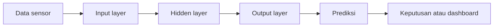

# Dasar Neural Network

Neural network adalah model yang mempelajari hubungan antara input dan target melalui parameter yang dapat disesuaikan. Dalam AIoT, input dapat berupa nilai suhu, kelembapan, arus listrik, gambar, atau gabungan beberapa sensor.

Satu neuron menghitung jumlah berbobot dari input, lalu menerapkan fungsi aktivasi:

$$
z = \sum_{i=1}^{n} w_i x_i + b
$$

$$
a = f(z)
$$


**Rujukan riset:** [Rosenblatt, “The Perceptron: A Probabilistic Model for Information Storage and Organization in the Brain” (1958), *Psychological Review*](https://doi.org/10.1037/h0042519). Persamaan neuron di atas adalah bentuk modern ringkas dari unit berbobot.

$x_i$ adalah input, $w_i$ adalah weight, $b$ adalah bias, dan $f$ adalah fungsi aktivasi. Model belajar dengan mengubah weight dan bias agar hasilnya mendekati target.



## Bentuk Input dan Output

- Regresi menghasilkan angka, seperti prediksi suhu atau penggunaan air.
- Klasifikasi menghasilkan kelas, seperti normal, perlu diperiksa, dan berbahaya.
- Multi-label classification dapat memberikan beberapa kondisi sekaligus.
- Anomaly detection mencari data yang berbeda dari pola normal.

## Istilah Dasar

- **Feature** adalah informasi yang diberikan kepada model.
- **Target** adalah jawaban yang ingin dipelajari model.
- **Parameter** adalah weight dan bias yang dipelajari saat training.
- **Hyperparameter** adalah pengaturan yang dipilih sebelum training, seperti learning rate dan jumlah layer.
- **Inference** adalah penggunaan model yang sudah dilatih untuk menghasilkan prediksi.

## Contoh AIoT

Empat sensor dapat menjadi satu input:

```text
[suhu, kelembapan, pH, level air] -> neural network -> status tanaman
```

Sebelum masuk model, data perlu memiliki satuan yang konsisten, nilai yang hilang perlu ditangani, dan skala fitur perlu diperiksa.

## What's next

<div class="ai-resource-grid ai-practice-grid" markdown="1">

[<span class="ai-practice-icon" aria-hidden="true">:lucide-activity:</span> **Fungsi Aktivasi** <span class="ai-practice-description">Amati bagaimana ReLU, sigmoid, dan fungsi lain mengubah nilai yang diteruskan neuron.</span>](activation-function.md){ .ai-practice-start }

</div>

[Kembali ke Deep Learning](overview.md)
