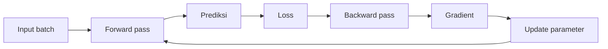

# Forward Pass dan Backward Pass

[Buka Lab Pelatihan Neural Network](../../labs/neuron-training.md){ .md-button }

Forward pass menghitung prediksi dari input. Backward pass menghitung turunan loss terhadap parameter. Optimizer memakai turunan itu untuk memperbarui parameter.

## Forward Pass

Untuk satu layer:

$$
z = Wx + b
$$

$$
a = f(z)
$$

Output `a` menjadi input bagi layer berikutnya. Pada akhir forward pass, model menghasilkan prediksi yang dibandingkan dengan target.

## Backward Pass

> **AI Generated, need human review**

Sebelum menghitung gradien, tentukan seberapa jauh prediksi dari target. Jika neuron memprediksi 2 ketika targetnya 3, selisih kuadratnya adalah `(2 − 3)² = 1`. Angka yang disebut *loss* ini menjadi titik awal untuk menghitung pengaruh bobot pada kesalahan.

**Rujukan riset:** [Rumelhart, Hinton & Williams, “Learning Representations by Back-propagating Errors” (1986), *Nature*](https://doi.org/10.1038/323533a0). Artikel ini menjabarkan propagasi error untuk memperbarui bobot jaringan berlapis.

Backward pass menggunakan aturan rantai untuk menghitung turunan loss terhadap setiap parameter. Jika `L` adalah loss dan `w` adalah weight, gradient ditulis sebagai:

$$
\frac{\partial L}{\partial w}
$$

Gradient menunjukkan arah perubahan loss ketika weight berubah sedikit.

## Gradient Descent

Parameter diperbarui dengan:

$$
w_{baru} = w_{lama} - \eta \frac{\partial L}{\partial w}
$$

`\eta` adalah learning rate. Learning rate terlalu besar dapat membuat training tidak stabil. Nilai terlalu kecil membuat training berjalan lambat.

## Dalam Sistem AIoT

Forward dan backward pass biasanya dijalankan di komputer training. Perangkat IoT umumnya hanya menjalankan forward pass saat inference. Karena itu, ukuran model dan biaya forward pass perlu diukur sebelum deployment.

## Hitung satu pembaruan bobot

Gunakan satu neuron linear dengan input `x = 2`, target `y = 3`, bobot `w = 1`, dan bias tetap `b = 0`.

1. Prediksi `wx + b = 2`. Loss kuadratnya `(2 − 3)² = 1`.
2. Turunan loss terhadap bobot adalah `2 × (prediksi − target) × x = −4`.
3. Dengan learning rate `0,1`, bobot baru adalah `1 − 0,1 × (−4) = 1,4`.
4. Hitung prediksi lagi dengan bobot baru. Hasilnya `2,8` dan loss turun menjadi `0,04` pada contoh ini.

Jika learning rate dinaikkan menjadi `0,5`, update dari bobot awal memberi bobot baru `3`. Prediksinya menjadi `6` dan loss `9`; langkah yang terlalu besar melewati bobot yang menghasilkan prediksi tepat `3`.

## What's next

[:lucide-target: **Loss Function** Setelah menghitung satu pembaruan bobot, pilih cara mengukur kesalahan untuk target angka atau kelas.](loss-function.md){ .ai-practice-start }

[:lucide-flask-conical: **Lab pelatihan neural network** Ubah bobot atau fungsi aktivasi. Jalankan satu langkah training dan amati perubahan prediksi.](../../labs/neuron-training.md)

[Kembali ke Deep Learning](overview.md)
