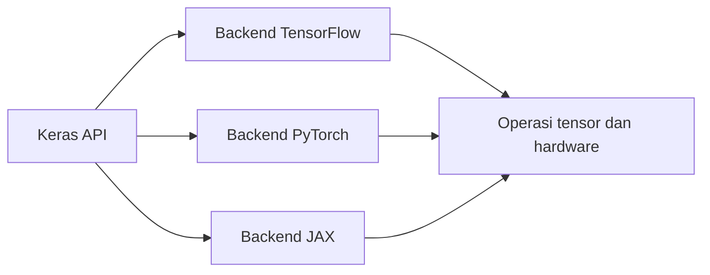

# TensorFlow, Keras, dan PyTorch

Ketiganya dipakai untuk membangun dan melatih model deep learning, tetapi namanya tidak menunjuk hal yang persis sama. TensorFlow dan PyTorch adalah framework. Keras menyediakan API tingkat tinggi agar model lebih ringkas ditulis.

## Hubungan Keras dengan framework

Keras menyediakan layer, model, training, dan evaluasi dalam antarmuka yang konsisten. Keras 3 dapat memakai backend TensorFlow, PyTorch, atau JAX. `tf.keras` adalah API Keras yang disediakan melalui TensorFlow. Jadi, Keras bukan framework keempat yang terpisah dari TensorFlow dengan batas yang selalu sama.



Pilih satu stack untuk belajar dan jaga versinya tetap cocok. Keras mengatur bentuk model; backend menjalankan operasi dan perhitungan training.

## Perbedaan untuk mulai belajar

| Teknologi | Peran | Yang sering terlihat di kode |
| --- | --- | --- |
| TensorFlow | Framework untuk tensor, training, dan deployment | `tf.Tensor`, `tf.data`, `tf.keras` |
| Keras | API tingkat tinggi untuk menyusun dan melatih model | `keras.layers`, `keras.Model`, `fit()` |
| PyTorch | Framework untuk tensor, autograd, dan model | `torch.Tensor`, `torch.nn`, training loop |

Keras cocok untuk menyusun model dengan cepat menggunakan pola yang seragam. PyTorch memberi akses langsung pada langkah komputasi dan training loop. TensorFlow menyediakan ekosistem yang mencakup training dan pilihan deployment. Pilihan praktis biasanya mengikuti materi kelas, contoh model yang hendak dijalankan, dan target deployment.

## Contoh satu MLP dengan Keras

Model menerima empat fitur sensor, memakai satu hidden layer, lalu menghasilkan skor untuk tiga kelas:

```python
import keras

inputs = keras.Input(shape=(4,))
hidden = keras.layers.Dense(16, activation="relu")(inputs)
outputs = keras.layers.Dense(3, activation="softmax")(hidden)
model = keras.Model(inputs, outputs)

model.compile(optimizer="adam", loss="sparse_categorical_crossentropy", metrics=["accuracy"])
```

Kode ini membangun arsitektur. Dataset, label, pembagian train/validation, dan preprocessing masih perlu disiapkan sebelum `model.fit(...)`.

## Instalasi

TensorFlow dan PyTorch dapat memerlukan paket serta konfigurasi hardware yang berbeda. Mulailah di virtual environment terpisah dan ikuti petunjuk instalasi resmi yang cocok dengan sistem operasi, versi Python, dan GPU. Keras 3 juga membutuhkan satu backend yang dipilih sebelum Keras diimpor.

Rujukan: [Getting started Keras](https://keras.io/getting_started/), [panduan Keras TensorFlow](https://www.tensorflow.org/guide/keras), [Learn the Basics PyTorch](https://docs.pytorch.org/tutorials/beginner/basics/intro.html).

## What's next

<div class="ai-resource-grid ai-practice-grid" markdown="1">

[<span class="ai-practice-icon" aria-hidden="true">:lucide-brain:</span> **Dasar Neural Network** <span class="ai-practice-description">Sebelum melatih model, ikuti perhitungan satu neuron untuk mengenali peran bobot dan bias.</span>](dasar-neural-network.md){ .ai-practice-start }

</div>
