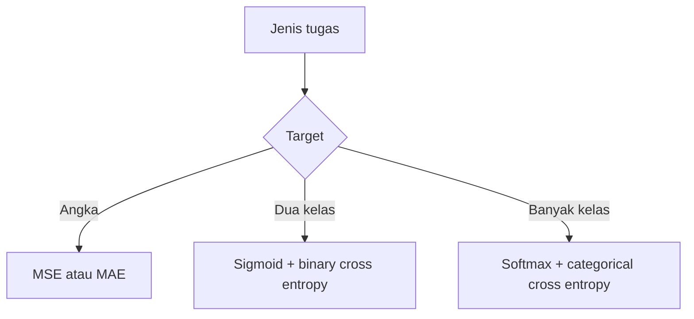

# Loss Function

Loss function mengukur perbedaan antara prediksi model dan target. Optimizer menggunakan nilai ini untuk menentukan perubahan parameter selama training. Loss bukan pengganti metrik bisnis atau metrik keselamatan sistem.

MSE, MAE, dan cross entropy di bawah adalah definisi objective statistik yang umum; tidak ada satu artikel riset tunggal yang menjadi sumber semua bentuk tersebut. Rumus cross entropy untuk klasifikasi terkait dengan estimasi probabilitas pada [Cox, “The Regression Analysis of Binary Sequences” (1958), *Journal of the Royal Statistical Society: Series B*](https://doi.org/10.1111/j.2517-6161.1958.tb00292.x).

## Mean Squared Error

MSE cocok untuk regresi ketika kesalahan besar perlu diberi penalti lebih kuat:

$$
\operatorname{MSE} = \frac{1}{N}\sum_{i=1}^{N}(y_i - \hat{y}_i)^2
$$

Contohnya adalah prediksi suhu atau debit air. Satuan loss menjadi kuadrat dari satuan target.

## Mean Absolute Error

MAE menghitung rata-rata nilai absolut kesalahan:

$$
\operatorname{MAE} = \frac{1}{N}\sum_{i=1}^{N}\left|y_i - \hat{y}_i\right|
$$

MAE lebih mudah dijelaskan karena berada pada satuan target dan biasanya lebih tahan terhadap outlier dibandingkan MSE.

Misalnya error prediksi adalah `1`, `1`, dan `10`. MAE bernilai `4`, sedangkan MSE bernilai `34`. Error besar lebih kuat menaikkan MSE karena dikuadratkan.

## Binary Cross Entropy

Untuk klasifikasi biner:

$$
L = -\frac{1}{N}\sum_{i=1}^{N}\left[y_i\log(p_i) + (1-y_i)\log(1-p_i)\right]
$$

Gunakan bersama output sigmoid. Contoh targetnya adalah `normal` dan `perlu diperiksa`.

## Categorical Cross Entropy

Untuk beberapa kelas, gunakan probabilitas dari softmax dan categorical cross entropy. Pastikan label dan bentuk output model sesuai.

## Pemilihan pada AIoT

Pilih loss berdasarkan bentuk target dan dampak kesalahan. Jika melewatkan kerusakan lebih berbahaya daripada false alarm, evaluasi recall dan biaya kesalahan, bukan loss saja.

## What's next

[:lucide-sliders-horizontal: **Optimasi dan Training** Lihat bagaimana optimizer memakai gradien dari loss untuk memperbarui bobot. Periksa juga hasil pada data validasi.](optimasi-dan-training.md){ .ai-practice-start }

[Kembali ke Deep Learning](overview.md)
