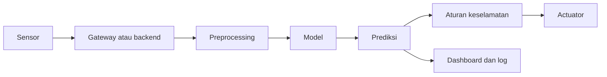

# Dari Model ke Sistem

Model machine learning hanya menghasilkan prediksi atau score. Sistem AIoT perlu mengubah output tersebut menjadi tindakan yang dapat dipantau dan dikendalikan.



## Alur Inference

1. Sensor mengirim data.
2. Gateway atau backend memvalidasi dan melakukan preprocessing.
3. Model menghasilkan prediksi.
4. Sistem memeriksa threshold dan batas operasi.
5. Actuator menjalankan tindakan jika kondisi aman.
6. Input, versi model, output, dan tindakan dicatat.

## Aturan Keselamatan

Output model tidak boleh langsung mengaktifkan actuator tanpa pemeriksaan. Tambahkan:

- Threshold yang sesuai dengan kebutuhan.
- Cooldown agar actuator tidak hidup dan mati terlalu sering.
- Batas durasi dan batas frekuensi operasi.
- Fallback berbasis aturan jika model, sensor, atau koneksi gagal.
- Mode manual untuk operator.

Contoh keputusan penyiraman:

```text
jika kelembapan < threshold
    dan sensor valid
    dan pompa belum melewati batas durasi
maka hidupkan pompa
selain itu
    jangan hidupkan pompa
```

## Deployment

Tentukan lokasi inference berdasarkan kebutuhan:

- **Backend**: model lebih besar dan mudah diperbarui, tetapi membutuhkan jaringan.
- **Gateway**: mengurangi latensi dan tetap dapat bekerja saat koneksi terbatas.
- **Microcontroller**: latensi rendah dan hemat jaringan, tetapi memiliki batas RAM dan komputasi.

Ukur waktu inference, RAM, ukuran model, konsumsi daya, dan frekuensi pembaruan model pada perangkat target.

## Monitoring

Simpan metrik dan log berikut:

- Versi model.
- Timestamp dan device ID.
- Input atau ringkasan input.
- Prediksi dan confidence score.
- Tindakan actuator.
- Error sensor dan kegagalan inference.

Pantau perubahan distribusi data. Sensor yang bergeser kalibrasinya atau lingkungan yang berubah dapat menurunkan performa model.

## What's next

<div class="ai-resource-grid ai-practice-grid" markdown="1">

[<span class="ai-practice-icon" aria-hidden="true">:lucide-cpu:</span> **AI Inference** <span class="ai-practice-description">Bandingkan menjalankan model di perangkat dan di cloud. Perhatikan batas memori, jaringan, dan waktu respons.</span>](../ai-systems/ai-inference.md){ .ai-practice-start }

[<span class="ai-practice-icon" aria-hidden="true">:lucide-brain:</span> **Dasar Neural Network** <span class="ai-practice-description">Jika ingin melatih jaringan saraf, mulai dari cara satu neuron mengubah angka masukan menjadi keluaran.</span>](../deep-learning/dasar-neural-network.md)

</div>

[Kembali ke Machine Learning](overview.md)
