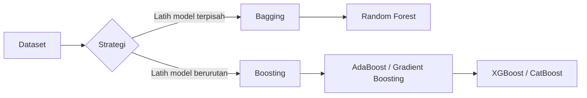

# Ensemble Learning

Ensemble menggabungkan prediksi dari beberapa model. Tujuannya mengurangi ketidakstabilan atau memperbaiki kesalahan yang masih dibuat model sebelumnya. Random Forest memakai bagging; AdaBoost, Gradient Boosting, XGBoost, dan CatBoost termasuk boosting.



## Decision tree sebagai model dasar

Sebuah tree membagi data lewat pertanyaan tentang fitur. Pada regresi, daun biasanya mengeluarkan rata-rata target di dalamnya; pada klasifikasi, daun mengeluarkan kelas mayoritas atau probabilitas kelas. Tree kecil mudah dibaca, sedangkan tree yang dalam dapat mengikuti noise pada data training.

## Bagging dan Random Forest

Bagging mengurangi variance dengan merata-ratakan beberapa model yang dilatih pada sampel bootstrap. Random Forest menambahkan pemilihan subset fitur di tiap split.

**Rujukan riset:** [Breiman, “Bagging Predictors” (1996), *Machine Learning*](https://doi.org/10.1007/BF00058655) untuk bagging; [Breiman, “Random Forests” (2001), *Machine Learning*](https://doi.org/10.1023/A:1010933404324) untuk Random Forest.

Bagging membuat beberapa sampel bootstrap dengan mengambil baris data secara acak dan mengizinkan baris yang sama terpilih lebih dari sekali. Setiap model dilatih sendiri. Untuk regresi, prediksi digabungkan dengan rata-rata:

$$
\hat{f}_{bag}(x) = \frac{1}{M}\sum_{m=1}^{M}\hat{f}_m(x)
$$

Jika tiga tree memprediksi $28, 30, 32 °C$, hasil bagging adalah $\frac{28+30+32}{3} = 30 °C$. Untuk klasifikasi, model dapat memakai suara mayoritas.

Random Forest menambah pengacakan fitur: setiap tree hanya mempertimbangkan subset fitur pada tiap pemisahan. Tree yang berbeda cenderung membuat kesalahan berbeda; merata-ratakannya mengurangi variance dan membuat prediksi lebih stabil.

??? example "Contoh Random Forest"
    ```python
    from sklearn.datasets import make_classification
    from sklearn.ensemble import RandomForestClassifier
    from sklearn.model_selection import train_test_split

    X, y = make_classification(n_samples=120, n_features=6, random_state=42)
    X_train, X_test, y_train, y_test = train_test_split(
        X, y, test_size=0.25, random_state=42, stratify=y
    )

    model = RandomForestClassifier(n_estimators=200, max_depth=5, random_state=42)
    model.fit(X_train, y_train)
    print("Akurasi uji:", model.score(X_test, y_test))
    ```

[Dokumentasi RandomForestClassifier](https://scikit-learn.org/stable/modules/generated/sklearn.ensemble.RandomForestClassifier.html){ .md-button }

## Boosting

**Rujukan riset:** [Freund & Schapire, “A Decision-Theoretic Generalization of On-Line Learning and an Application to Boosting” (1997), *Journal of Computer and System Sciences*](https://doi.org/10.1006/jcss.1997.1504) untuk AdaBoost; [Friedman, “Greedy Function Approximation: A Gradient Boosting Machine” (2001), *The Annals of Statistics*](https://doi.org/10.1214/aos/1013203451) untuk gradient boosting. Persamaan berikut adalah bentuk ringkas additive boosting; implementasi memakai objective dan turunan loss tertentu.

Boosting membangun model berurutan. Model berikutnya diarahkan untuk memperbaiki kesalahan gabungan model sebelumnya. Bentuk sederhana untuk regresi adalah:

$$
F_m(x) = F_{m-1}(x) + \eta h_m(x)
$$

$F_{m-1}$ adalah prediksi saat ini, $h_m$ model baru, dan $\eta$ learning rate yang mengecilkan kontribusi model baru. Contoh: prediksi awal $28 °C$, model berikutnya memperkirakan koreksi $+2 °C$, dan $\eta=0,1$; prediksi berubah menjadi $28 + 0,1(2) = 28,2 °C$. Banyak langkah kecil dapat memperbaiki prediksi tanpa memberi satu tree pengaruh terlalu besar.


Jika tree terlalu dalam atau jumlah langkah terlalu banyak, boosting dapat overfit. Learning rate yang lebih kecil biasanya memerlukan lebih banyak tree. Early stopping menghentikan training saat skor validation tidak lagi membaik.

[Dokumentasi AdaBoost](https://scikit-learn.org/stable/modules/generated/sklearn.ensemble.AdaBoostClassifier.html){ .md-button }
[Dokumentasi Gradient Boosting](https://scikit-learn.org/stable/modules/generated/sklearn.ensemble.GradientBoostingClassifier.html){ .md-button }

## XGBoost dan CatBoost

**Rujukan riset:** [Chen & Guestrin, “XGBoost: A Scalable Tree Boosting System” (2016), *Proceedings of KDD*](https://doi.org/10.1145/2939672.2939785); [Prokhorenkova et al., “CatBoost: unbiased boosting with categorical features” (2018), *Proceedings of NeurIPS*](https://proceedings.neurips.cc/paper_files/paper/2018/file/14491b756b3a51daac41c24863285549-Paper.pdf). Keduanya adalah makalah konferensi.

XGBoost mengoptimalkan gradient boosted trees dengan regularisasi dan teknik komputasi untuk data tabular. Parameter yang sering diperiksa meliputi kedalaman tree, learning rate, jumlah tree, subsampling, dan regularisasi.

CatBoost juga memakai gradient boosting dan menyediakan penanganan fitur kategorikal. Fitur seperti jenis perangkat, lokasi greenhouse, atau mode operasi dapat dimasukkan sebagai kategori; pemisahan data tetap harus mencegah informasi target bocor ke training.

??? example "Contoh XGBoost"
    Instal paket `xgboost` di environment Python sebelum menjalankan contoh ini.

    ```python
    from sklearn.datasets import make_classification
    from sklearn.model_selection import train_test_split
    from xgboost import XGBClassifier

    X, y = make_classification(n_samples=120, n_features=6, random_state=42)
    X_train, X_test, y_train, y_test = train_test_split(
        X, y, test_size=0.25, random_state=42, stratify=y
    )
    X_fit, X_valid, y_fit, y_valid = train_test_split(
        X_train, y_train, test_size=0.2, random_state=42, stratify=y_train
    )

    model = XGBClassifier(
        n_estimators=200,
        max_depth=4,
        learning_rate=0.05,
        eval_metric="logloss",
        early_stopping_rounds=10,
    )
    model.fit(X_fit, y_fit, eval_set=[(X_valid, y_valid)], verbose=False)
    print("Akurasi uji:", model.score(X_test, y_test))
    ```

    Validation dipakai untuk early stopping; data test tetap disimpan untuk penilaian akhir.

[Dokumentasi XGBoost Python API](https://xgboost.readthedocs.io/en/stable/python/python_api.html#xgboost.XGBClassifier){ .md-button }

??? example "Contoh CatBoost untuk kategori sensor"
    Instal paket `catboost` sebelum menjalankan contoh. Kolom kedua berisi nama lokasi dan diberikan sebagai fitur kategori.

    ```python
    from catboost import CatBoostClassifier

    X = [
        [24.0, "greenhouse-a"], [31.0, "greenhouse-a"],
        [23.0, "greenhouse-b"], [33.0, "greenhouse-b"],
        [25.0, "greenhouse-a"], [34.0, "greenhouse-b"],
    ]
    y = [0, 1, 0, 1, 0, 1]  # 0 normal, 1 perlu diperiksa

    model = CatBoostClassifier(iterations=100, depth=4, verbose=False)
    model.fit(X, y, cat_features=[1])
    print("Prediksi:", model.predict([[29.0, "greenhouse-a"]])[0])
    ```

[Dokumentasi CatBoostClassifier](https://catboost.ai/docs/en/concepts/python-reference_catboostclassifier){ .md-button }

Keduanya bukan jaminan hasil lebih baik. Mulai dari baseline atau Random Forest, lalu bandingkan pada split waktu dan metrik yang sama. Periksa juga latensi dan ukuran model jika inference berjalan di gateway.

## Memilih strategi

Bagging cocok ketika satu model seperti decision tree berubah banyak akibat perubahan data latih. Boosting cocok saat ingin memperbaiki kesalahan secara bertahap dan tersedia waktu untuk menyetel parameter. Periksa skor train dan validation; skor train yang terus naik sementara validation memburuk adalah tanda overfitting.

## What's next

<div class="ai-resource-grid ai-practice-grid" markdown="1">

[<span class="ai-practice-icon" aria-hidden="true">:lucide-clipboard-check:</span> **Evaluasi Model** <span class="ai-practice-description">Bandingkan model gabungan dan baseline pada data uji yang sama. Catat juga biaya inference jika model dipasang di gateway.</span>](evaluasi-model.md){ .ai-practice-start }

</div>

[Kembali ke Machine Learning](overview.md)
