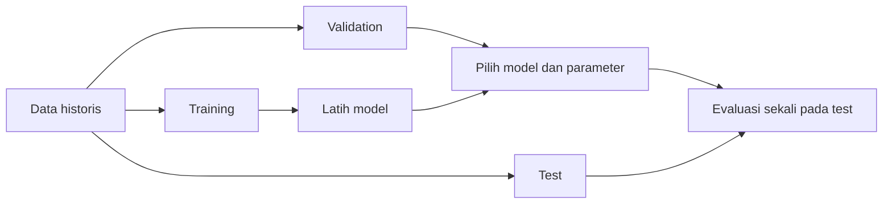

# Evaluasi Model

Evaluasi mengukur kinerja model pada data yang tidak dipakai untuk melatihnya. Pilih metrik sesuai dampak kesalahan: sistem alarm kebocoran, misalnya, perlu memperhatikan kebocoran yang terlewat, bukan hanya persentase prediksi benar.

## Pisahkan data dengan benar

Data training digunakan untuk mempelajari parameter. Validation digunakan untuk memilih model dan pengaturan. Test disimpan sampai keputusan model selesai.

Untuk time-series, urutkan data menurut waktu. Contohnya, gunakan Januari–Oktober untuk training, November untuk validation, dan Desember untuk test. Pengacakan biasa dapat membuat pembacaan Desember masuk ke training ketika model seolah-olah memprediksi bulan sebelumnya.

## Metrik regresi

Misalkan error pada dua prediksi adalah `+1 °C` dan `−2 °C`. MAE rata-ratakan besar kesalahan:

$$
\operatorname{MAE} = \frac{1}{N}\sum_{i=1}^{N}|y_i - \hat{y}_i| = \frac{1+2}{2}=1{,}5\,°C
$$

RMSE menghitung akar rata-rata error kuadrat:

$$
\operatorname{RMSE} = \sqrt{\frac{1}{N}\sum_{i=1}^{N}(y_i - \hat{y}_i)^2} = \sqrt{\frac{1+4}{2}} \approx 1{,}58\,°C
$$

RMSE lebih sensitif terhadap kesalahan besar. Keduanya memakai satuan target, sehingga hasil dapat dibaca sebagai besaran error suhu. Periksa juga error maksimum bila prediksi mengendalikan batas operasi.

## Metrik klasifikasi

Confusion matrix membandingkan label sebenarnya dengan prediksi. Untuk deteksi kondisi berbahaya, definisikan dulu kelas positif—misalnya `kebocoran`—agar arti TP, FP, dan FN jelas.

|  | Diprediksi bocor | Diprediksi normal |
| --- | ---: | ---: |
| Sebenarnya bocor | TP = 8 | FN = 4 |
| Sebenarnya normal | FP = 2 | TN = 16 |

Precision menjawab “dari alarm yang berbunyi, berapa yang benar?” Recall menjawab “dari semua kebocoran, berapa yang tertangkap?”

$$
\operatorname{Precision} = \frac{TP}{TP+FP} = \frac{8}{10}=0{,}80
$$

$$
\operatorname{Recall} = \frac{TP}{TP+FN} = \frac{8}{12}\approx0{,}67
$$

F1 adalah rata-rata harmonik precision dan recall:

$$
F1 = 2\cdot\frac{\operatorname{Precision}\cdot\operatorname{Recall}}{\operatorname{Precision}+\operatorname{Recall}} \approx 0{,}73
$$

Model ini melewatkan 4 dari 12 kebocoran. Jika kebocoran yang terlewat berisiko tinggi, recall lebih penting; bila pemeriksaan alarm sangat mahal, precision juga perlu dijaga. Accuracy dapat terlihat tinggi hanya karena kelas normal jauh lebih banyak.

## Uji ambang alarm kebocoran

> **AI Generated, need human review**

Model memberi setiap kasus skor antara nol dan satu. Dashboard menyalakan alarm jika skor mencapai ambang. Turunkan ambang untuk menangkap lebih banyak kasus dan amati berapa alarm palsu yang ikut muncul.

  <label for="leak-threshold">Ambang skor <output for="leak-threshold">0.50</output></label>
  <input id="leak-threshold" type="range" min="0" max="1" step="0.01" value="0.50">
  <table>
    <caption>Confusion matrix pada 10 kasus ilustratif</caption>
    <thead><tr><th scope="col">Kondisi sebenarnya</th><th scope="col">Alarm</th><th scope="col">Tanpa alarm</th></tr></thead>
    <tbody>
      <tr><th scope="row">Bocor</th><td data-count="tp">3</td><td data-count="fn">2</td></tr>
      <tr><th scope="row">Normal</th><td data-count="fp">2</td><td data-count="tn">3</td></tr>
    </tbody>
  </table>
  
Alarm palsu: 2. Kebocoran terlewat: 2.

  <noscript>Pada ambang 0,50, dua kebocoran terlewat dan dua kasus normal memicu alarm.</noscript>

Coba ambang 0,30 dan 0,80. Pilih nilai yang masuk akal jika kebocoran yang terlewat lebih mahal daripada pemeriksaan tambahan. Sepuluh kasus ini hanya untuk membaca matriks, sehingga keputusan di lapangan perlu diuji pada data yang mewakili penggunaan.

## Overfitting dan baseline

Overfitting terjadi saat model menghafal pola training tetapi gagal pada data baru. Bandingkan skor training dan validation. Gap yang besar dapat menunjukkan model terlalu kompleks, kebocoran data, atau perubahan pola antarperiode.

Bandingkan hasil dengan baseline yang masuk akal, misalnya memakai suhu terakhir untuk memprediksi suhu berikutnya. Model baru baru berguna jika memperbaiki baseline pada periode uji yang sama.

Contoh pada data suhu: jika nilai terakhir pada 10:03 adalah 29,5 °C, baseline memprediksi 29,5 °C untuk 10:04. Jika aktualnya 30,0 °C, error absolutnya 0,5 °C. Pada satu sampel, MAE dan RMSE sama-sama 0,5 °C; keduanya baru menggambarkan performa saat dihitung pada banyak data uji.

## Evaluasi untuk AIoT

Catat ukuran model, RAM, waktu inference, konsumsi daya, dan kebutuhan jaringan bersama metrik prediksi. Model yang sedikit lebih akurat belum tentu cocok jika terlalu lambat untuk gateway atau menghabiskan memori perangkat.

## What's next

[:lucide-server: **Dari Model ke Sistem** Ikuti bagaimana aplikasi memakai prediksi. Tentukan aturan untuk tindakan dan data yang perlu dicatat.](dari-model-ke-sistem.md){ .ai-practice-start }

[:lucide-activity: **Praktik deteksi anomali sensor** Bandingkan waktu alarm, alarm palsu, dan kejadian yang terlewat pada dua aturan deteksi.](../../hands-on/sensor-anomaly.md)

[Kembali ke Machine Learning](overview.md)
