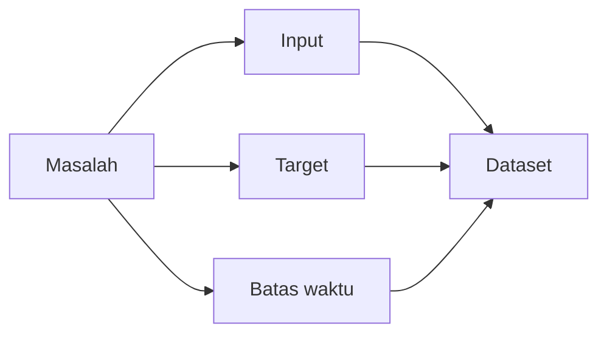

# Masalah dan Data

Machine learning dimulai dari masalah yang jelas, bukan dari algoritma. Tentukan apa yang ingin diprediksi, data yang tersedia, dan pihak yang akan menggunakan hasilnya.

## Menentukan Masalah

Tentukan empat hal berikut:

- **Input**: informasi yang diberikan kepada model.
- **Target**: hasil yang ingin diprediksi.
- **Unit pengamatan**: satu baris mewakili apa, misalnya satu pembacaan sensor atau satu perangkat per jam.
- **Batas waktu**: kapan prediksi harus tersedia dan seberapa jauh ke masa depan prediksi dibuat.

Contoh masalah AIoT:

| Masalah | Input | Target |
| --- | --- | --- |
| Prediksi suhu | Suhu, kelembapan, waktu | Suhu satu jam berikutnya |
| Kondisi tanaman | Suhu, pH, kelembapan tanah | Sehat, kering, atau tergenang |
| Pemeliharaan pompa | Getaran, arus, durasi kerja | Normal atau perlu diperiksa |

## Bentuk Data

Data dapat berupa nilai sensor, gambar, audio, teks, atau gabungan beberapa sumber. Untuk data sensor, simpan timestamp, device ID, nama sensor, nilai, dan satuan.

## Kualitas Data

Periksa sampling rate, nilai kosong, duplikasi, nilai di luar rentang, noise, dan perubahan sensor. Data yang salah dapat membuat model belajar pola yang tidak nyata.

Untuk data time-series, jangan mencampur data masa depan ke data training. Pembagian data harus mengikuti urutan waktu jika model digunakan untuk memprediksi masa depan.

## Baseline

Buat solusi sederhana sebelum melatih model. Contohnya adalah menggunakan nilai sensor terakhir, rata-rata bergerak, atau aturan threshold. Baseline membantu menentukan apakah model baru benar-benar memberi perbaikan.

## What's next

[:lucide-filter: **Preprocessing** Siapkan pembacaan sensor untuk model. Tangani nilai kosong dan pisahkan data latih serta data uji berdasarkan waktu.](preprocessing.md){ .ai-practice-start }

[Kembali ke Machine Learning](overview.md)
