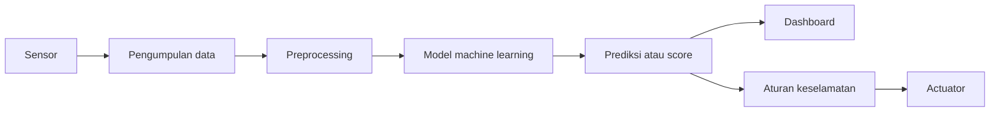

# Machine Learning

Machine learning mempelajari pola dari data untuk menghasilkan prediksi atau keputusan. Dalam AIoT, model dapat membaca data sensor, mendeteksi anomali, memprediksi kondisi perangkat, dan membantu menentukan tindakan.

## Posisi Machine Learning dalam AIoT

Mulai dari masalah, data, target, batas waktu, dan penerima output. Pilihan algoritma ditentukan setelah bagian tersebut jelas.

## Prasyarat

Siapkan Python dan pahami cara membaca tabel. Contoh di [Preprocessing](preprocessing.md#contoh-pemisahan-berdasarkan-waktu) menunjukkan pembagian data menurut waktu dan fitur dari pembacaan sebelumnya.

Contoh kode memakai scikit-learn. Di project Python-mu, pasang dengan `uv add scikit-learn`. Contoh XGBoost dan CatBoost bersifat opsional; pasang `uv add xgboost` atau `uv add catboost` hanya jika ingin menjalankan contoh library tersebut.

## Urutan Materi

> **AI Generated, need human review**

1. [Masalah dan Data](masalah-dan-data.md)
2. [Preprocessing](preprocessing.md)
3. [Supervised Learning](supervised-learning.md)
4. [Unsupervised Learning](unsupervised-learning.md)
5. [Ensemble Learning](ensemble-learning.md)
6. [Evaluasi Model](evaluasi-model.md)
7. [Dari Model ke Sistem](dari-model-ke-sistem.md)

Sesudah membandingkan prediksi dan baseline, ikuti cara menempatkan model dalam alur inference dan memantau hasilnya. Untuk melihat bagaimana alarm diperiksa pada data berurutan, lanjutkan ke [Praktik Deteksi Anomali Sensor pH](../../hands-on/sensor-anomaly.md).

## Kasus yang menyatukan materi

Gunakan prediksi suhu satu menit ke depan sebagai contoh: data sampai waktu `t` menjadi input, suhu pada `t+1` menjadi target, dan nilai terakhir menjadi baseline. Evaluasi model regresi pada periode uji yang sama dengan baseline. Tabel waktu, target, prediksi, dan error memperlihatkan apakah model benar-benar membantu.

[Kembali ke Overview AI](../overview.md)
