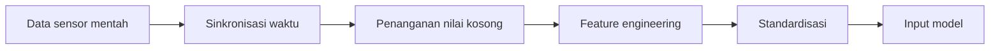

# Preprocessing

Preprocessing mengubah data mentah menjadi fitur yang bisa dibaca model. Aturan yang dipakai saat training harus tersimpan dan digunakan kembali saat inference; jika berbeda, angka yang masuk ke model tidak lagi memiliki arti yang sama.

## Langkah Umum

- Menangani nilai kosong.
- Menghapus atau memperbaiki data duplikat.
- Memeriksa outlier dan nilai yang tidak masuk akal.
- Menyamakan timestamp dan sampling rate.
- Mengubah kategori menjadi fitur numerik.
- Membuat fitur dari riwayat sensor.
- Menyimpan aturan preprocessing bersama model.

## Standardisasi

Standardisasi membantu fitur dengan satuan berbeda agar tidak mendominasi satu sama lain. Nilai fitur diubah agar rata-ratanya nol dan standar deviasinya satu:

$$
x' = \frac{x - \mu}{\sigma}
$$

Jika suhu `30 °C`, rata-rata data training `28 °C`, dan standar deviasinya `2 °C`, hasil standardisasi adalah `(30−28)/2 = 1`. Hitung `μ` dan `σ` dari data training saja, lalu pakai nilai yang sama pada validation, test, dan inference.

Standardisasi adalah transformasi statistik umum, bukan algoritma yang memiliki satu makalah asal tunggal. Dokumentasi [scikit-learn: StandardScaler](https://scikit-learn.org/stable/modules/generated/sklearn.preprocessing.StandardScaler.html) menjelaskan bentuk implementasi dan aturan fit pada data training.

Contoh ringkas data sebelum dan sesudah penanganan nilai kosong:

| Waktu | Suhu mentah | Setelah isi nilai kosong dengan pembacaan terakhir |
| --- | ---: | ---: |
| 10:00 | 28,0 | 28,0 |
| 10:01 | kosong | 28,0 |
| 10:02 | 29,0 | 29,0 |

Mengisi dengan nilai terakhir masuk akal untuk contoh pembacaan berurutan, tetapi tidak cocok untuk semua sensor. Pilih cara pengisian berdasarkan frekuensi sampling, batas waktu, dan arti nilai yang hilang.

## Fitur Time-Series

Data sensor dapat dibuat menjadi fitur lag, rata-rata bergerak, perubahan nilai, minimum, dan maksimum. Fitur lag menyimpan pembacaan sebelumnya; fitur tersebut membantu model melihat arah perubahan.



Contoh fitur dari suhu:

```text
suhu_sekarang
suhu_5_menit_lalu
rata_rata_suhu_10_menit
perubahan_suhu_1_menit
suhu_minimum_1_jam
```

Untuk memprediksi suhu satu langkah ke depan, fitur `lag_1` pada waktu `t` harus memakai suhu di `t−1`, sementara targetnya suhu di `t+1`. Jangan menghitung rata-rata bergerak dengan pembacaan yang belum tersedia pada waktu prediksi.

## Data Leakage

Data leakage terjadi ketika informasi yang seharusnya hanya tersedia setelah prediksi masuk ke input model. Contohnya adalah menghitung rata-rata dari seluruh dataset sebelum membagi data, atau menggunakan nilai masa depan untuk memprediksi masa lalu.

Pisahkan data terlebih dahulu, lalu hitung statistik preprocessing hanya dari data training. Pipeline membantu mengikat preprocessing dan model dalam satu alur sehingga aturan yang sama dapat diterapkan kembali.

## Contoh pemisahan berdasarkan waktu

Gunakan lima pembacaan suhu berikut. Targetnya adalah suhu satu menit setelah waktu prediksi.

| Waktu | Suhu (°C) | Bagian data |
| --- | ---: | --- |
| 10:00 | 28,0 | Latih |
| 10:01 | Kosong | Latih |
| 10:02 | 29,0 | Latih |
| 10:03 | 29,5 | Uji |
| 10:04 | 30,0 | Uji |

Pada 10:01, nilai kosong diisi 28,0 dari pembacaan terakhir. Untuk prediksi pada 10:03, suhu saat ini 29,5 °C dan `lag_1` 29,0 °C berasal dari waktu 10:03 dan sebelumnya. Targetnya 30,0 °C pada 10:04. Nilai 10:04 hanya dipakai untuk menilai prediksi setelah pengukuran tiba, bukan sebagai input.

## What's next

<div class="ai-resource-grid ai-practice-grid" markdown="1">

[<span class="ai-practice-icon" aria-hidden="true">:lucide-target:</span> **Supervised Learning** <span class="ai-practice-description">Jika data punya target, gunakan contoh berlabel untuk memprediksi angka atau kelas.</span>](supervised-learning.md){ .ai-practice-start }

[<span class="ai-practice-icon" aria-hidden="true">:lucide-network:</span> **Unsupervised Learning** <span class="ai-practice-description">Jika data belum punya label, cari kelompok atau pola pada pembacaan sensor.</span>](unsupervised-learning.md)

</div>

[Kembali ke Machine Learning](overview.md)
