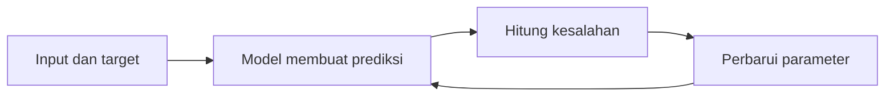

# Supervised Learning

Supervised learning melatih model memakai pasangan input dan target. Contohnya, satu baris data berisi suhu, kelembapan, dan pH sebagai input; label `kering` menjadi targetnya. Model mempelajari hubungan dari contoh tersebut, lalu memperkirakan target untuk data baru.

Contoh klasifikasi di halaman ini memakai data sensor buatan. Buka dan jalankan persiapan data ini lebih dahulu; contoh model setelahnya memakai `X_train`, `X_test`, `y_train`, dan `y_test` yang dihasilkan di sini.



??? example "Siapkan data sensor untuk contoh klasifikasi"
    ```python
    from sklearn.model_selection import train_test_split

    # Fitur: kelembapan tanah (%) dan suhu (°C)
    X = [
        [72, 25], [68, 27], [75, 26], [65, 28], [70, 24], [73, 29],
        [22, 32], [28, 31], [18, 34], [30, 33], [25, 29], [20, 30],
        [95, 24], [90, 25], [98, 26], [88, 23], [93, 27], [96, 22],
    ]
    y = ["normal"] * 6 + ["kering"] * 6 + ["terlalu basah"] * 6

    X_train, X_test, y_train, y_test = train_test_split(
        X, y, test_size=0.25, random_state=42, stratify=y
    )
    ```

Dataset ini hanya untuk mencoba API. Nilai akurasi dari sampel buatan yang kecil tidak mengukur kinerja pada sensor nyata.

## Regresi linear

Regresi digunakan ketika target berupa angka, seperti suhu satu jam ke depan atau konsumsi energi. Untuk satu fitur, garis regresinya berbentuk:

$$
\hat{y} = wx + b
$$

$w$ menentukan kemiringan garis, sedangkan $b$ menentukan titik potongnya. Jika sebuah model menghasilkan $\hat{y} = 0{,}8x + 6$ dan suhu saat ini $x = 30$, prediksi suhu berikutnya adalah $0{,}8(30) + 6 = 30 °C$.

Model memilih nilai $w$ dan $b$ agar prediksinya dekat dengan target. Salah satu ukuran kesalahannya adalah mean squared error (MSE):

$$
\operatorname{MSE} = \frac{1}{N}\sum_{i=1}^{N}(y_i - \hat{y}_i)^2
$$

Jika targetnya `30 °C` dan prediksi `29 °C`, error kuadratnya `1`. Jika prediksi `27 °C`, error kuadratnya `9`; karena dikuadratkan, kesalahan yang jauh mendapat penalti lebih besar.


Regresi linear berguna sebagai baseline yang mudah dibaca. Hubungan yang melengkung atau dipengaruhi banyak interaksi fitur mungkin memerlukan model lain.

**Rujukan riset:** [Legendre, *Nouvelles méthodes pour la détermination des orbites des comètes* (1805)](https://gallica.bnf.fr/ark:/12148/bpt6k77596n), sumber awal metode kuadrat terkecil yang menjadi dasar regresi linear.

??? example "Contoh regresi linear"
    ```python
    from sklearn.linear_model import LinearRegression

    # Suhu saat ini menjadi fitur; suhu satu jam berikutnya menjadi target.
    X_suhu = [[24], [26], [28], [30], [32]]
    y_suhu = [25, 27, 29, 30, 33]

    model = LinearRegression()
    model.fit(X_suhu, y_suhu)
    print("Prediksi:", model.predict([[29]])[0])
    ```

[Dokumentasi LinearRegression](https://scikit-learn.org/stable/modules/generated/sklearn.linear_model.LinearRegression.html){ .md-button }

## Logistic regression

Logistic regression memperkirakan probabilitas kelas. Walaupun namanya “regression”, penggunaan umumnya adalah klasifikasi. Model menghitung skor linear $z = wᵀx + b$, lalu mengubahnya menjadi probabilitas dengan fungsi sigmoid:

$$
p(y=1 \mid x) = \sigma(z) = \frac{1}{1 + e^{-z}}
$$

Misalnya $z = 1$, maka $\sigma(1) \approx 0{,}73$. Dengan threshold $0{,}5$, model memilih kelas positif. Untuk mendeteksi kondisi kering, kelas positif dapat berarti `kering`. Threshold dapat dinaikkan jika alarm palsu mahal, atau diturunkan jika kondisi kering yang terlewat lebih berbahaya.

Untuk beberapa kelas, softmax mengubah skor menjadi probabilitas yang jumlahnya satu:

$$
p(y=k \mid x) = \frac{e^{z_k}}{\sum_{j=1}^{K} e^{z_j}}
$$

Untuk klasifikasi biner, cross entropy rata-rata mengukur apakah probabilitas besar diberikan kepada kelas yang benar:

$$
L = -\frac{1}{N}\sum_{i=1}^{N}\left[y_i\log(p_i)+(1-y_i)\log(1-p_i)\right]
$$

Jika target `kering` bernilai `1`, model mendapat loss besar saat probabilitas kelas kering kecil.

**Rujukan riset:** [Cox, “The Regression Analysis of Binary Sequences” (1958), *Journal of the Royal Statistical Society: Series B*](https://doi.org/10.1111/j.2517-6161.1958.tb00292.x).

??? example "Contoh Logistic Regression"
    ```python
    from sklearn.linear_model import LogisticRegression
    from sklearn.pipeline import make_pipeline
    from sklearn.preprocessing import StandardScaler

    model = make_pipeline(StandardScaler(), LogisticRegression(max_iter=500))
    model.fit(X_train, y_train)
    print("Prediksi:", model.predict(X_test))
    print("Akurasi uji:", model.score(X_test, y_test))
    ```

[Dokumentasi LogisticRegression](https://scikit-learn.org/stable/modules/generated/sklearn.linear_model.LogisticRegression.html){ .md-button }

## K-Nearest Neighbors (KNN)

KNN menyimpan data latih. Untuk mengklasifikasikan sampel baru, model mencari `k` titik terdekat lalu memilih kelas yang paling sering muncul di antara tetangganya.


Jarak Euclidean antara dua data dengan fitur `d` adalah:

$$
d(x, x_i) = \sqrt{\sum_{j=1}^{m}(x_j - x_{ij})^2}
$$

Sebagai contoh, untuk titik baru `(kelembapan=6, suhu=28)` dan titik latih `(5, 30)`, jaraknya $\sqrt{(6-5)^2 + (28-30)^2} = \sqrt{5} \approx 2{,}24$. KNN mengurutkan semua jarak dan mengambil `k` yang terkecil. Nilai `k=1` mudah terpengaruh noise; nilai terlalu besar dapat mengaburkan batas kelas.

Skala fitur perlu diperiksa sebelum menghitung jarak. Selisih suhu puluhan derajat dapat mendominasi kelembapan yang rentangnya hanya 0–1. Standardisasi membantu membuat kontribusi fitur lebih sebanding.

**Rujukan riset:** [Cover & Hart, “Nearest Neighbor Pattern Classification” (1967), *IEEE Transactions on Information Theory*](https://doi.org/10.1109/TIT.1967.1053964).

??? example "Contoh KNN dengan scaling"
    ```python
    from sklearn.neighbors import KNeighborsClassifier
    from sklearn.pipeline import make_pipeline
    from sklearn.preprocessing import StandardScaler

    model = make_pipeline(StandardScaler(), KNeighborsClassifier(n_neighbors=3))
    model.fit(X_train, y_train)
    print("Prediksi:", model.predict(X_test))
    print("Akurasi uji:", model.score(X_test, y_test))
    ```

[Dokumentasi KNeighborsClassifier](https://scikit-learn.org/stable/modules/generated/sklearn.neighbors.KNeighborsClassifier.html){ .md-button }

## Decision Tree

Decision tree mengajukan pertanyaan berurutan tentang fitur. Setiap cabang membatasi data ke kelompok yang lebih kecil, dan daun menghasilkan kelas atau angka prediksi.


Untuk klasifikasi, salah satu ukuran ketidakmurnian sebuah node adalah Gini:

$$
Gini = 1 - \sum_{k=1}^{K} p_k^2
$$

Jika node berisi 8 sampel `kering` dan 2 sampel `normal`, maka $Gini = 1 − (0{,}8² + 0{,}2²) = 0{,}32$. Pemisahan yang baik menghasilkan anak node dengan ketidakmurnian lebih rendah. Model memilih pertanyaan yang paling mengurangi ketidakmurnian tersebut.

Pohon mudah dijelaskan, tetapi pohon yang terlalu dalam dapat menghafal data latih. Batasi kedalaman atau jumlah sampel minimum per daun, lalu ukur kinerjanya pada data yang tidak dipakai untuk training.

**Rujukan riset:** [Quinlan, “Induction of Decision Trees” (1986), *Machine Learning*](https://doi.org/10.1007/BF00116251). Makalah ini memperkenalkan ID3 dan information gain; Gini adalah kriteria split lain yang umum dipakai, termasuk pada CART.

??? example "Contoh Decision Tree dengan batas kedalaman"
    ```python
    from sklearn.tree import DecisionTreeClassifier

    model = DecisionTreeClassifier(max_depth=3, random_state=42)
    model.fit(X_train, y_train)
    print("Prediksi:", model.predict(X_test))
    print("Akurasi uji:", model.score(X_test, y_test))
    ```

`max_depth` membatasi jumlah tingkat pertanyaan. Coba bandingkan skor training dan test ketika nilainya berubah.

[Dokumentasi DecisionTreeClassifier](https://scikit-learn.org/stable/modules/generated/sklearn.tree.DecisionTreeClassifier.html){ .md-button }

## Support Vector Machine (SVM)

SVM mencari batas yang memisahkan kelas dengan margin selebar mungkin. Titik terdekat ke batas disebut support vector; titik-titik inilah yang paling menentukan posisi batas.

Untuk batas linear, model mencari `w` dan `b` dengan margin besar sambil mengizinkan sebagian kesalahan:

$$
\min_{w,b,\xi}\; \frac{1}{2}\lVert w\rVert^2 + C\sum_i \xi_i
\quad\text{dengan}\quad y_i(w^T x_i+b) \geq 1-\xi_i,\; \xi_i\geq0
$$

Persamaan batasnya adalah $wᵀx + b = 0$, dan lebar margin berbanding terbalik dengan $\|w\|$. $\xi_i$ mengukur pelanggaran margin; $C$ mengatur kompromi antara margin lebar dan kesalahan training. Kernel memungkinkan SVM membentuk batas non-linear dengan menghitung kemiripan tanpa membuat fitur baru secara eksplisit.


SVM dapat bekerja baik pada dataset kecil atau menengah dengan batas kelas yang jelas. Pemilihan kernel dan parameter perlu diuji, dan model dapat menjadi berat ketika jumlah sampel sangat besar.

**Rujukan riset:** [Cortes & Vapnik, “Support-vector networks” (1995), *Machine Learning*](https://doi.org/10.1007/BF00994018).

??? example "Contoh SVM dengan standardisasi"
    ```python
    from sklearn.pipeline import make_pipeline
    from sklearn.preprocessing import StandardScaler
    from sklearn.svm import SVC

    model = make_pipeline(StandardScaler(), SVC(kernel="rbf", C=1.0))
    model.fit(X_train, y_train)
    print("Prediksi:", model.predict(X_test))
    print("Akurasi uji:", model.score(X_test, y_test))
    ```

[Dokumentasi SVC](https://scikit-learn.org/stable/modules/generated/sklearn.svm.SVC.html){ .md-button }

## Memilih algoritma

Mulai dengan baseline sederhana. Regresi linear cocok untuk target angka dan hubungan yang mendekati linear; logistic regression memberi probabilitas kelas; KNN berguna untuk melihat pengaruh tetangga; decision tree mudah dijelaskan; SVM mencari margin pemisah. Bandingkan model pada pembagian data dan metrik yang sama. Untuk data berurutan, pisahkan berdasarkan waktu agar data masa depan tidak masuk ke training.

## What's next

<div class="ai-resource-grid ai-practice-grid" markdown="1">

[<span class="ai-practice-icon" aria-hidden="true">:lucide-layers:</span> **Ensemble Learning** <span class="ai-practice-description">Gabungkan beberapa model untuk melihat bagaimana bagging dan boosting memengaruhi prediksi.</span>](ensemble-learning.md){ .ai-practice-start }

[<span class="ai-practice-icon" aria-hidden="true">:lucide-clipboard-check:</span> **Evaluasi Model** <span class="ai-practice-description">Jika sudah punya satu model, bandingkan prediksinya dengan baseline pada data uji yang sama.</span>](evaluasi-model.md)

</div>

[Kembali ke Machine Learning](overview.md)
