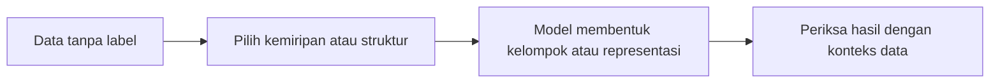

# Unsupervised Learning

Unsupervised learning mencari struktur pada data tanpa label target. Model dapat mengelompokkan pola penggunaan energi, menandai pembacaan sensor yang berbeda, atau merangkum banyak fitur ke beberapa dimensi.



## K-Means

K-Means membagi data menjadi `K` kelompok. Setiap kelompok diwakili centroid, yaitu rata-rata titik anggotanya. Model meminimalkan jumlah jarak kuadrat:

$$
J = \sum_{k=1}^{K}\sum_{x_i \in C_k}\lVert x_i - \mu_k\rVert^2
$$

$C_k$ adalah kelompok ke-$k$ dan $\mu_k$ adalah centroidnya. Prosesnya berulang: tempatkan tiap titik ke centroid terdekat, hitung ulang centroid, lalu ulangi sampai penempatan hampir tidak berubah.


Contoh satu dimensi: data $1, 2, 8, 9$ dengan centroid awal $2$ dan $8$. Pembagian terdekat menghasilkan $\{1, 2\}$ dan $\{8, 9\}$. Centroid baru menjadi $(1+2)/2 = 1,5$ dan $(8+9)/2 = 8,5$. Semua titik berjarak $0,5$ dari centroidnya, sehingga $J = 4 \times 0,5² = 1$.

K-Means perlu jumlah kelompok ditentukan di awal dan lebih cocok untuk kelompok yang relatif padat. Hasilnya juga bergantung pada skala fitur dan pemilihan centroid awal.

**Rujukan riset:** [Lloyd, “Least squares quantization in PCM” (1982), *IEEE Transactions on Information Theory*](https://doi.org/10.1109/TIT.1982.1056489). Artikel ini menjelaskan prosedur iteratif yang dikenal sebagai algoritma Lloyd atau K-Means.

??? example "Contoh K-Means dengan scikit-learn"
    ```python
    from sklearn.cluster import KMeans
    from sklearn.preprocessing import StandardScaler

    readings = [[72, 25], [68, 27], [22, 32], [28, 31], [95, 24], [90, 25]]
    X_scaled = StandardScaler().fit_transform(readings)

    model = KMeans(n_clusters=3, n_init="auto", random_state=42)
    labels = model.fit_predict(X_scaled)
    print("Kelompok:", labels)
    ```

[Dokumentasi KMeans](https://scikit-learn.org/stable/modules/generated/sklearn.cluster.KMeans.html){ .md-button }

## DBSCAN

DBSCAN membentuk kelompok dari titik yang punya cukup banyak tetangga dalam radius `ε` (epsilon). `min_samples` menentukan jumlah minimum tetangga untuk menganggap suatu titik sebagai titik inti. Titik yang tidak terhubung ke kelompok mana pun ditandai sebagai noise.

Metode ini dapat menemukan kelompok dengan bentuk tidak bulat dan tidak perlu diberi jumlah kelompok. Hasilnya sensitif terhadap `ε`; fitur dengan skala berbeda sebaiknya distandardisasi lebih dulu. Untuk data berdimensi tinggi, jarak antar titik sering makin sulit dibedakan.

**Rujukan riset:** [Ester et al., “A Density-Based Algorithm for Discovering Clusters in Large Spatial Databases with Noise” (1996), *Proceedings of KDD*](https://www.dbs.ifi.lmu.de/Publikationen/Papers/KDD-96.final.frame.pdf). Ini prosiding konferensi dan sumber asli DBSCAN.

??? example "Contoh DBSCAN"
    ```python
    from sklearn.cluster import DBSCAN
    from sklearn.preprocessing import StandardScaler

    readings = [[72, 25], [68, 27], [22, 32], [28, 31], [95, 24], [90, 25]]
    X_scaled = StandardScaler().fit_transform(readings)

    labels = DBSCAN(eps=0.8, min_samples=2).fit_predict(X_scaled)
    print("Label kelompok (-1 berarti noise):", labels)
    ```

[Dokumentasi DBSCAN](https://scikit-learn.org/stable/modules/generated/sklearn.cluster.DBSCAN.html){ .md-button }

## Hierarchical clustering

Agglomerative clustering memulai dari satu kelompok per titik, lalu berulang kali menggabungkan dua kelompok terdekat. Pilihan *linkage* menentukan jarak antarkelompok: `single` memakai pasangan terdekat, `complete` pasangan terjauh, dan `average` rata-rata jarak.

Dendrogram memperlihatkan urutan penggabungan. Memotong dendrogram pada ketinggian tertentu menghasilkan jumlah kelompok yang berbeda. Metode ini membantu melihat struktur bertingkat, tetapi kebutuhan komputasinya dapat besar untuk dataset yang sangat banyak.

**Rujukan riset:** [Murtagh, “A Survey of Recent Advances in Hierarchical Clustering Algorithms” (1983), *The Computer Journal*](https://doi.org/10.1093/comjnl/26.4.354).

??? example "Contoh Agglomerative Clustering"
    ```python
    from sklearn.cluster import AgglomerativeClustering
    from sklearn.preprocessing import StandardScaler

    readings = [[72, 25], [68, 27], [22, 32], [28, 31], [95, 24], [90, 25]]
    X_scaled = StandardScaler().fit_transform(readings)

    labels = AgglomerativeClustering(n_clusters=3).fit_predict(X_scaled)
    print("Kelompok:", labels)
    ```

[Dokumentasi AgglomerativeClustering](https://scikit-learn.org/stable/modules/generated/sklearn.cluster.AgglomerativeClustering.html){ .md-button }

## Gaussian Mixture Model (GMM)

GMM menganggap data berasal dari campuran beberapa distribusi Gaussian. Berbeda dari K-Means yang menetapkan satu kelompok tegas, GMM memberi probabilitas keanggotaan untuk setiap kelompok.

Untuk komponen ke-`k`, probabilitas posteriornya sebanding dengan:

$$
p(k \mid x) = \frac{\pi_k\,\mathcal{N}(x \mid \mu_k, \Sigma_k)}{\sum_j \pi_j\,\mathcal{N}(x \mid \mu_j, \Sigma_j)}
$$

$\pi_k$ adalah bobot komponen, sedangkan $\mu_k$ dan $\Sigma_k$ adalah rata-rata dan kovariansnya. Jika satu pembacaan mendapat probabilitas $0,55$ untuk kondisi A dan $0,45$ untuk kondisi B, sistem dapat menandainya sebagai pola yang berada di batas dua kelompok.

**Rujukan riset:** [Dempster, Laird & Rubin, “Maximum Likelihood from Incomplete Data via the EM Algorithm” (1977), *Journal of the Royal Statistical Society: Series B*](https://doi.org/10.1111/j.2517-6161.1977.tb01600.x). EM dapat dipakai untuk mengestimasi parameter campuran Gaussian.

??? example "Contoh Gaussian Mixture Model"
    ```python
    from sklearn.mixture import GaussianMixture
    from sklearn.preprocessing import StandardScaler

    readings = [[72, 25], [68, 27], [22, 32], [28, 31], [95, 24], [90, 25]]
    X_scaled = StandardScaler().fit_transform(readings)

    model = GaussianMixture(n_components=3, random_state=42)
    model.fit(X_scaled)
    print("Probabilitas kelompok:", model.predict_proba(X_scaled[:1]))
    ```

[Dokumentasi GaussianMixture](https://scikit-learn.org/stable/modules/generated/sklearn.mixture.GaussianMixture.html){ .md-button }

## PCA untuk merangkum fitur

Principal Component Analysis (PCA) mengubah fitur berkorelasi menjadi sumbu baru yang saling tegak lurus. Komponen pertama menangkap variasi terbesar, komponen kedua menangkap variasi terbesar berikutnya, dan seterusnya.

Secara matematis, PCA mencari eigenvector dari matriks kovarians data yang sudah dipusatkan. Proyeksi ke `q` komponen ditulis $Z = XW_q$, dengan $W_q$ berisi `q` eigenvector terpilih. Mengurangi jumlah komponen dapat membantu visualisasi dan mengurangi ukuran input, tetapi informasi yang dibuang juga bisa memuat sinyal penting.

PCA bukan algoritma clustering: PCA mengubah representasi data, sementara K-Means atau metode lain dapat dijalankan setelahnya. Periksa proporsi variasi yang dipertahankan sebelum memakai hasil reduksi untuk keputusan.

**Rujukan riset:** [Hotelling, “Analysis of a Complex of Statistical Variables into Principal Components” (1933), *Journal of Educational Psychology*](https://doi.org/10.1037/h0070888).

??? example "Contoh PCA untuk dua komponen"
    ```python
    from sklearn.decomposition import PCA
    from sklearn.preprocessing import StandardScaler

    readings = [[72, 25], [68, 27], [22, 32], [28, 31], [95, 24], [90, 25]]
    X_scaled = StandardScaler().fit_transform(readings)

    model = PCA(n_components=2)
    X_reduced = model.fit_transform(X_scaled)
    print("Data hasil reduksi:", X_reduced)
    print("Variansi per komponen:", model.explained_variance_ratio_)
    ```

[Dokumentasi PCA](https://scikit-learn.org/stable/modules/generated/sklearn.decomposition.PCA.html){ .md-button }

## Memilih metode

Gunakan K-Means jika jumlah kelompok dapat diperkirakan dan kelompoknya cukup kompak. Pilih DBSCAN saat ingin menandai noise dan bentuk kelompok tidak diketahui. Gunakan hierarchical clustering untuk membaca hubungan bertingkat, GMM untuk keanggotaan probabilistik, dan PCA untuk mengurangi dimensi. Nama kelompok tetap perlu ditafsirkan berdasarkan konteks sensor dan operasi.

## What's next

<div class="ai-resource-grid ai-practice-grid" markdown="1">

[<span class="ai-practice-icon" aria-hidden="true">:lucide-clipboard-check:</span> **Evaluasi Model** <span class="ai-practice-description">Pelajari cara menguji hasil ketika kelompok dipakai sebagai fitur untuk prediksi yang mempunyai target.</span>](evaluasi-model.md){ .ai-practice-start }

</div>

[Kembali ke Machine Learning](overview.md)
