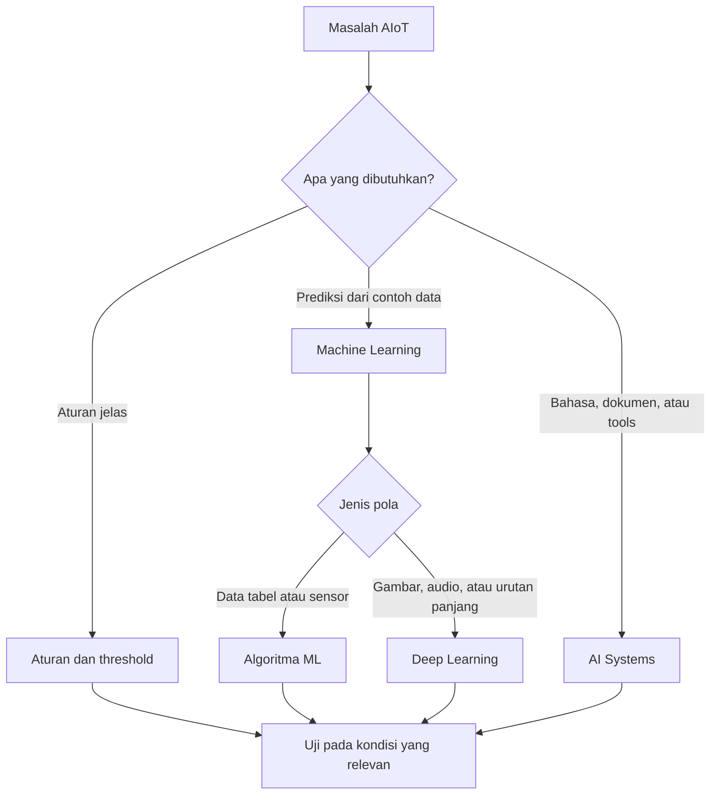

# Artificial Intelligence

AI adalah bidang yang mempelajari cara membuat sistem menyelesaikan tugas seperti mengenali pola, memprediksi nilai, memahami bahasa, dan memilih tindakan. Dalam AIoT, pilih pendekatan dari masalah dan data yang tersedia. Model yang lebih rumit tidak otomatis memberi hasil yang lebih baik.

> **AI Generated, need human review**

Bayangkan sebuah tangki air perlu dipantau. Jika alarm harus berbunyi saat air mencapai 80 cm, program bisa membandingkan pembacaan sensor dengan batas itu. Uji pembacaan tepat di bawah dan tepat pada batas untuk melihat kapan alarm menyala.

Kalau ingin tahu apakah tangki akan penuh dalam sepuluh menit, perkirakan dulu dari laju kenaikan air. Jika laju itu sering berubah, model *machine learning* dapat mempelajari pola dari contoh lama. Model memakai pembacaan sebelumnya untuk memperkirakan ketinggian air berikutnya.

Ketinggian air juga bisa dibaca dari gambar kamera. Untuk tugas seperti itu, *deep learning* memakai jaringan saraf berlapis yang dapat mempelajari pola visual, misalnya garis permukaan air. Deep learning adalah salah satu bagian dari machine learning.

Saat model dipasang dalam aplikasi, pembacaan terbaru perlu diambil dan hasil prediksi perlu diperiksa sebelum peringatan dikirim. Cara merangkai komponen itu dibahas di **AI Systems**. Percobaan awal dapat memakai model yang sudah tersedia.

## Rute belajar

- Mulai dari [AI Fundamental](fundamental.md) untuk merumuskan masalah sensor, mencoba aturan pembanding, dan memahami kapan model mungkin membantu.
- Buka [Machine Learning](machine-learning/overview.md) untuk menyiapkan data, mempelajari algoritma, dan mengevaluasi prediksi.
- Lanjutkan ke [Deep Learning](deep-learning/overview.md) setelah mengenal data dan evaluasi model. Materi ini membahas jaringan saraf serta penerapannya pada data sensor, gambar, dan urutan.
- Pilih [AI Systems](ai-systems/overview.md) untuk mempelajari inference, LLM, embeddings, OCR, RAG, tools, MCP, dan agents.
- Lanjutkan ke [AI Dashboard](ai-dashboard/overview.md) untuk membuat antarmuka Python bagi data, model, dan demo AI dengan Streamlit atau Gradio.

Data sensor yang dipakai untuk latihan disimpan dan diolah lewat database. Lihat [Overview Database](../database/overview.md) untuk alur dari device dan backend sampai query yang dapat digunakan dashboard atau analisis.

Untuk contoh tangki air, [AI Fundamental](fundamental.md) memulai dari aturan alarm sederhana. Jika targetnya memprediksi kapan air akan melewati batas, lanjut ke [Masalah dan Data](machine-learning/masalah-dan-data.md) untuk menentukan input, target, dan waktu prediksi.

[Buka Sumber Eksplorasi AI](sumber-eksplorasi.md){ .md-button }

[Kembali ke Home](../index.md)
