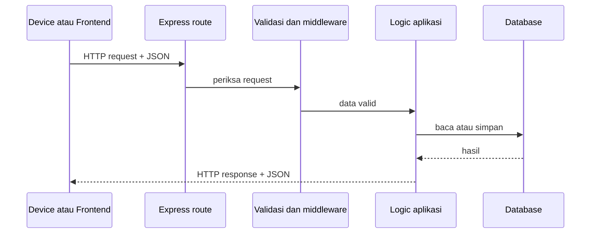

# Backend

!!! note "AI Generated"

    Pembuka dan jalur praktik API pada halaman ini disusun dengan bantuan AI.

Backend adalah bagian aplikasi yang menjalankan aturan dan mengelola data di server. Saat client mengirim permintaan HTTP, backend membaca metode dan alamatnya, menjalankan tindakan yang sesuai, lalu mengirim hasil sebagai respons.

Alur ini bisa terlihat pada aplikasi pemesanan. Saat pengguna mengirim pesanan, backend memeriksa isinya dan menyimpan catatan, sehingga pengguna bisa membuka kembali pesanan itu.

Pada proyek AIoT, yang dikirim adalah pembacaan sensor. Kita memakai JavaScript, Node.js, dan Express.js untuk memvalidasi kiriman sebelum menyimpannya. ID dari respons API membantu menemukan pembacaan yang sama di database dan dashboard.

Python tetap dipelajari pada bagian AI karena banyak alat machine learning dan deep learning menggunakannya. Di proyek KSM, backend yang sudah ada dapat memakai FastAPI. Halaman [Express.js dan FastAPI di KSM](express-fastapi-bridge.md) menunjukkan hubungan keduanya.

## Alur request

## Urutan belajar

1. [JavaScript Fundamental](javascript-fundamental.md): nilai, fungsi, object, array, dan error.
2. [Node.js dan HTTP](nodejs-http.md): menjalankan JavaScript di server dan memahami request.
3. [API dengan Express.js](express-api.md): membuat route, menerima JSON, dan mengirim status serta response.
4. [Validasi dan Middleware](validation-middleware.md): memeriksa input dan menangani request lintas asal.
5. [Asynchronous JavaScript](async-javascript.md): menunggu database atau layanan jaringan tanpa menghentikan alur server.
6. [Struktur Proyek Backend](project-structure.md): memisahkan route, service, dan akses database.
7. [Akses Database dari Express](database-integration.md): membandingkan query SQL dengan `pg` dan model dokumen dengan Mongoose.
8. [Express.js dan FastAPI di KSM](express-fastapi-bridge.md): membandingkan pola yang sama di proyek Python.

Setelah mengenal route, jalankan [Backend Mini](../hands-on/backend-mini.md) dan periksa respons valid serta respons 400 lewat Postman. Buat [tabel pembacaan](../hands-on/database-mini.md#buat-tabel), lalu ikuti [Dashboard Hands-on](../hands-on/dashboard-hands-on.md) untuk menelusuri satu ID pembacaan sampai tabel Vue.

Gunakan [demo PostgreSQL dan MongoDB](../hands-on/backend-database-demo.md) sebagai materi pembanding akses database. Masing-masing memakai proyek dengan endpoint dan bentuk data sendiri.

## Hasil yang dituju

- Menjalankan server Node.js dan Express.js.
- Membuat endpoint GET dan POST.
- Memeriksa request JSON dan memilih status HTTP yang sesuai.
- Menghubungkan endpoint dengan database.
- Membedakan akses PostgreSQL melalui SQL dengan akses MongoDB melalui Mongoose.
- Mengenali padanan alur Express.js pada backend FastAPI di proyek KSM.

[Kembali ke Home](../index.md)

## What's next

[:lucide-code-xml: **JavaScript Fundamental** Kenali nilai, fungsi, dan objek yang akan dipakai di handler.](javascript-fundamental.md){ .ai-practice-start }

[:lucide-flask-conical: **Backend Mini** Jalankan API Express dan uji responsnya di Postman.](../hands-on/backend-mini.md)

