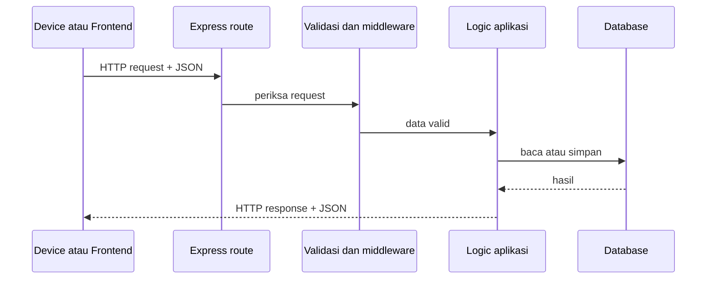

# Backend

Bagian ini memakai **JavaScript, Node.js, dan Express.js**, sesuai materi backend di kelas. Kamu akan membuat API untuk menerima kiriman sensor, memeriksa isinya, lalu menyimpan atau mengirim data.

Python tetap dipelajari pada bagian AI karena banyak alat machine learning dan deep learning menggunakannya. Di proyek KSM, backend yang sudah ada dapat memakai FastAPI. Halaman [Express.js dan FastAPI di KSM](express-fastapi-bridge.md) menunjukkan hubungan keduanya.

## Alur request

## Urutan belajar

1. [JavaScript Fundamental](javascript-fundamental.md): nilai, fungsi, object, array, dan error.
2. [Node.js dan HTTP](nodejs-http.md): menjalankan JavaScript di server dan memahami request.
3. [API dengan Express.js](express-api.md): membuat route, menerima JSON, dan mengirim status serta response.
4. [Validasi dan Middleware](validation-middleware.md): memeriksa input dan menangani request lintas asal.
5. [Asynchronous JavaScript](async-javascript.md): menunggu database atau layanan jaringan tanpa menghentikan alur server.
6. [Struktur Proyek Backend](project-structure.md): memisahkan route, service, dan akses database.
7. [Akses Database dari Express](database-integration.md): membandingkan query SQL dengan `pg` dan model dokumen dengan Mongoose.
8. [Express.js dan FastAPI di KSM](express-fastapi-bridge.md): membandingkan pola yang sama di proyek Python.

Setelah API dasar dikenali, jalankan [Backend Mini](../hands-on/backend-mini.md). Lanjutkan ke [Backend dengan PostgreSQL dan MongoDB](../hands-on/backend-database-demo.md) untuk mencoba dua demo, lalu [Dashboard Hands-on](../hands-on/dashboard-hands-on.md) untuk menghubungkan device, PostgreSQL, dan frontend.

## Hasil yang dituju

- Menjalankan server Node.js dan Express.js.
- Membuat endpoint GET dan POST.
- Memeriksa request JSON dan memilih status HTTP yang sesuai.
- Menghubungkan endpoint dengan database.
- Membedakan akses PostgreSQL melalui SQL dengan akses MongoDB melalui Mongoose.
- Mengenali padanan alur Express.js pada backend FastAPI di proyek KSM.

[Kembali ke Home](../index.md)
