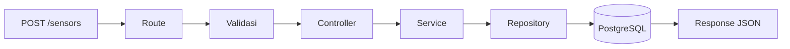

# Struktur Proyek Backend

Saat latihan pertama, satu file `main.js` cukup untuk melihat route dan response bersama-sama. Ketika aplikasi bertambah, pisahkan tugas agar aturan API, validasi, dan query database mudah ditemukan.

## Contoh susunan folder

```text
mini_backend/
├── src/
│   ├── app.js
│   ├── server.js
│   ├── routes/
│   │   └── sensor-routes.js
│   ├── controllers/
│   │   └── sensor-controller.js
│   ├── services/
│   │   └── sensor-service.js
│   └── repositories/
│       └── sensor-repository.js
├── .env
├── .gitignore
└── package.json
```

Nama dan jumlah folder dapat berbeda antarproyek. Ini peta untuk membantu membaca kode, bukan aturan yang wajib diikuti.

| Bagian | Tugas |
| --- | --- |
| `server.js` | menyalakan server dan memilih port |
| `app.js` | membuat aplikasi Express dan memasang middleware |
| `routes/` | memetakan method dan path ke handler |
| `controllers/` | membaca request dan membentuk response |
| `services/` | menjalankan aturan aplikasi |
| `repositories/` | membaca atau menulis database |
| `.env` | menyimpan konfigurasi lokal yang tidak dikomit |

## Contoh susunan pada demo

Demo MongoDB memakai pembagian yang mirip dengan peta di atas:

| File | Peran dalam demo |
| --- | --- |
| `index.js` | memasang middleware, memasang router `/api/devices`, dan menyalakan server |
| `src/config/db.js` | membuat koneksi Mongoose menggunakan `MONGO_HOST` dan `DB_NAME` |
| `src/middlewares/logger.js` | mencatat method dan URL request |
| `src/routes/deviceRoutes.js` | memasangkan method dan path ke fungsi controller |
| `src/controllers/deviceController.js` | membaca request, memanggil model `Device`, dan menyusun response |
| `src/models/device.js` | menetapkan schema dokumen device dan aturan field |

Demo PostgreSQL lebih ringkas: `db.js` membuat `Pool`, sementara `index.js` menyiapkan tabel dan menjalankan query untuk route. Ini memudahkan melihat request sampai query pertama. Saat fitur bertambah, pindahkan query dari handler ke service atau repository agar pengujian dan perubahan database lebih mudah dikelola.

## Ikuti satu request



Pada [Backend Mini](../hands-on/backend-mini.md), semua langkah masih berada di `main.js`. Pada [demo MongoDB](../hands-on/backend-database-demo.md), ikuti `POST /api/devices` dari route ke controller lalu model. Jangan menganggap suatu lapisan dipakai sebelum melihat pemanggilannya.

Pemisahan ini juga berlaku pada FastAPI, meskipun nama file dan cara validasinya berbeda. Lihat [padanan Express.js dan FastAPI](express-fastapi-bridge.md).
