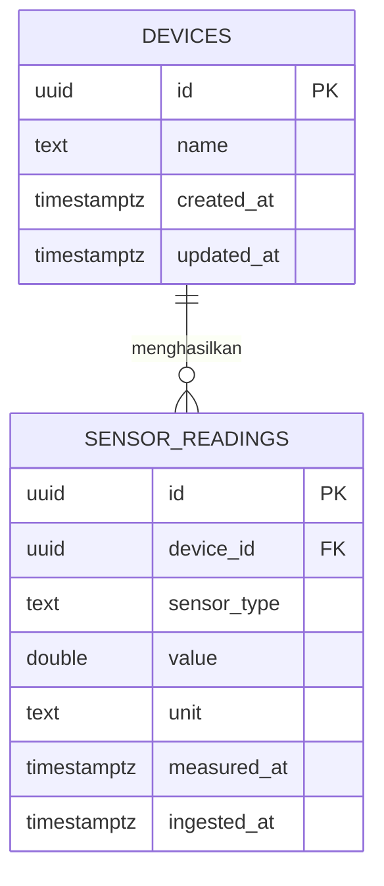

# Desain Data IoT

!!! note "AI Generated"

    Kartu What's next pada halaman ini disusun dengan bantuan AI.

Satu perangkat dapat mengirim banyak pembacaan. Simpan informasi perangkat sekali, lalu hubungkan setiap pembacaan ke perangkat itu lewat `device_id`. Pisahkan pula waktu pengukuran dari waktu backend menerima data; keduanya berbeda saat device mengirim ulang data setelah koneksi terputus.

## Contoh tabel perangkat dan pembacaan



Tabel perangkat menyimpan nama dan metadata yang berubah jarang. Tabel pembacaan menyimpan nilai peristiwa yang umumnya ditambahkan terus-menerus.

```sql
CREATE TABLE devices (
  id UUID PRIMARY KEY,
  name TEXT NOT NULL,
  created_at TIMESTAMPTZ NOT NULL DEFAULT now(),
  updated_at TIMESTAMPTZ NOT NULL DEFAULT now()
);

CREATE TABLE sensor_readings (
  id UUID PRIMARY KEY DEFAULT uuidv7(),
  device_id UUID NOT NULL REFERENCES devices(id),
  sensor_type TEXT NOT NULL,
  value DOUBLE PRECISION NOT NULL,
  unit TEXT NOT NULL,
  measured_at TIMESTAMPTZ NOT NULL,
  ingested_at TIMESTAMPTZ NOT NULL DEFAULT now()
);
```

`measured_at` berisi waktu yang dilaporkan perangkat. `ingested_at` diisi server ketika baris diterima. Jangan memakai ID sebagai pengganti waktu pengukuran: UUIDv7 mencatat waktu pembentukan ID, yang bisa terjadi setelah pengukuran.

Index berikut membantu query pembacaan satu perangkat dalam urutan waktu:

```sql
CREATE INDEX idx_sensor_readings_device_time
ON sensor_readings (device_id, measured_at DESC);
```

Contoh query terbaru:

```sql
SELECT sensor_type, value, unit, measured_at
FROM sensor_readings
WHERE device_id = '019535d9-3df7-79fb-b466-fa907fa17f9e'
ORDER BY measured_at DESC
LIMIT 10;
```

Pembacaan sensor biasanya bersifat append-only, jadi kolom `updated_at` tidak diperlukan di tabel pembacaan. Gunakan `updated_at` untuk tabel yang memang dapat diedit, seperti metadata perangkat, jika sistem perlu mengetahui kapan perubahan terakhir terjadi. `DEFAULT now()` hanya mengisi nilai awal; aplikasi atau trigger harus memperbaruinya saat baris berubah.

KSM AIoT memakai UUIDv7 sebagai ID unik untuk data time-series. Sebelum mengubah tabel PostgreSQL biasa menjadi hypertable yang dipartisi menurut waktu pengukuran, baca batasan primary key pada [Time-Series dan TimescaleDB](timeseries.md#aturan-unik-dan-primary-key). Aturan TimescaleDB mengharuskan indeks unik menyertakan kolom partisi.

[Kembali ke Overview Database](overview.md)

## What's next

<div class="ai-resource-grid ai-practice-grid" markdown="1">

[<span class="ai-practice-icon" aria-hidden="true">:lucide-database:</span> **UUIDv4 dan UUIDv7** <span class="ai-practice-description">Lihat konsekuensi pilihan ID saat mencatat data yang bertambah terus.</span>](uuid-identifiers.md){ .ai-practice-start }

</div>
