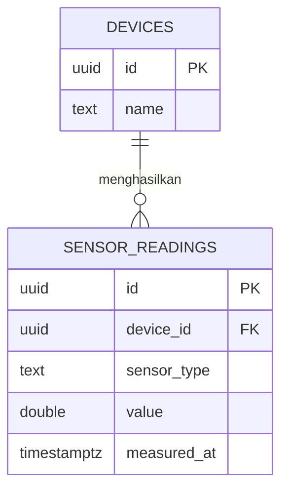

# Database Fundamental

!!! note "AI Generated"

    Kartu What's next pada halaman ini disusun dengan bantuan AI.

PostgreSQL adalah database relasional. Data disimpan dalam tabel yang punya kolom tertentu, dan tabel dapat dihubungkan melalui kunci. Contoh paling sederhana adalah tabel perangkat dan tabel pembacaan sensor.

## Tabel, baris, dan kolom

Kolom menyatakan jenis informasi. Baris menyimpan satu catatan. Setiap kolom memiliki tipe data agar database tahu nilai apa yang diterima.

| Kolom | Tipe | Contoh nilai | Makna |
| --- | --- | --- | --- |
| `device_id` | `UUID` | `019...` | identitas perangkat |
| `sensor_type` | `TEXT` | `temperature` | jenis sensor |
| `value` | `DOUBLE PRECISION` | `28.5` | nilai numerik |
| `measured_at` | `TIMESTAMPTZ` | `2026-11-17 10:00+07` | waktu pengukuran dengan zona waktu |

Gunakan tipe sesuai makna data. Suhu disimpan sebagai angka, bukan teks; waktu disimpan sebagai tipe waktu, bukan string yang harus diurai setiap kali query.

## Kunci dan relasi

**Primary key** mengidentifikasi satu baris. **Foreign key** menghubungkan baris dengan baris pada tabel lain. Misalnya, satu perangkat memiliki banyak pembacaan:



`devices.id` adalah primary key. `sensor_readings.device_id` menjadi foreign key yang menunjuk ke perangkat. Dengan pemisahan ini, nama perangkat disimpan sekali dan tidak perlu disalin ke setiap pembacaan.

## Constraint dan nilai kosong

Constraint menjaga agar data yang tidak masuk akal tidak tersimpan.

```sql
CREATE TABLE devices (
  id UUID PRIMARY KEY,
  name TEXT NOT NULL UNIQUE
);
```

`PRIMARY KEY` mewajibkan nilai unik dan tidak kosong. `NOT NULL` mewajibkan kolom terisi. `UNIQUE` mencegah nama perangkat yang sama jika memang aturan sistem mengharuskannya. `NULL` berarti nilai tidak diketahui atau belum tersedia; nilainya berbeda dari angka nol dan teks kosong.

## Mengapa relasi membantu?

Jika data perangkat dan pembacaan dicampur, nama dan lokasi perangkat akan berulang di setiap baris sensor. Perubahan nama harus memperbarui banyak baris. Dengan tabel terpisah, pembacaan menunjuk ke perangkat lewat foreign key. SQL `JOIN` dapat menggabungkan keduanya saat laporan membutuhkan nama perangkat.

Materi berikutnya menunjukkan cara membuat database dan menulis query di [SQL Basics](sql-basics.md). Contoh struktur sensor yang lebih lengkap ada di [Desain Data IoT](data-modeling.md).

[Kembali ke Overview Database](overview.md)

## What's next

<div class="ai-resource-grid ai-practice-grid" markdown="1">

[<span class="ai-practice-icon" aria-hidden="true">:lucide-database:</span> **SQL Basics** <span class="ai-practice-description">Buat tabel dan baca pembacaan dengan query SQL.</span>](sql-basics.md){ .ai-practice-start }

</div>
