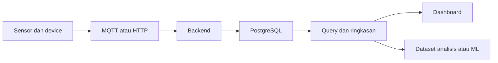

# Database

!!! note "AI Generated"

    Pembuka dan jalur dari respons API ke baris database disusun dengan bantuan AI.

Database menyimpan data secara terstruktur agar aplikasi dapat membaca dan memperbaruinya kembali. Pada database relasional seperti PostgreSQL, data tersusun dalam tabel, dan ID membantu menemukan satu baris tertentu.

Aplikasi toko dapat memakai tabel untuk mencatat pesanan. Saat pelanggan membuka riwayat, aplikasi mencari pesanan yang sudah tersimpan dan mengembalikan rinciannya melalui API.

Di proyek AIoT, satu kiriman sensor menjadi satu baris pembacaan. PostgreSQL memberikan ID ketika baris disimpan, sehingga peserta dapat mencocokkan respons API dengan hasil query dan tampilan dashboard.

## Alur data

Database menyimpan data agar backend dan dashboard dapat membaca catatan yang sama. PostgreSQL dipilih untuk materi ini karena menyimpan data relasional dengan SQL, transaksi, dan constraint. Hubungan seperti device–sensor–pembacaan dapat dijelaskan dalam satu sistem; bila kebutuhan time-series tumbuh, TimescaleDB menambahkan fitur khusus tanpa mengganti cara dasar memakai tabel PostgreSQL.

## Urutan belajar

1. [Database Fundamental](fundamental.md) — tabel, tipe data, kunci, dan relasi.
2. [SQL Basics](sql-basics.md) — instalasi PostgreSQL, membuat tabel, dan menjalankan query.
3. [Desain Data IoT](data-modeling.md) — memisahkan perangkat dan pembacaan sensor.
4. [UUIDv4 dan UUIDv7](uuid-identifiers.md) — memilih ID sesuai kebutuhan dan konvensi KSM AIoT.
5. [Time-Series dan TimescaleDB](timeseries.md) — hypertable, columnstore, ringkasan, dan retensi data.
6. [Database Mini](../hands-on/database-mini.md) — menyimpan dan membaca pembacaan sensor.

## Setelah bagian ini

Kamu akan bisa membaca struktur tabel, menulis query untuk sensor, dan menjelaskan kapan PostgreSQL biasa cukup serta kapan TimescaleDB membantu. Data historis yang dibaca dengan query juga dapat menjadi sumber fitur untuk [Machine Learning](../ai/machine-learning/overview.md). Untuk mengikuti data dari backend sampai dashboard, mulai dari [membuat tabel](../hands-on/database-mini.md#buat-tabel), lalu [cari baris dari respons API](../hands-on/database-mini.md#cari-baris-dari-respons-api).

[Kembali ke Home](../index.md)

## What's next

[:lucide-database: **Database Fundamental** Kenali tabel, tipe data, dan kunci yang membantu menemukan satu baris.](fundamental.md){ .ai-practice-start }

[:lucide-flask-conical: **Database Mini** Buat tabel untuk menyimpan pembacaan yang dikirim dari Express.](../hands-on/database-mini.md#buat-tabel)

