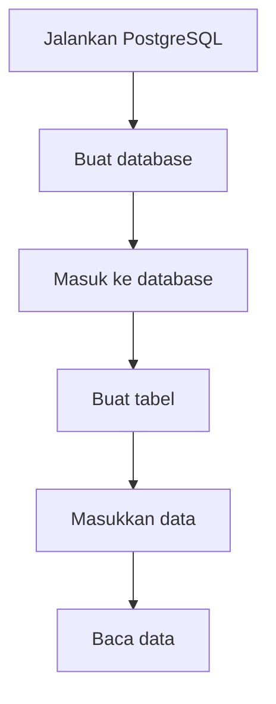

# SQL Basics

!!! note "AI Generated"

    Kartu What's next pada halaman ini disusun dengan bantuan AI.

SQL adalah bahasa untuk berbicara dengan database relasional seperti PostgreSQL.

Kalau backend adalah penerima pesan, database adalah tempat menyimpan catatan.

Dokumentasi:

- [PostgreSQL Documentation](https://www.postgresql.org/docs/current/)
- [PostgreSQL CREATE DATABASE](https://www.postgresql.org/docs/current/sql-createdatabase.html)

## Mengapa PostgreSQL?

PostgreSQL cocok untuk contoh AIoT di materi ini karena data perangkat, sensor, dan riwayat kontrol memiliki hubungan yang jelas. Tipe data, primary key, foreign key, dan constraint membantu menjaga hubungan itu. Transaksi membuat beberapa perubahan dapat berhasil atau dibatalkan sebagai satu kesatuan. SQL juga dipakai backend untuk menyimpan pembacaan dan dashboard untuk mengambil ringkasan.

PostgreSQL cukup untuk mulai belajar dan menyimpan data sensor. TimescaleDB bukan syarat agar PostgreSQL bisa menyimpan time-series; ekstensi itu dibahas nanti untuk membantu mengelola data dan query saat kebutuhan bertambah.

## Instal PostgreSQL di Windows

Unduh installer Windows dari [halaman unduhan PostgreSQL](https://www.postgresql.org/download/windows/). Installer yang disediakan EDB mencakup server PostgreSQL dan pgAdmin. Pilih PostgreSQL 18 agar contoh UUIDv7 bawaan pada materi ini dapat dijalankan. PostgreSQL 18 menambahkan fungsi `uuidv7()` dan `uuidv4()`. [Catatan rilis PostgreSQL 18](https://www.postgresql.org/docs/18/release-18.html)

Saat wizard berjalan:

1. Pilih komponen PostgreSQL Server dan pgAdmin.
2. Simpan password untuk pengguna `postgres`; password ini dipakai saat pgAdmin atau `psql` menghubungkan diri.
3. Gunakan port `5432` jika belum dipakai PostgreSQL lain.
4. Selesaikan instalasi, buka pgAdmin, lalu hubungkan ke server lokal.

Di pgAdmin, pilih server lokal, buka **Tools → Query Tool**, lalu pastikan server merespons:

```sql
SELECT version();
SELECT uuidv7();
```

Jika `uuidv7()` tidak dikenal, periksa versi server dengan `SELECT version();`. Fungsi bawaan ini tersedia mulai PostgreSQL 18. Installer Windows resmi menyediakan pgAdmin; dokumentasi instalasi dan versi yang didukung tersedia di [PostgreSQL Windows installers](https://www.postgresql.org/download/windows/).

## Bentuk Data Database

Database relasional menyimpan data dalam tabel.

```text
sensor_readings
```

| id | device_id | sensor_type | value | recorded_at |
| --- | --- | --- | --- | --- |
| 1 | device-01 | temperature | 28.5 | 2026-05-27 10:00 |

## Urutan dari Nol

Saat memakai PostgreSQL, urutan awalnya biasanya seperti ini:



## Membuat Database

Database adalah wadah besar untuk tabel.

Contoh membuat database:

```sql
CREATE DATABASE aiot_learning;
```

Setelah database dibuat, kamu perlu masuk ke database tersebut.

Jika memakai `psql`, perintahnya:

```bash
psql -d aiot_learning
```

Atau dari dalam `psql`:

```sql
\c aiot_learning
```

## Membuat Tabel

Tabel adalah tempat data disusun dalam baris dan kolom.

Contoh tabel untuk data sensor:

```sql
CREATE TABLE sensor_readings (
  id BIGSERIAL PRIMARY KEY,
  device_id TEXT NOT NULL,
  sensor_type TEXT NOT NULL,
  value DOUBLE PRECISION NOT NULL,
  unit TEXT NOT NULL,
  recorded_at TIMESTAMPTZ NOT NULL DEFAULT now()
);
```

Arti sederhananya:

| Kolom | Fungsi |
| --- | --- |
| `id` | nomor unik setiap baris |
| `device_id` | identitas device |
| `sensor_type` | jenis sensor |
| `value` | nilai sensor |
| `unit` | satuan nilai |
| `recorded_at` | waktu database mencatat baris |

`BIGSERIAL` dipakai di contoh pertama agar fokusnya pada primary key dan query dasar. Untuk data time-series, konvensi KSM AIoT menggunakan UUIDv7; alasan dan batasannya dibahas di [UUIDv4 dan UUIDv7](uuid-identifiers.md).

## Melihat Tabel

Di `psql`, kamu bisa melihat daftar tabel dengan:

```sql
\dt
```

Untuk melihat struktur tabel:

```sql
\d sensor_readings
```

## CRUD

CRUD adalah empat operasi dasar database.

| Operasi | SQL | Fungsi |
| --- | --- | --- |
| Create | `INSERT` | menambah data |
| Read | `SELECT` | membaca data |
| Update | `UPDATE` | mengubah data |
| Delete | `DELETE` | menghapus data |

## Contoh Query

Menambah data:

```sql
INSERT INTO sensor_readings (device_id, sensor_type, value, unit)
VALUES ('device-01', 'temperature', 28.5, 'celsius');
```

Membaca semua data:

```sql
SELECT * FROM sensor_readings;
```

Mengambil data terbaru:

```sql
SELECT *
FROM sensor_readings
ORDER BY recorded_at DESC
LIMIT 10;
```

Mengubah data:

```sql
UPDATE sensor_readings
SET value = 29.0
WHERE id = 1;
```

Menghapus data:

```sql
DELETE FROM sensor_readings
WHERE id = 1;
```

Untuk latihan awal, hati-hati saat memakai `UPDATE` dan `DELETE`. Selalu gunakan `WHERE` agar tidak mengubah atau menghapus semua data.

## Query Ringkasan

Satu perangkat bisa mengirim suhu dan pH. Rata-ratakan hanya baris dengan jenis sensor dan satuan yang sama.

```sql
SELECT device_id, AVG(value) AS average_celsius
FROM sensor_readings
WHERE sensor_type = 'temperature' AND unit = 'celsius'
GROUP BY device_id;
```

## Ambil tiga pembacaan suhu terbaru

Gunakan tabel `sensor_readings` yang didefinisikan pada halaman ini. Untuk memeriksa query, bayangkan tabel berisi baris berikut:

| device_id | sensor_type | value | unit | recorded_at |
| --- | --- | ---: | --- | --- |
| device-01 | temperature | 28.5 | celsius | 2026-05-27 10:00+00 |
| device-01 | temperature | 28.7 | celsius | 2026-05-27 10:01+00 |
| device-01 | temperature | 28.6 | celsius | 2026-05-27 10:02+00 |
| device-01 | humidity | 70 | percent | 2026-05-27 10:03+00 |

Jalankan query ini untuk mengambil tiga pembacaan suhu terbaru:

```sql
SELECT device_id, sensor_type, value, unit, recorded_at
FROM sensor_readings
WHERE device_id = 'device-01'
  AND sensor_type = 'temperature'
ORDER BY recorded_at DESC
LIMIT 3;
```

Urutan hasilnya 10:02 (28.6), 10:01 (28.7), lalu 10:00 (28.5). Filter jenis sensor mencegah suhu tercampur dengan kelembapan.

[Kembali ke Overview Database](overview.md)

## What's next

<div class="ai-resource-grid ai-practice-grid" markdown="1">

[<span class="ai-practice-icon" aria-hidden="true">:lucide-flask-conical:</span> **Database Mini** <span class="ai-practice-description">Uji tabel latihan dan cari baris berdasarkan ID dari respons API.</span>](../hands-on/database-mini.md){ .ai-practice-start }

[<span class="ai-practice-icon" aria-hidden="true">:lucide-database:</span> **Desain Data IoT** <span class="ai-practice-description">Pelajari cara memisahkan metadata perangkat dari pembacaan.</span>](data-modeling.md)

</div>
