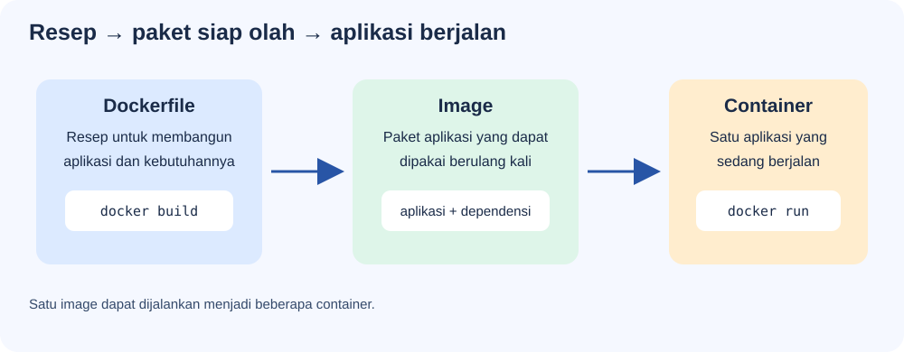

# Docker dan Docker Compose

!!! note "AI Generated"

    Penjelasan Docker dan langkah menjalankan paket aplikasi sensor disusun dengan bantuan AI.

Docker membantu menjalankan aplikasi dengan berkas dan dependensi yang sudah disiapkan. Bayangkan Dockerfile sebagai resep, image sebagai paket siap olah yang dibuat dari resep itu, dan container sebagai satu aplikasi yang berjalan dari paket tersebut.

Docker membaca Dockerfile untuk membangun image. Saat image dijalankan, Docker membuat container; beberapa container dapat dibuat dari image yang sama, seperti beberapa porsi dari satu resep.

Saat aplikasi memiliki beberapa bagian, Docker Compose mengatur container yang perlu berjalan bersama. Pada latihan AIoT, berkas `compose.yaml` menyiapkan layanan `db`, `api`, dan `web`: PostgreSQL menyimpan pembacaan, Express memproses request, dan NGINX menyajikan Vue serta meneruskan request API.



## Siapkan Docker

Pilih cara memasang Docker sesuai sistem operasi. Windows dan macOS memakai Docker Desktop, sedangkan Linux memasang Docker Engine dan Compose dari paket distribusi.

Tab di bawah mengikuti sistem operasi mesin tempat perintah dijalankan. Jika paket dipasang pada server jarak jauh, pilih tab Linux saat menjalankan perintah di server.

=== "Windows"

    Pasang [Docker Desktop untuk Windows](https://docs.docker.com/desktop/setup/install/windows-install/) dengan backend WSL 2, lalu jalankan Docker Desktop.

    ```powershell
    docker compose version
    ```

=== "macOS"

    Pasang [Docker Desktop untuk Mac](https://docs.docker.com/desktop/setup/install/mac-install/), lalu jalankan Docker Desktop.

    ```sh
    docker compose version
    ```

=== "Linux"

    Pasang Docker Engine dan Compose mengikuti panduan untuk [distribusi Linux](https://docs.docker.com/engine/install/).

    ```sh
    docker compose version
    ```

Jika perintah menampilkan versi Compose, Docker siap menjalankan paket latihan.

## Siapkan paket

1. Unduh [paket deployment AIoT](../assets/demos/aiot-deployment.zip).
2. Jika server berada di komputer lain, salin ZIP melalui [SSH](ssh-basics.md#menyalin-file-ke-server) dan jalankan langkah berikut pada server.
3. Ekstrak ZIP dan masuk ke folder `sensor-deployment`.

    === "Windows"

        ```powershell
        Expand-Archive -LiteralPath "$HOME\Downloads\aiot-deployment.zip" -DestinationPath "$HOME\aiot-lab" -Force
        Set-Location "$HOME\aiot-lab\sensor-deployment"
        ```

    === "macOS"

        ```sh
        unzip "$HOME/Downloads/aiot-deployment.zip" -d "$HOME/aiot-lab"
        cd "$HOME/aiot-lab/sensor-deployment"
        ```

    === "Linux"

        ```sh
        unzip "$HOME/Downloads/aiot-deployment.zip" -d "$HOME/aiot-lab"
        cd "$HOME/aiot-lab/sensor-deployment"
        ```

## Bangun image dan jalankan layanan

1. Jika `.env` belum ada, buat berkas itu dengan kata sandi database baru.

    === "Windows"

        ```powershell
        "POSTGRES_PASSWORD=$(openssl rand -hex 24)" | Set-Content -Path .env -Encoding ascii
        ```

    === "macOS"

        ```sh
        umask 077
        printf 'POSTGRES_PASSWORD=%s\n' "$(openssl rand -hex 24)" > .env
        ```

    === "Linux"

        ```sh
        umask 077
        printf 'POSTGRES_PASSWORD=%s\n' "$(openssl rand -hex 24)" > .env
        ```

2. Periksa berkas Compose dengan `docker compose config --quiet`. Perintah Docker Compose di langkah berikut sama di ketiga sistem operasi.
3. Bangun image dan jalankan layanan.

    ```console
    docker compose up -d --build
    ```

4. Periksa status dengan `docker compose ps`.
5. Periksa log API dengan `docker compose logs api`.

Saat build pertama, Docker mengambil base image dan memasang dependensi. Compose menunggu PostgreSQL sehat sebelum membuka API. PostgreSQL menjalankan `schema.sql` ketika volume masih kosong, sehingga tabel `sensor_readings` tersedia pada awal latihan. [Urutan startup Compose](https://docs.docker.com/compose/how-tos/startup-order/) · [Inisialisasi image PostgreSQL](https://hub.docker.com/_/postgres)

API menghubungi PostgreSQL lewat nama layanan `db`. NGINX memakai nama `api` untuk meneruskan request ke Express. Hanya port web 8080 yang dipetakan ke loopback server, sedangkan komunikasi API dan database berlangsung di jaringan Compose. [Jaringan Compose](https://docs.docker.com/compose/how-tos/networking/)

## Periksa container yang menjalankan API

Jalankan `docker compose ps` dan periksa apakah `db` serta `api` berstatus sehat. Jika layanan berhenti, gunakan `docker compose ps -a` untuk menemukannya, lalu baca `docker compose logs db api web` untuk melihat bagian yang gagal.

Jalankan pemeriksaan API dari terminal yang sama.

=== "Windows"

    ```powershell
    curl.exe -i http://127.0.0.1:8080/api/health
    ```

=== "macOS"

    ```sh
    curl -i http://127.0.0.1:8080/api/health
    ```

=== "Linux"

    ```sh
    curl -i http://127.0.0.1:8080/api/health
    ```

Status 200 dengan body `{"status":"ok"}` menunjukkan request sampai ke Express melalui NGINX. Lanjutkan ke [uji dashboard](nginx-basics.md#uji-dashboard-dari-browser) untuk memeriksa satu pembacaan.

Jika port 8080 sudah dipakai, tambahkan `DASHBOARD_PORT=8081` ke `.env` sebelum menjalankan ulang Compose. Gunakan port baru pada alamat server dan pada tujuan SSH tunnel.

## What's next

<div class="ai-resource-grid ai-practice-grid" markdown="1">

[<span class="ai-practice-icon" aria-hidden="true">:lucide-network:</span> **NGINX untuk Reverse Proxy** <span class="ai-practice-description">Uji halaman Vue dan endpoint API melalui satu alamat.</span>](nginx-basics.md){ .ai-practice-start }

[<span class="ai-practice-icon" aria-hidden="true">:lucide-panels-top-left:</span> **Portainer** <span class="ai-practice-description">Jika penasaran pengelolaan lewat web, baca status dan log container pada dashboard admin.</span>](portainer.md)

</div>
