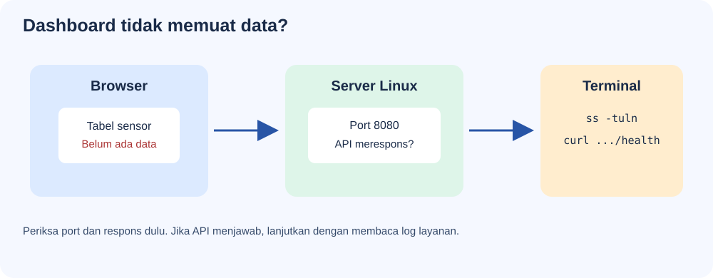

# Linux Basics for Deployment

!!! note "AI Generated"

    Pembuka, pemeriksaan port, dan jalur ke SSH diperbarui dengan bantuan AI.

Linux adalah sistem operasi yang menjalankan program dan mengatur berkas serta jaringan komputer. Di server, kita memakai terminal untuk meminta informasi dari sistem, misalnya proses apa yang aktif atau port mana yang menerima koneksi.

Perintah Linux berguna ketika aplikasi berjalan di komputer yang tidak berada di depan kita. Hasil perintah membantu mempersempit pemeriksaan: apakah layanan aktif, apakah port terbuka, atau apakah server memberi respons.

Di latihan AIoT, dashboard yang gagal memuat data memberi kita pertanyaan awal: apakah server membuka port web dan menjawab request? Kita akan memakai terminal untuk memeriksa port dan respons API sebelum membaca log layanan.

Perintah pada halaman ini dijalankan di server Linux. Jika laptop memakai Windows atau macOS, masuk ke server lewat [SSH](ssh-basics.md) terlebih dahulu.

## Kenapa perlu belajar Linux?

Pemeriksaan server sering dimulai dari satu pertanyaan, misalnya apakah aplikasi sudah membuka port. Linux menyediakan alat untuk memeriksa proses dan port, sehingga kita bisa menentukan apakah perlu membaca log aplikasi atau mengecek jaringan.

## Konsep dasar yang perlu dipahami

- File system: struktur folder seperti `/home`, `/etc`, `/var`, `/opt`.
- User dan permission: siapa yang boleh baca, tulis, dan eksekusi file.
- Service: aplikasi yang berjalan di background (misal NGINX, database, backend).
- Networking dasar: port, IP, dan koneksi antar-service.

## Command Linux yang sering dipakai

| Kebutuhan | Command |
| --- | --- |
| Cek lokasi saat ini | `pwd` |
| Lihat isi folder | `ls -la` |
| Pindah folder | `cd /path/tujuan` |
| Buat folder | `mkdir nama-folder` |
| Salin file/folder | `cp -r sumber tujuan` |
| Pindah/rename file | `mv lama baru` |
| Hapus file | `rm nama-file` |
| Hapus folder | `rm -r nama-folder` |
| Lihat isi file | `cat nama-file` |
| Edit file via terminal | `nano nama-file` |

## Command untuk monitoring server

| Kebutuhan | Command |
| --- | --- |
| Lihat proses berjalan | `ps aux` |
| Monitor proses real-time | `top` |
| Lihat penggunaan disk | `df -h` |
| Lihat ukuran folder/file | `du -sh *` |
| Cek memory | `free -h` |
| Cek port yang aktif | `ss -tuln` |

## Command service (systemd)

| Kebutuhan | Command |
| --- | --- |
| Cek status service | `sudo systemctl status nginx` |
| Menjalankan service | `sudo systemctl start nginx` |
| Menghentikan service | `sudo systemctl stop nginx` |
| Restart service | `sudo systemctl restart nginx` |
| Aktif saat boot | `sudo systemctl enable nginx` |

## Tips praktik untuk pemula

- Biasakan cek posisi folder dengan `pwd` sebelum menjalankan command.
- Gunakan `ls -la` untuk memastikan file yang akan diubah benar.
- Hati-hati dengan `rm -r` karena bisa menghapus banyak file sekaligus.
- Simpan konfigurasi penting dan lakukan backup sebelum edit.

## Periksa API dari server

Jika dashboard gagal mengambil data, masuk ke server lewat [SSH](ssh-basics.md). Jalankan `ss -tuln` dan cari port web latihan 8080. Jika port sudah dibuka oleh stack, kirim `curl -i http://127.0.0.1:8080/api/health` dari server untuk melihat respons Express melalui NGINX.

Jika hasilnya 200 dengan body `{"status":"ok"}`, jalur dari server ke API sudah merespons. Jika port belum terlihat, periksa [status layanan Compose](docker-container.md#periksa-container-yang-menjalankan-api) dari folder latihan.

## What's next

[:lucide-terminal: **SSH Basics** Masuk ke server dan salin berkas latihan dari laptop.](ssh-basics.md){ .ai-practice-start }

