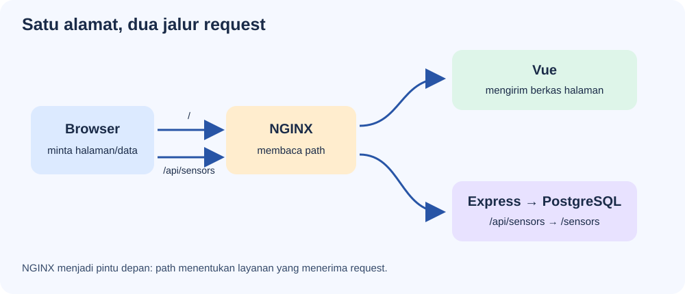

# NGINX untuk Reverse Proxy

!!! note "AI Generated"

    Penjelasan jalur request dan uji deployment dari browser disusun dengan bantuan AI.

NGINX menerima request dari browser lalu memilih cara menjawabnya. NGINX dapat mengirim berkas web secara langsung atau meneruskan request ke aplikasi lain; peran kedua ini disebut *reverse proxy*.

Situs web sering memakai satu alamat untuk halaman dan data. Browser meminta halaman dari alamat itu, lalu memakai alamat yang sama untuk mengambil data; NGINX melihat path request untuk memilih layanan yang tepat.

Pada latihan AIoT, NGINX menyajikan halaman Vue saat browser meminta `/`. Saat browser meminta `/api/sensors`, NGINX meneruskannya ke Express sebagai `/sensors`, lalu Express mengambil data dari PostgreSQL.

## Uji path yang diterima backend

Buka [nginx.conf pada paket](../assets/demos/sensor-deployment/nginx.conf) untuk menemukan blok `location /api/`. Pada `proxy_pass http://api:8000/;`, URI `/` di akhir mengganti awalan `/api/`. Karena itu request `/api/health` tiba di Express sebagai `/health`. [Aturan URI pada proxy_pass](https://nginx.org/en/docs/http/ngx_http_proxy_module.html#proxy_pass)

Jalankan `docker compose exec web nginx -t` dari folder deployment di server untuk memeriksa sintaks. Jika hasil curl memberi 404, periksa path yang diteruskan. Jika mendapat 502, jalankan `docker compose logs web api` untuk memeriksa apakah NGINX dapat menghubungi API.

## Uji dashboard dari browser

1. Jalankan [SSH tunnel](ssh-basics.md#buka-akses-browser-lewat-ssh-tunnel) dari terminal laptop.
2. Buka `http://127.0.0.1:8080/` di browser.
3. Kirim [payload sensor](../hands-on/backend-mini.md#kirim-post-dengan-json) lewat Postman ke `http://127.0.0.1:8080/api/sensors`.
4. Catat `data.id` dari respons 201.
5. Klik **Muat ulang** di dashboard.
6. Cocokkan ID, nilai, dan satuan dengan isi respons POST.

Jika browser berada di mesin Linux yang sama, buka alamat latihan langsung. Pada server jarak jauh, biarkan tunnel aktif selama pengujian karena koneksi browser bergantung pada sesi itu.

Jika ingin mengakhiri latihan di sini, jalankan `docker compose down` dari folder deployment di server. Perintah itu menghentikan container, sementara volume database tetap tersedia saat stack dijalankan lagi. Jika ingin lanjut memeriksa stack di Portainer atau Beszel, biarkan container latihan berjalan. [Dokumentasi compose down](https://docs.docker.com/reference/cli/docker/compose/down/)

## What's next

[:lucide-panels-top-left: **Portainer** Kelola stack dan baca log Docker lewat antarmuka web.](portainer.md){ .ai-practice-start }

[:lucide-activity: **Beszel** Amati riwayat CPU dan memori server serta container.](beszel.md)

[:lucide-chart-line: **Prometheus + Grafana** Ikuti perjalanan metrik CPU dan memori sampai tampil sebagai grafik.](prometheus-grafana.md)

