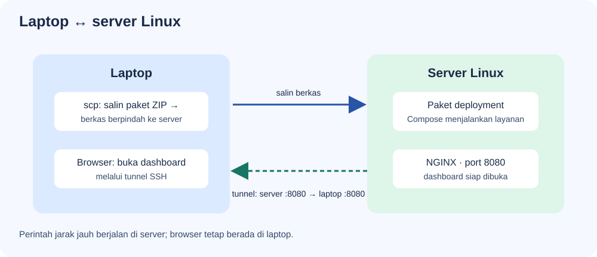

# SSH Basics untuk Deployment

!!! note "AI Generated"

    Pembuka, pemindahan paket latihan, dan akses melalui SSH tunnel disusun dengan bantuan AI.

SSH atau **Secure Shell** membuka koneksi terenkripsi dari laptop ke komputer lain. Setelah login berhasil, perintah yang kita ketik di terminal laptop dijalankan pada server.

Pengelola sistem memakai SSH untuk memeriksa server dan memindahkan berkas. Koneksi yang sama juga dapat meneruskan satu port ke laptop, sehingga browser lokal dapat membuka layanan yang berjalan di server.

Di latihan AIoT, kita menyalin paket deployment ke server, menjalankan Docker Compose di sana, lalu membuka tunnel ke dashboard. Browser tetap berada di laptop, sementara aplikasi berjalan di server Linux.

## Kenapa Perlu SSH?

Saat aplikasi sudah diletakkan di VPS atau server cloud, kita tidak lagi membuka foldernya seperti di laptop.

Biasanya kita masuk ke server dengan pola seperti ini:



## Bentuk Command SSH

OpenSSH tersedia di Windows, macOS, dan Linux, sehingga perintah koneksi di halaman ini sama pada ketiga sistem. Setelah login, perintah yang dijalankan di sesi server mengikuti lingkungan server Linux.

Format paling umum:

```bash
ssh username@server_ip
```

Contoh:

```bash
ssh ubuntu@203.0.113.10
```

Artinya:

- `ssh` adalah command untuk membuka koneksi,
- `ubuntu` adalah username di server,
- `203.0.113.10` adalah alamat IP server.

Jika berhasil, terminal kamu akan masuk ke server. Command yang kamu jalankan setelah itu berjalan di server, bukan lagi di laptop.

## Password dan SSH Key

Ada dua cara umum untuk login SSH:

| Cara login | Penjelasan |
| --- | --- |
| Password | masuk dengan password user server |
| SSH key | masuk dengan pasangan private key dan public key |

Untuk belajar awal, password lebih mudah dipahami.

Untuk penggunaan serius, SSH key lebih disarankan karena lebih aman dan tidak perlu mengetik password setiap kali login.

## Membuat SSH Key

Di laptop, kamu bisa membuat key dengan:

```bash
ssh-keygen -t ed25519 -C "nama-atau-email"
```

Biasanya key tersimpan di:

```text
~/.ssh/id_ed25519
~/.ssh/id_ed25519.pub
```

Perbedaan penting:

- `id_ed25519` adalah private key, simpan baik-baik dan jangan dibagikan.
- `id_ed25519.pub` adalah public key, boleh ditempatkan di server.

## Menyalin Public Key ke Server

Jika server mendukung `ssh-copy-id`, kamu bisa menjalankan:

```bash
ssh-copy-id username@server_ip
```

Contoh:

```bash
ssh-copy-id ubuntu@203.0.113.10
```

Setelah itu, coba login:

```bash
ssh ubuntu@203.0.113.10
```

Kalau berhasil tanpa password, SSH key sudah bekerja.

## Menggunakan File Key Tertentu

Kadang key tidak memakai nama default.

Gunakan opsi `-i`:

=== "Windows"

    ```powershell
    ssh -i "$HOME\.ssh\aiot-server" ubuntu@203.0.113.10
    ```

=== "macOS"

    ```sh
    ssh -i ~/.ssh/aiot-server ubuntu@203.0.113.10
    ```

=== "Linux"

    ```sh
    ssh -i ~/.ssh/aiot-server ubuntu@203.0.113.10
    ```

## Port SSH

Port default SSH adalah `22`.

Jika server memakai port lain, gunakan opsi `-p`:

```bash
ssh -p 2222 ubuntu@203.0.113.10
```

Perhatikan hurufnya:

- `ssh -p` untuk port SSH,
- `scp -P` untuk port saat menyalin file dengan `scp`.

## Menyalin File ke Server

Untuk menyalin file dari laptop ke server, kamu bisa memakai `scp`.

```bash
scp file.txt username@server_ip:/home/username/
```

Contoh:

```bash
scp docker-compose.yml ubuntu@203.0.113.10:/home/ubuntu/app/
```

Untuk folder, tambahkan `-r`:

```bash
scp -r folder-app ubuntu@203.0.113.10:/home/ubuntu/
```

### Salin paket latihan AIoT

1. Unduh [paket deployment AIoT](../assets/demos/aiot-deployment.zip) ke laptop.
2. Buat folder `Downloads` pada server.

    ```bash
    ssh ubuntu@203.0.113.10 "mkdir -p ~/Downloads"
    ```

3. Buka terminal laptop di folder unduhan dan salin paket ke server.

    ```bash
    scp aiot-deployment.zip ubuntu@203.0.113.10:~/Downloads/
    ```

Ganti `ubuntu` dan `203.0.113.10` dengan akun serta alamat server latihan. Setelah login, jalankan `ls ~/Downloads/aiot-deployment.zip` untuk memastikan berkas sampai.

## Buka akses browser lewat SSH tunnel

Stack latihan menyediakan NGINX pada port 8080 di loopback server. Penerusan port SSH menghubungkan port laptop dengan port server itu, sehingga browser di laptop bisa mengaksesnya melalui koneksi SSH. [Penerusan port lokal OpenSSH](https://man.openbsd.org/ssh#L)

1. Buka terminal baru di laptop.
2. Jalankan perintah berikut dengan akun SSH server latihan.

    ```bash
    ssh -N -o ExitOnForwardFailure=yes -L 127.0.0.1:8080:127.0.0.1:8080 ubuntu@203.0.113.10
    ```

3. Buka `http://127.0.0.1:8080/` setelah stack berjalan.
4. Tutup tunnel dengan `Ctrl+C` setelah selesai.

Alamat loopback pertama mengacu ke laptop. Alamat loopback kedua mengacu ke server. Jika hanya port laptop yang bentrok, ubah angka pertama menjadi 8081 dan buka `http://127.0.0.1:8081/`.

## Command yang Sering Dipakai Setelah Login

Setelah masuk ke server lewat SSH, biasanya kamu akan menjalankan command Linux seperti:

```bash
pwd
ls -la
cd app
git pull
docker ps
docker compose up -d
sudo systemctl status nginx
```

Jika prompt terminal berubah menjadi nama server, itu tanda kamu sedang bekerja di server.

## Error yang Sering Muncul

| Error | Kemungkinan penyebab | Yang bisa dicek |
| --- | --- | --- |
| `Connection timed out` | IP salah, server mati, firewall menutup port | cek IP, status VPS, security group/firewall |
| `Connection refused` | service SSH tidak berjalan atau port salah | cek port SSH dan service `sshd` |
| `Permission denied` | username, password, atau key salah | cek username dan key yang dipakai |
| `WARNING: REMOTE HOST IDENTIFICATION HAS CHANGED` | fingerprint server berubah | pastikan server benar sebelum menghapus known host |

Jangan langsung menghapus warning keamanan tanpa memastikan server yang kamu akses benar.

## Tips Aman

- Jangan bagikan private key.
- Jangan pakai password yang sama untuk banyak server.
- Gunakan user biasa, lalu `sudo` saat butuh akses admin.
- Tutup port yang tidak diperlukan.
- Catat IP, username, port, dan lokasi key yang dipakai tim.

## Quick Check

Sebelum deploy, pastikan kamu tahu:

- IP server,
- username server,
- cara login: password atau SSH key,
- port SSH,
- folder aplikasi di server,
- command untuk mengecek service.

## Bedakan akses SSH dan status NGINX

Dua pemeriksaan ini menjawab pertanyaan yang berbeda. Contoh keluaran berikut bersifat ilustrasi:

```text
$ ssh ubuntu@server
ubuntu@server:~$
```

Prompt `ubuntu@server` menunjukkan sesi SSH berhasil masuk ke server. Ini belum membuktikan NGINX aktif.

```text
$ sudo systemctl status nginx
● nginx.service - A high performance web server
   Active: active (running)
```

`Active: active (running)` menunjukkan service NGINX sedang berjalan. Jika tertulis `inactive` atau `failed`, NGINX tidak sedang berjalan dengan normal. Service yang aktif juga belum membuktikan dashboard dapat mencapai backend; untuk itu periksa konfigurasi dan log aplikasi secara terpisah.

[Kembali ke Deployment Overview](overview.md)

## What's next

<div class="ai-resource-grid ai-practice-grid" markdown="1">

[<span class="ai-practice-icon" aria-hidden="true">:lucide-container:</span> **Docker dan Compose** <span class="ai-practice-description">Ekstrak paket di server dan jalankan tiga layanan latihan.</span>](docker-container.md){ .ai-practice-start }

</div>
