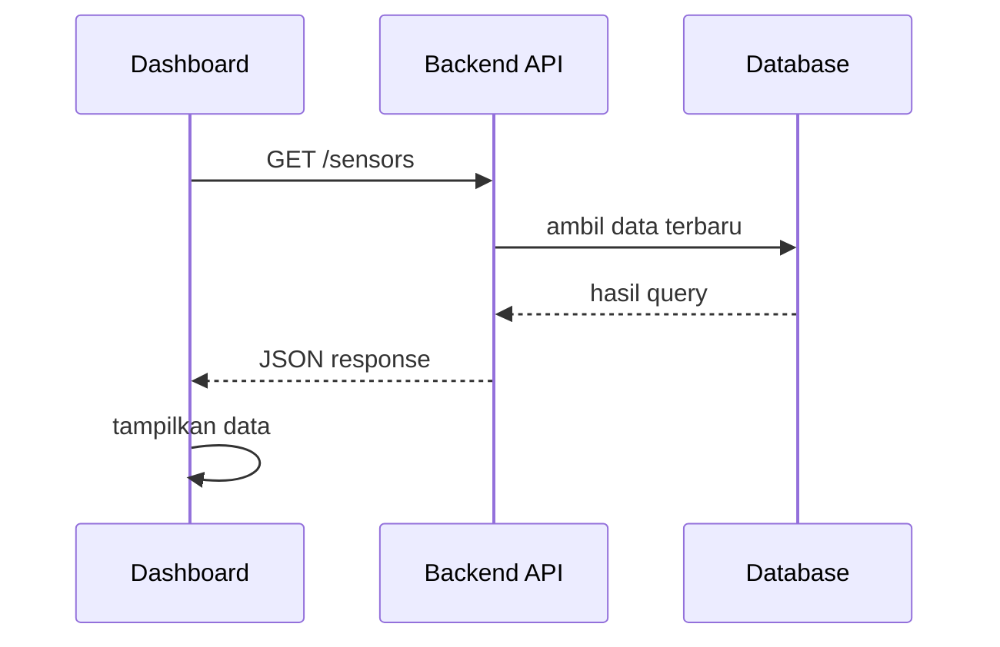

# Integrasi Frontend dengan API

!!! note "AI Generated"

    Pembuka, contoh Fetch, dan pemeriksaan kondisi halaman disusun dengan bantuan AI.

Integrasi API memungkinkan frontend meminta data dari server dan memperbarui tampilan setelah respons tiba. Antarmuka memeriksa status HTTP sebelum memakai isi respons, sehingga bisa menampilkan keadaan yang sesuai saat data diterima atau terjadi masalah.

Saat membuka riwayat pesanan, browser dapat menampilkan pesan memuat sambil menunggu daftar tiba. Respons yang berhasil tetapi kosong akan memicu pesan yang berbeda dari permintaan yang gagal.

Di proyek AIoT, dashboard mengambil pembacaan dengan `GET /sensors`. Ketika tabel menampilkan ID dari respons POST, peserta dapat menelusuri pembacaan yang sama kembali ke PostgreSQL.

## Alur Dasar



## Hal yang Perlu Disiapkan

Sebelum frontend memanggil API, pastikan:

- backend sedang berjalan,
- endpoint benar,
- response berbentuk JSON,
- CORS sudah diizinkan jika frontend dan backend beda port.

## Fetch Data

Contoh sederhana:

```js
const response = await fetch("http://127.0.0.1:8000/sensors");
if (!response.ok) throw new Error(`HTTP ${response.status}`);
const sensors = await response.json();
```

Setelah [Dashboard Hands-on](../hands-on/dashboard-hands-on.md), endpoint `GET /sensors` mengembalikan array pembacaan terbaru. Pemanggilan `response.json()` membaca body JSON menjadi data JavaScript. Dalam contoh ini bentuknya array, termasuk `[]` saat tabel kosong.

## Loading, Error, dan Empty

Integrasi API tidak selalu sukses.

Karena itu UI perlu menyiapkan beberapa kondisi:

```text
mulai request -> loading
request sukses + data ada -> tampilkan data
request sukses + data kosong -> tampilkan empty state
request gagal -> tampilkan error
```

## CORS

CORS adalah aturan keamanan browser.

Kalau frontend berjalan di `127.0.0.1:5500` dan backend berjalan di `127.0.0.1:8000`, browser menganggap keduanya berbeda asal.

Jika backend belum mengizinkan frontend, browser bisa menolak request.

## Lacak klik sampai pesan tampil

Gunakan tombol **Cek Backend** pada [Frontend Mini](../hands-on/frontend-mini.md). Klik memanggil `loadHealth()`, lalu fungsi menjalankan `fetch` ke `http://127.0.0.1:8000/health`.

Coba dua keadaan berikut:

| Keadaan | Yang terlihat di elemen `output` |
| --- | --- |
| Backend Mini berjalan | `{"status":"ok"}` setelah request selesai |
| Backend tidak berjalan atau alamat tidak bisa dijangkau | `Gagal mengambil data dari backend.` |

Saat request dimulai, teks berubah menjadi `Mengambil data...`. Contoh ini memeriksa `response.ok`. Sambungan yang gagal dan kode HTTP gagal seperti `404` berakhir di blok `catch`.

Setelah cek koneksi berhasil, coba [empat kondisi dashboard Vue](../hands-on/dashboard-hands-on.md#coba-kondisi-halaman). Bandingkan pesan saat memuat, saat daftar kosong, saat pembacaan tampil, dan saat API gagal dihubungi.

[Kembali ke Overview Frontend](overview.md)

## What's next

<div class="ai-resource-grid ai-practice-grid" markdown="1">

[<span class="ai-practice-icon" aria-hidden="true">:lucide-layout-dashboard:</span> **Jalur Praktik Frontend** <span class="ai-practice-description">Urutkan cek koneksi, latihan komponen, dan praktik dashboard.</span>](fundamental.md){ .ai-practice-start }

[<span class="ai-practice-icon" aria-hidden="true">:lucide-flask-conical:</span> **Dashboard Hands-on** <span class="ai-practice-description">Coba kondisi memuat, kosong, berhasil, dan gagal pada Vue.</span>](../hands-on/dashboard-hands-on.md)

</div>
