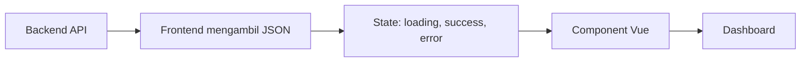

# Frontend Development

!!! note "AI Generated"

    Pembuka dan jalur dari cek API ke dashboard Vue disusun dengan bantuan AI.

Frontend adalah bagian aplikasi yang dilihat dan dipakai pengguna. Saat pengguna membuka halaman atau menekan tombol, frontend dapat meminta data, lalu memperbarui tampilan berdasarkan respons server.

Pada aplikasi toko, halaman riwayat pesanan mengambil data dari API dan menampilkannya sebagai daftar. Jika daftar kosong atau server gagal merespons, antarmuka menunjukkan pesan yang berbeda karena tindakan pengguna berikutnya juga berbeda.

Di proyek AIoT, alur yang sama dipakai untuk menampilkan pembacaan sensor. Coba sambungan awal lewat `/health`, lalu muat `/sensors` dari Vue untuk melihat ID, nilai, satuan, dan waktu simpan.

## Alur Besar

## Urutan Belajar yang Disarankan

1. [Web Basics](web-basics.md)
2. [JavaScript untuk Frontend](javascript.md)
3. [TypeScript untuk Frontend](typescript.md)
4. [Vue Basics](vue-basics.md)
5. [Integrasi Frontend dengan API](api-integration.md)
6. [Jalur Praktik Frontend](fundamental.md)
7. [Frontend Mini](../hands-on/frontend-mini.md) untuk memeriksa koneksi browser ke API.
8. [Dashboard Hands-on](../hands-on/dashboard-hands-on.md#jalankan-dashboard-vue) untuk mencocokkan data Vue dengan respons Express dan baris PostgreSQL.

## Capaian Belajar

- Memahami peran HTML, CSS, dan JavaScript.
- Memahami alasan TypeScript dipakai di proyek yang butuh tipe data lebih jelas.
- Memahami component, props, event, dan state di Vue.
- Mengambil data dari API.
- Menampilkan loading, error, dan empty state.
- Membaca struktur folder frontend tanpa tersesat.

[Kembali ke Home](../index.md)

## What's next

[:lucide-code-xml: **Web Basics untuk Dashboard** Kenali peran HTML, CSS, dan JavaScript saat halaman menampilkan respons.](web-basics.md){ .ai-practice-start }

[:lucide-flask-conical: **Dashboard Hands-on** Jalankan Express dan Vue untuk melihat ID pembacaan yang sama.](../hands-on/dashboard-hands-on.md)

