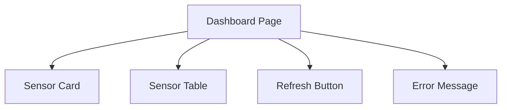

# Vue Basics

!!! note "AI Generated"

    Jalur dari contoh komponen ke dashboard dengan API disusun dengan bantuan AI.

Vue membantu kita membangun antarmuka dari potongan bernama **component**. Sebuah komponen memuat tampilan dan perilaku untuk satu bagian halaman. Ketika data komponen berubah, Vue memperbarui bagian yang memakainya.

Pada halaman katalog, tim dapat memakai komponen kartu yang sama untuk setiap produk. Tiap kartu menerima nama dan harga yang berbeda melalui data dari halaman induk.

Dashboard AIoT memakai pola itu untuk pembacaan sensor. Halaman dapat meneruskan satu pembacaan ke kartu, sementara daftar dari API ditampilkan sebagai tabel.

## Kenapa Pakai Component?

Kalau dashboard makin besar, satu file akan sulit dirawat.

Dengan component, kita bisa memecah tampilan menjadi bagian kecil.



## Data Reaktif

Di Vue, data yang berubah bisa otomatis memperbarui tampilan.

Contoh ide sederhananya:

```text
data berubah -> Vue memperbarui UI
```

Karena itu Vue cocok untuk dashboard yang datanya sering berubah.

## Props

Props adalah data yang dikirim dari component induk ke component anak.

Misalnya halaman dashboard punya data sensor, lalu mengirim satu item sensor ke `SensorCard`.

```text
Dashboard -> SensorCard
```

## Event

Event adalah sinyal dari component anak ke component induk.

Contoh:

```text
RefreshButton diklik -> Dashboard mengambil data lagi
```

## Lifecycle

Lifecycle adalah momen ketika component dibuat, muncul di halaman, diperbarui, atau dihapus.

Untuk pemula, cukup ingat satu pola:

> Saat halaman dibuka, ambil data awal dari backend.

## Ikuti data halaman ke prop komponen

Gunakan dua komponen berikut untuk melihat satu nilai diteruskan dari halaman ke komponen anak. Setelah mengenal props, coba [Dashboard Hands-on](../hands-on/dashboard-hands-on.md#jalankan-dashboard-vue) untuk menjalankan Vue dengan data yang dibaca dari API.

`Dashboard.vue`:

```vue
<script setup lang="ts">
import SensorCard from "./SensorCard.vue";

const reading = { deviceId: "esp32-01", value: 28.5 };
</script>

<template>
  <SensorCard :device-id="reading.deviceId" :value="reading.value" />
</template>
```

`SensorCard.vue`:

```vue
<script setup lang="ts">
defineProps<{ deviceId: string; value: number }>();
</script>

<template>
  <p>{{ deviceId }}: {{ value }} °C</p>
</template>
```

Ikuti `reading.value` dari halaman ke prop `value`; komponen menampilkannya sebagai `28.5 °C`. Atribut `:device-id` diterima sebagai prop `deviceId`.

[Kembali ke Overview Frontend](overview.md)

## What's next

<div class="ai-resource-grid ai-practice-grid" markdown="1">

[<span class="ai-practice-icon" aria-hidden="true">:lucide-layout-dashboard:</span> **Integrasi Frontend dengan API** <span class="ai-practice-description">Muat data dari Express dan tampilkan keadaan yang sesuai dengan respons.</span>](api-integration.md){ .ai-practice-start }

</div>
