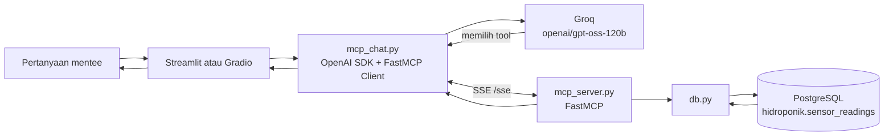

# Praktik MCP dengan Chat Sensor PostgreSQL

Demo ini menjawab pertanyaan tentang pembacaan hidroponik yang tersimpan di PostgreSQL. Saat pertanyaan memerlukan data, model Groq memilih tool MCP, server menjalankan query, lalu hasilnya kembali ke chat.

Streamlit menjadi antarmuka utama dan Gradio menyediakan pilihan lain. Database PostgreSQL lokal dipakai khusus untuk latihan ini, sehingga tabel contoh berada di skema `hidroponik`.

## Alur aplikasi



Di sini, model hanya meminta data lewat tool yang tersedia. `mcp_server.py` menjalankan tiga operasi baca, sedangkan `seed_db.py` menyiapkan data contoh dan dapat dijalankan ulang tanpa menambah baris duplikat.

## Kenali berkas proyek

Tekan tombol untuk menyusun dan mengunduh ZIP berisi semua berkas latihan. Script mengambil berkas pada tabel dari situs lalu menyusunnya di browser. Tabel juga menyediakan tautan tiap berkas jika ingin mengambilnya satu per satu.

<a class="md-button" id="download-mcp-zip" href="#download-mcp-zip">Unduh file Zip</a>
<p id="mcp-zip-status" role="status" aria-live="polite"></p>

| Berkas | Peran |
| --- | --- |
| [`db.py`](../assets/ai-labs/mcp-postgresql-chat/db.py) | Membuka koneksi PostgreSQL dari `DATABASE_URL` dan menyiapkan nilai agar dapat dikirim sebagai JSON. |
| [`seed_db.py`](../assets/ai-labs/mcp-postgresql-chat/seed_db.py) | Membuat skema, tabel, indeks, lalu mengisi 12 pembacaan contoh. |
| [`mcp_server.py`](../assets/ai-labs/mcp-postgresql-chat/mcp_server.py) | Menyediakan tool `list_tables`, `get_data_summary`, dan `get_latest_reading` melalui SSE. |
| [`mcp_chat.py`](../assets/ai-labs/mcp-postgresql-chat/mcp_chat.py) | Menghubungkan model Groq ke daftar tool MCP dan menjalankan tool yang dipilih. |
| [`streamlit_app.py`](../assets/ai-labs/mcp-postgresql-chat/streamlit_app.py) | Menyediakan UI chat utama dan kolom endpoint MCP. |
| [`gradio_app.py`](../assets/ai-labs/mcp-postgresql-chat/gradio_app.py) | Menyediakan UI chat alternatif dengan endpoint dan pertanyaan contoh. |
| [`.env.example`](../assets/ai-labs/mcp-postgresql-chat/env.example) | Menyediakan format konfigurasi tanpa menyertakan API key. |
| [`.gitignore`](../assets/ai-labs/mcp-postgresql-chat/gitignore.template) | Mengabaikan `.env` dan berkas lokal lain saat Git dipakai. |

## Siapkan proyek Python

Siapkan `uv`, Python 3.13, PostgreSQL lokal, dan `psql`. Pastikan PostgreSQL berjalan sebelum membuat role latihan.

1. Buat folder proyek.

    === "Windows"

        ```powershell
        mkdir pertemuan-6
        ```

    === "macOS"

        ```sh
        mkdir pertemuan-6
        ```

    === "Linux"

        ```sh
        mkdir pertemuan-6
        ```

2. Masuk ke folder proyek.

    ```console
    cd pertemuan-6
    ```

3. Inisialisasi proyek dengan Python 3.13.

    ```console
    uv init --no-package --python 3.13
    ```

4. Ekstrak ZIP ke folder proyek.

    === "Windows"

        ```powershell
        Expand-Archive -LiteralPath "$env:USERPROFILE\Downloads\mcp-postgresql-chat.zip" -DestinationPath . -Force
        ```

    === "macOS"

        ```sh
        unzip -o ~/Downloads/mcp-postgresql-chat.zip -d .
        ```

    === "Linux"

        ```sh
        unzip -o ~/Downloads/mcp-postgresql-chat.zip -d .
        ```

Sesuaikan lokasi ZIP jika browser menyimpannya di folder lain.

5. Pasang dependensi yang dipakai aplikasi.

    ```console
    uv add "fastmcp>=4.2.2" "gradio>=6.32.0" "openai>=3.57.0" "psycopg[binary]>=3.3.9" "python-dotenv>=1.2.4" "streamlit>=1.67.0"
    ```

Perintah `uv add` mencatat dependensi ke `pyproject.toml` dan `uv.lock`. README proyek memakai `uv sync` karena kedua berkas tersebut sudah tersedia di checkout proyek.

## Siapkan PostgreSQL khusus latihan

Buat role dan database lokal untuk demo. Kredensial contoh ini hanya untuk komputer latihan; jangan gunakan pada server produksi.

1. Buka prompt PostgreSQL sebagai admin.

    ```console
    psql -U postgres -d postgres
    ```

2. Buat role latihan dan database.

    ```sql
    CREATE ROLE demopertemuan6 LOGIN PASSWORD 'mcpdemo6';
    CREATE DATABASE hidroponik_demo OWNER demopertemuan6;
    ```

Jalankan `CREATE DATABASE` sebagai perintah terpisah di prompt `psql`, karena PostgreSQL tidak mengizinkannya di dalam transaksi. Jika role dan database sudah ada, gunakan kembali keduanya.

3. Keluar dari prompt PostgreSQL.

    ```sql
    \q
    ```

4. Salin `.env.example` menjadi `.env`.

    === "Windows"

        ```powershell
        cp .env.example .env
        ```

    === "macOS"

        ```sh
        cp .env.example .env
        ```

    === "Linux"

        ```sh
        cp .env.example .env
        ```

5. Isi `LLM_API_KEY` pada `.env` dengan API key Groq yang tersedia.

`.env.example` sudah memuat URL database untuk role dan database latihan. Jika port atau kredensial berbeda, sesuaikan `DATABASE_URL` sebelum menjalankan script.

## Isi database dengan data contoh

Jalankan seeder dari folder proyek.

```console
uv run python seed_db.py
```

Seeder membuat skema `hidroponik`, tabel `sensor_readings`, indeks waktu, dan 12 pembacaan. Setiap pembacaan memakai `sample_key` tetap, sehingga menjalankan seeder lagi akan memperbarui baris yang sama.

## Jalankan server MCP

Buka terminal pertama pada folder proyek dan jalankan server.

```console
uv run python mcp_server.py
```

Server membuka endpoint SSE `http://127.0.0.1:8000/sse`. Tool `list_tables` menemukan tabel, `get_data_summary` merangkum rentang jam, dan `get_latest_reading` membaca baris terbaru.

## Coba chat dengan Streamlit

Buka terminal kedua pada folder proyek dan jalankan antarmuka utama.

```console
uv run streamlit run streamlit_app.py
```

Buka alamat lokal yang ditampilkan Streamlit. Sidebar sudah memakai endpoint MCP lokal; ubah nilainya hanya jika server berjalan di alamat lain.

| Pertanyaan contoh | Tool yang seharusnya dipakai |
| --- | --- |
| “Tabel apa saja yang tersedia?” | `list_tables` |
| “Rangkum data sensor 12 jam terakhir.” | `get_data_summary(hours=12)` |
| “Berapa nilai pH dan EC pada data terbaru?” | `get_latest_reading` |

Model dapat memilih tool berdasarkan isi pertanyaan. Jika Groq atau server MCP gagal dihubungi, UI menampilkan pesan error untuk membantu memeriksa API key, endpoint, dan koneksi PostgreSQL.

### Coba antarmuka Gradio

Gradio memakai fungsi chat dan koneksi MCP yang sama. Hentikan Streamlit dengan `Ctrl+C`, lalu jalankan:

```console
uv run python gradio_app.py
```

Buka alamat lokal yang ditampilkan Gradio. Gunakan kolom endpoint untuk memastikan UI mengarah ke `http://127.0.0.1:8000/sse`.

## Cocokkan hasil dengan PostgreSQL

Buka prompt PostgreSQL sebagai role latihan.

```console
psql -U demopertemuan6 -d hidroponik_demo
```

Jika `psql` meminta kata sandi, masukkan nilai yang sama dengan `DATABASE_URL`.

Periksa jumlah baris dan pembacaan terbaru. Jumlah awal seharusnya 12, dan nilai terbaru harus cocok dengan jawaban tool.

```sql
SELECT count(*) AS jumlah
FROM hidroponik.sensor_readings;

SELECT recorded_at, ph, ec_ms_cm
FROM hidroponik.sensor_readings
ORDER BY recorded_at DESC
LIMIT 1;
```

Keluar dari prompt `psql` dengan `\q`. Hentikan UI dan server MCP di terminal masing-masing dengan `Ctrl+C`; data tetap tersimpan di database lokal.

## What's next

<div class="ai-resource-grid ai-practice-grid" markdown="1">

[<span class="ai-practice-icon" aria-hidden="true">:lucide-brain-circuit:</span> **MCP** <span class="ai-practice-description">Lihat peran host, client, server, tool, dan transport yang dipakai chat ini.</span>](../ai/ai-systems/mcp.md){ .ai-practice-start }

</div>
