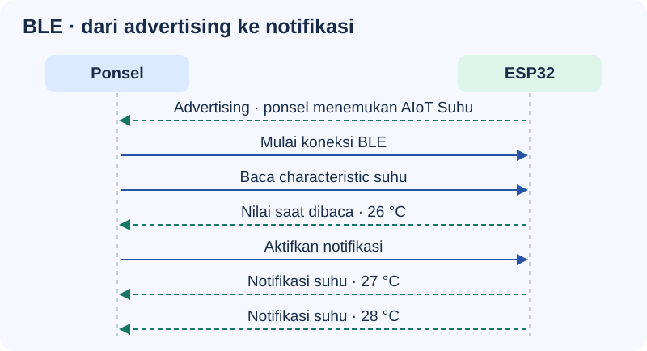

# BLE (Bluetooth Low Energy)

!!! note "AI Generated"

    Penjelasan, diagram, dan praktik pada halaman ini disusun dengan bantuan AI.

Bluetooth Low Energy (BLE) memungkinkan perangkat yang berdekatan bertukar data lewat radio dengan konsumsi daya rendah. Perangkat dapat menyiarkan paket kecil yang disebut *advertising*, sehingga perangkat lain bisa menemukannya. Setelah terhubung, aplikasi dapat membaca nilai atau menerima pembaruan melalui GATT (*Generic Attribute Profile*), yaitu aturan untuk menyusun dan mengakses data perangkat.

Aplikasi jam tangan, misalnya, bisa membaca tingkat baterai saat tersambung. Jika perangkat mendukung notifikasi untuk nilai itu, aplikasi dapat berlangganan agar tampilan berubah ketika tingkat baterai berubah. [Bluetooth SIG Battery Service](https://www.bluetooth.com/wp-content/uploads/Files/Specification/HTML/BAS_v1.1/out/en/index-en.html)

Dalam latihan AIoT ini, ESP32 menyediakan nilai suhu sintetis. Ponsel membaca nilainya sekali lalu mengaktifkan notifikasi untuk melihat pembaruan. Pertukaran itu berlangsung langsung antara ponsel dan ESP32.

## Sejarah singkat

Bluetooth SIG menambahkan dukungan Low Energy ke Bluetooth Core Specification 4.0 pada 2010. Versi tersebut juga memperkenalkan ATT dan GATT, yang memungkinkan aplikasi mengakses data perangkat lewat antarmuka yang terstruktur. [Riwayat Bluetooth Core Specification](https://www.bluetooth.com/wp-content/uploads/Files/Specification/HTML/Core-54/out/en/consolidated-table-of-contents---compliance-requirements/version-history-and-acknowledgments.html)

## Menemukan perangkat dan membaca nilai

Ponsel melakukan *scan* untuk menemukan paket advertising. Pada latihan ini, ponsel berperan sebagai *central* yang memulai koneksi, sedangkan ESP32 berperan sebagai *peripheral* yang menerima koneksi. Setelah itu, ponsel menjadi client GATT yang meminta data, sementara ESP32 menyediakannya sebagai server GATT.

Di dalam GATT, *service* mengelompokkan data yang berkaitan. Data seperti suhu disimpan di sebuah *characteristic*, yaitu satu nilai dengan aturan akses. Service dan characteristic punya UUID, yaitu pengenal yang memungkinkan aplikasi menemukan bagian yang benar meskipun namanya tidak ditampilkan.

Pada contoh ini, characteristic suhu mendukung `Read` dan `Notify`. Saat ponsel menjalankan Read, ESP32 mengembalikan nilai saat itu. Setelah ponsel mengaktifkan Notify, ESP32 dapat mengirim nilai berikutnya tanpa permintaan baca setiap kali. [Bluetooth SIG BLE Primer](https://www.bluetooth.com/bluetooth-le-primer/#13-the-generic-attribute-profile)

## Praktik membaca suhu dengan ponsel

Siapkan ESP32 yang mendukung BLE, kabel USB, Arduino IDE, dan ponsel dengan [nRF Connect for Mobile](https://www.nordicsemi.com/Products/Development-tools/nRF-Connect-for-mobile). Sketch memakai API paket board ESP32 versi 3.3.x. Nilai berputar dari 26 hingga 29 °C setiap dua detik sehingga hasilnya bisa diamati tanpa memasang sensor.

1. Pasang paket board ESP32 melalui [Arduino IDE](../getting-started/arduino-ide.md).
2. Simpan [ble_temperature.ino](../assets/protocol-labs/ble_temperature/ble_temperature.ino) di folder bernama `ble_temperature`.
3. Buka sketch di Arduino IDE.
4. Pilih board yang sesuai dengan ESP32.
5. Pilih port USB ESP32.
6. Unggah sketch ke ESP32.
7. Buka nRF Connect di ponsel.
8. Jalankan pemindaian BLE.
9. Hubungkan ponsel ke perangkat `AIoT Suhu`.
10. Buka service dengan UUID yang berakhiran `f521`.
11. Jalankan Read pada characteristic yang UUID-nya berakhiran `f522`.
12. Aktifkan Notify pada characteristic tersebut.
13. Amati nilai selama beberapa detik.
14. Nonaktifkan Notify untuk menghentikan pembaruan.

Jika aplikasi menampilkan heksadesimal, `0x1A` berarti 26 °C dan `0x1D` berarti 29 °C. Sketch memang mengirim satu byte yang nilainya langsung menyatakan suhu dalam derajat Celsius. Setelah Notify dinonaktifkan, Read masih dapat digunakan untuk mengambil nilai terbaru.

## What's next

[:lucide-radio: **LoRaWAN** Ikuti pembacaan sensor yang dikirim dari lokasi jauh lewat gateway radio.](lorawan.md){ .ai-practice-start }

