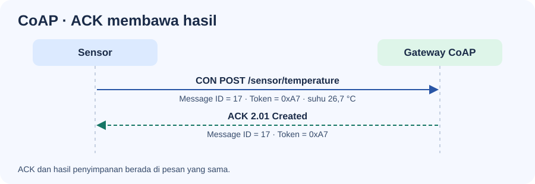
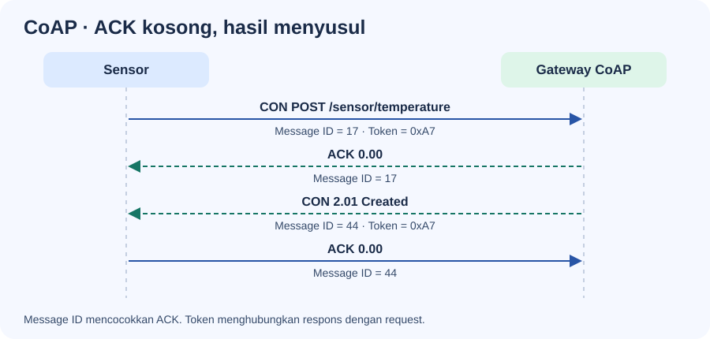
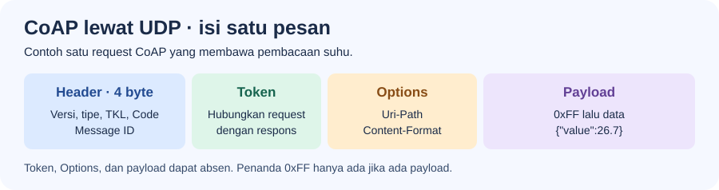
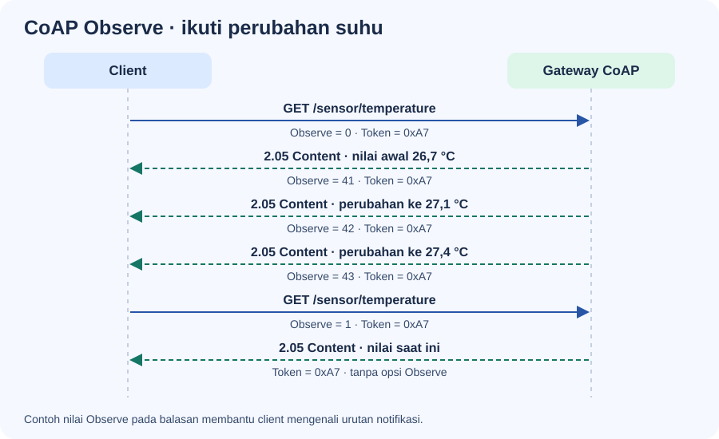

# CoAP (Constrained Application Protocol)

!!! note "AI Generated"

    Revisi pembuka, sejarah, penjelasan struktur pesan, diagram, dan jalur belajar pada halaman ini disusun dengan bantuan AI.

CoAP adalah protokol pertukaran pesan untuk perangkat dengan daya atau memori terbatas, atau jaringan dengan kapasitas kecil. Pola dasarnya *request-response*. Client meminta suatu *resource*, yaitu data atau fungsi yang dapat diakses melalui alamat tertentu, lalu server membalas dengan hasilnya.

Pola itu cocok untuk komunikasi antarperangkat, misalnya dalam otomasi gedung. Pengendali dapat meminta status lampu melalui alamat yang ditentukan. Perangkat membalas dengan statusnya, sehingga pengendali dapat mengetahui apakah lampu sedang menyala.

Pada contoh AIoT di bab ini, sensor mengirim pembacaan suhu ke gateway dengan CoAP lewat UDP. Saat panel pemantauan perlu mengikuti perubahan suhu, panel juga dapat memakai CoAP Observe untuk mendaftar sekali dan menerima pembaruan berikutnya.

## Sejarah singkat

RFC 7252 diterbitkan pada 2014 untuk perangkat dan jaringan dengan sumber daya terbatas. Dokumen itu mendefinisikan pesan CoAP lewat UDP. Pada 2015, RFC 7641 menambahkan Observe agar client bisa mengikuti perubahan resource setelah satu pendaftaran. [RFC 7252](https://datatracker.ietf.org/doc/html/rfc7252) · [RFC 7641](https://datatracker.ietf.org/doc/html/rfc7641)

## Tipe pesan pada CoAP

| Tipe | Arti |
| --- | --- |
| Confirmable (CON) | Pengirim menunggu ACK. Jika ACK belum tiba, pengirim dapat mengirim ulang sampai batas percobaan. |
| Non-confirmable (NON) | Pesan dikirim tanpa menunggu ACK. Bila ada hasil aplikasi, server dapat mengirimkannya sebagai pesan terpisah. |
| Acknowledgement (ACK) | Mengonfirmasi penerimaan pesan CON. ACK bisa kosong atau membawa hasil permintaan. |
| Reset (RST) | Penerima melihat pesan tetapi tidak punya konteks untuk memprosesnya. |

## Siklus request-response CoAP dalam proyek AIoT

Anggap gateway menyimpan pembacaan sensor ke basis data. Bandingkan dua cara gateway menangani satu pesan CON.

### ACK membawa respons

Gateway selesai menyimpan pembacaan sebelum perlu mengirim ACK. Gateway menggabungkan ACK dan kode hasil `2.01 Created` dalam satu pesan. Ini disebut *piggybacked response*.

[](../assets/images/coap-ack-flow.svg)

### ACK kosong dan respons terpisah

Jika penyimpanan butuh lebih lama, gateway dapat mengirim ACK kosong dulu. Saat ACK kosong tiba, sensor tahu pesan diterima dan berhenti mengulang permintaan. Hasil penyimpanan menyusul. Di contoh ini gateway mengirim hasil sebagai CON, sehingga sensor mengirim ACK untuk pesan baru itu.

[](../assets/images/coap-separate-flow.svg)

Untuk telemetri berkala yang masih berguna ketika satu pembacaan hilang, coba bandingkan dengan `NON POST /sensor/temperature`. Sensor tidak menunggu ACK. Jika pesan hilang, lapisan pesan CoAP tidak mengirim ulang pesan NON itu.

Rujukan [RFC 7252 §4 tentang tipe pesan](https://www.rfc-editor.org/rfc/rfc7252.html#section-4) dan [§5.2 tentang respons](https://www.rfc-editor.org/rfc/rfc7252.html#section-5.2).

## Struktur dasar request CoAP

CoAP punya metode GET, POST, PUT, dan DELETE. Metode menentukan tindakan yang diminta. Tipe pesan menentukan cara pesan dikirim dan dikonfirmasi.

Contoh isi permintaan `POST /sensor/temperature`:

```json
{
  "device_id": "node-01",
  "value": 26.7
}
```

Pada CoAP lewat UDP, setiap pesan diawali header tetap 4 byte. `Message ID` membantu mencocokkan ACK dengan pesan yang dikonfirmasi. Token menghubungkan respons dengan request, termasuk ketika server mengirim respons terpisah.

[](../assets/images/coap-message-structure.svg)

Options membawa informasi seperti path resource dan format isi pesan. Jika ada payload, penanda `0xFF` menunjukkan awal data. [RFC 7252 §3](https://datatracker.ietf.org/doc/html/rfc7252#section-3)

## Mengikuti perubahan dengan CoAP Observe

Client CoAP bisa mengirim GET berulang untuk membaca suhu terbaru. Dengan Observe, client mendaftar sekali melalui GET dengan opsi `Observe=0`. Jika server menerima pendaftaran, respons awal menyertakan opsi Observe dan nilai saat itu.

[](../assets/images/coap-observe-flow.svg)

Server dapat mengirim notifikasi saat representasi resource berubah. Notifikasi membawa token yang sama dan nilai Observe yang membantu client membedakan pembaruan yang lebih baru. Jika respons awal tidak menyertakan opsi Observe, client dapat kembali memakai GET berkala.

Observe bekerja secara *best effort*, sehingga dashboard bisa melewatkan nilai antara dua pembaruan yang diterima. Untuk berhenti mengamati secara eksplisit, kirim GET ke resource yang sama dengan `Observe=1` dan token awal. Balasan pembatalan tidak memuat opsi Observe. [RFC 7641 §3.6 dan §4](https://datatracker.ietf.org/doc/html/rfc7641#section-3.6)

## Beberapa fitur tambahan CoAP

- **Block-wise transfer** mengirim data besar dalam beberapa blok. [RFC 7959](https://www.rfc-editor.org/rfc/rfc7959.html).
- **DTLS** menyediakan pengamanan transport CoAP lewat UDP. [RFC 7252 §9](https://www.rfc-editor.org/rfc/rfc7252.html#section-9).

## What's next

<div class="ai-resource-grid ai-practice-grid" markdown="1">

[<span class="ai-practice-icon" aria-hidden="true">:lucide-network:</span> **Bandingkan dengan MQTT** <span class="ai-practice-description">Jika satu pembacaan perlu diteruskan ke beberapa aplikasi, lihat bagaimana MQTT memakai broker dan topik langganan.</span>](mqtt.md){ .ai-practice-start }

</div>
