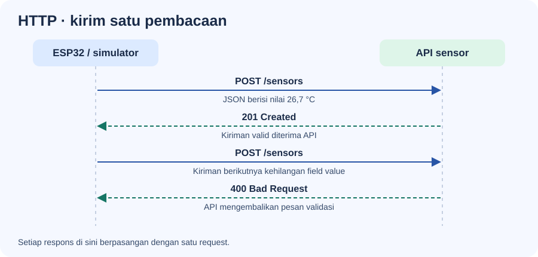
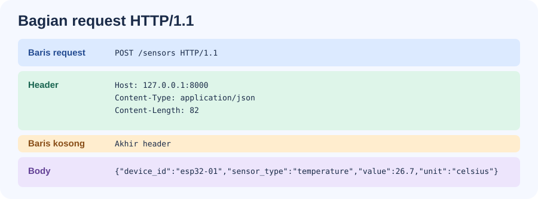
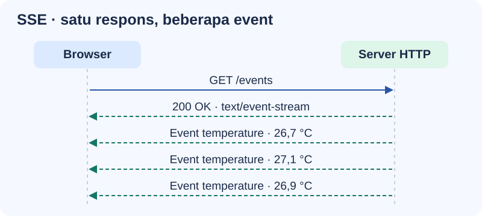

# HTTP (Hypertext Transfer Protocol)

!!! note "AI Generated"

    Revisi pembuka, sejarah, penjelasan struktur pesan, diagram, materi SSE, dan jalur belajar pada halaman ini disusun dengan bantuan AI.

HTTP adalah protokol untuk bertukar pesan di web dengan pola *request-response*. Client mengirim permintaan (*request*) yang menyatakan tindakan dan alamat yang dituju. Server membalas dengan respons (*response*) yang memuat kode status dan dapat membawa isi, seperti halaman atau data.

Saat membuka halaman web, browser berperan sebagai client yang meminta halaman ke server. Pola yang sama dipakai oleh aplikasi yang mengambil data lewat API, yaitu antarmuka untuk bertukar data atau meminta tindakan dari aplikasi lain.

Di proyek AIoT, ESP32 atau simulator mengambil peran client. Keduanya dapat mengirim pembacaan suhu ke API. Kode status pada respons menunjukkan apakah permintaan berhasil diproses.

## Sejarah singkat

RFC 1945 mendokumentasikan HTTP/1.0 pada 1996. RFC 2068 menyusul pada 1997 sebagai spesifikasi awal HTTP/1.1. Bab ini memakai format pesan HTTP/1.1 dari RFC 9112 untuk membaca contoh kiriman sensor. [RFC 1945](https://datatracker.ietf.org/doc/html/rfc1945) · [RFC 2068](https://datatracker.ietf.org/doc/html/rfc2068) · [RFC 9112](https://datatracker.ietf.org/doc/html/rfc9112)

## Siklus request-response dalam proyek IoT

1. Client mengirim request ke endpoint API.
2. Server validasi data (format, token, nilai wajib).
3. Server proses logika bisnis.
4. Server kirim response status dan data.

### Diagram alur request-response HTTP

[](../assets/images/http-sensor-flow.svg)

Contoh status code yang sering muncul:

- 200 OK: request berhasil.
- 201 Created: data baru berhasil dibuat.
- 400 Bad Request: format/isi request tidak valid.
- 401 Unauthorized: butuh autentikasi.
- 500 Internal Server Error: ada error di sisi server.

Untuk melihat lebih lengkap, kalian bisa mengunjungi situs: [Status Code Reference](https://developer.mozilla.org/en-US/docs/Web/HTTP/Reference/Status)

## Struktur dasar request HTTP

Contoh HTTP/1.1 berikut memakai request dari latihan [Backend Mini](../hands-on/backend-mini.md). Baris pertama memuat metode dan alamat yang dituju. Header memberi informasi untuk membaca pesan, lalu satu baris kosong memisahkannya dari body JSON.

[](../assets/images/http-message-structure.svg)

Kirim field yang sama sebagai JSON pada latihan Backend Mini. Client HTTP dapat menghitung `Content-Length` dari jumlah byte body. Pada contoh ini body berukuran 82 byte jika dikirim sebagai satu baris tanpa baris baru di akhir. [Format pesan HTTP/1.1](https://datatracker.ietf.org/doc/html/rfc9112#section-2.1)

```http
POST /sensors HTTP/1.1
Host: 127.0.0.1:8000
Content-Type: application/json
Content-Length: 82

{"device_id":"esp32-01","sensor_type":"temperature","value":26.7,"unit":"celsius"}
```

## Tipe data pada request

Saat kirim request ke server, data bisa diletakkan di beberapa tempat. Tiga yang paling sering dipakai adalah query, request param (path param), dan request body.

### Query string

Query dipakai untuk filter, pencarian, sorting, atau pagination. Letaknya di URL setelah tanda `?`.

Contoh:

```text
GET /sensor/history?device_id=esp32-01&limit=10
```

Penjelasan singkat:

- `device_id=esp32-01` untuk pilih data milik device tertentu.
- `limit=10` untuk batasi jumlah data yang diambil.

### Request param (path param)

Request param dipakai saat kita ingin menunjuk resource yang spesifik lewat URL path.

Contoh pola endpoint:

```text
GET /sensor/:id
```

Contoh saat dipanggil:

```text
GET /sensor/123
```

Di sini, nilai `123` adalah path param `id`.

### Request body

Request body dipakai untuk mengirim data utama, biasanya pada method POST atau PUT.

Contoh:

```http
POST /sensor HTTP/1.1
Content-Type: application/json

{
  "device_id": "esp32-01",
  "suhu": 27.1,
  "kelembapan": 60.2
}
```

Body paling umum dipakai dalam format JSON karena mudah dibaca dan mudah diproses di backend.

## Method HTTP yang paling sering dipakai

### GET (Read)

Dipakai untuk mengambil data dari server.

Karakteristik:

- Umumnya tanpa body.
- Parameter sering dikirim lewat query string.
- Bisa di-cache oleh browser.

Contoh:

```text
GET /sensor/latest?id=123
```

### POST (Create)

Dipakai untuk mengirim dan membuat data baru.

Karakteristik:

- Data utama dikirim lewat body.
- Cocok untuk payload yang lebih besar dari query string.

Contoh penggunaan di AIoT:

- ESP32 kirim pembacaan sensor periodik ke endpoint server.

Contoh request:

```http
POST /sensor-data HTTP/1.1
Content-Type: application/json
{
  "device_id": "esp32-01",
  "suhu": 26.7,
  "kelembapan": 56.3
}
```

Browser akan mengirim request tersebut ke server, lalu server akan memproses data dan menyimpannya ke database.

### PUT (Update)

Dipakai untuk memperbarui data yang sudah ada.

Contoh:

- Update konfigurasi ambang batas suhu perangkat.

Contoh request:

```http
PUT /sensor/123 HTTP/1.1
Content-Type: application/json

{
  "suhu": 27.1,
  "kelembapan": 60.2
}
```

### DELETE (Delete)

Dipakai untuk menghapus resource tertentu.

Contoh:

- Hapus data sensor duplikat atau data uji.

Contoh request:

```http
DELETE /sensor/123 HTTP/1.1
```

## Tips praktik

- Selalu set Content-Type: application/json untuk payload JSON.
- Validasi nilai sensor sebelum dikirim (hindari data kosong/aneh).
- Cek status code di sisi client sebelum parsing response.
- Simpan endpoint API dalam variabel konfigurasi, jangan hardcode langsung di kode proyek, gunakan `.env` untuk menyimpan data penting seperti URL server, API Key, dan sebagainya.

## Telusuri permintaan sensor yang gagal

Jalankan [Backend Mini](../hands-on/backend-mini.md#jalankan-server). Kirim contoh JSON lengkap ke `POST /sensors` dan periksa kode 201 serta nilai yang dikembalikan. Hapus `value` lalu kirim ulang. Pada respons 400, baca pesan validasi. Jika alamatnya diganti ke rute yang tidak terdaftar, periksa respons 404.

## Server-Sent Events (SSE)

SSE memungkinkan server HTTP mengirim beberapa event dalam satu respons. Browser membuka request lewat `EventSource`. Server mengirim isi respons secara bertahap, sehingga browser dapat memproses event satu per satu selama aliran terbuka. [WHATWG HTML Standard](https://html.spec.whatwg.org/multipage/server-sent-events.html)

Aplikasi web dapat memakai aliran ini untuk menampilkan progres pekerjaan yang berjalan di server. Setiap kali pekerjaan maju, server mengirim event baru dan browser memperbarui angka di layar. Jika browser perlu mengirim tindakan, seperti membatalkan pekerjaan, buat request HTTP terpisah.

Di proyek AIoT, dashboard dapat menerima pembacaan suhu dari backend dengan cara yang sama. Sensor masih dapat mengirim suhu ke API atau broker. SSE menangani bagian dari backend ke browser, sehingga dashboard dapat memperbarui tampilan setiap kali server mengirim pembacaan baru.

[](../assets/images/http-sse-flow.svg)

### Cara membaca satu event

Server menandai respons dengan header `Content-Type: text/event-stream`. Di dalam respons, field `event` memberi nama event, `data` membawa isi, dan satu baris kosong menandai akhir event. Untuk contoh suhu, JavaScript membaca `event.data` sebagai teks JSON lalu mengambil nilai `value`.

### Praktik menerima tiga pembacaan

1. Siapkan [uv](https://docs.astral.sh/uv/getting-started/installation/).
2. Simpan [sse_server.py](../assets/protocol-labs/sse_server.py) di folder latihan.
3. Buka terminal di folder latihan.
4. Jalankan server lokal.

    ```powershell
    uv run --no-project sse_server.py
    ```

5. Buka `http://127.0.0.1:8002/` di browser.
6. Amati pembacaan suhu yang muncul satu per satu.

Halaman menerima 26,7 °C, 27,1 °C, dan 26,9 °C sebelum menampilkan status **Aliran selesai**. Server mengirim event `done` setelah pembacaan terakhir, lalu halaman menutup `EventSource`. Saat sambungan terputus sebelum selesai, browser dapat mencoba terhubung kembali dan demo akan memulai urutan suhu dari awal.

Untuk melihat teks yang diterima browser, jalankan perintah berikut di terminal kedua. Opsi `-N` membuat curl menampilkan data tanpa menunggu buffer output terisi. Setelah selesai memeriksa hasil, hentikan server dengan `Ctrl+C` di terminal pertama.

```powershell
curl.exe -N -i http://127.0.0.1:8002/events
```

Gunakan SSE jika dashboard terutama menerima pembaruan. Jika server dan browser perlu saling berkirim pesan lewat koneksi yang sama, pelajari [WebSocket](websocket.md).

## What's next

<div class="ai-resource-grid ai-practice-grid" markdown="1">

[<span class="ai-practice-icon" aria-hidden="true">:lucide-flask-conical:</span> **Backend Mini** <span class="ai-practice-description">Kirim satu pembacaan suhu. Bandingkan status respons untuk JSON yang lengkap dan yang kehilangan nilai sensor.</span>](../hands-on/backend-mini.md){ .ai-practice-start }

[<span class="ai-practice-icon" aria-hidden="true">:lucide-cpu:</span> **IoT Simulator Mini** <span class="ai-practice-description">Jika API sudah berjalan, kirim data sensor sintetis dari Python tanpa memakai board fisik.</span>](../hands-on/iot-simulator-mini.md)

</div>
