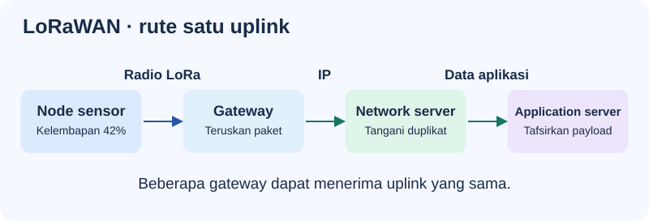

# LoRaWAN

!!! note "AI Generated"

    Penjelasan dan diagram pada halaman ini disusun dengan bantuan AI.

LoRaWAN adalah protokol jaringan yang memungkinkan perangkat hemat daya mengirim data lewat radio jarak jauh. Perangkat mengirim paket yang dapat diterima satu atau beberapa gateway radio. Gateway meneruskan paket ke *network server*, yang mengelola komunikasi sebelum data diteruskan ke aplikasi.

Dalam pemantauan meter air, petugas dapat membaca catatan konsumsi dari beberapa lokasi melalui satu aplikasi. Meter cukup mengirim pembaruan berkala karena aplikasi menyimpan dan menampilkan hasil saat data tiba. Pengiriman seperti ini sesuai untuk data berukuran kecil yang tidak perlu dikirim terus-menerus.

Dalam proyek AIoT, pola itu cocok untuk memantau kelembapan tanah di petak yang berada di luar jangkauan Wi-Fi. Node mengirim pembacaan lewat radio, lalu gateway dengan koneksi IP meneruskannya ke jaringan LoRaWAN. Backend dapat menyimpan hasil itu untuk ditampilkan pada dashboard.

## Sejarah singkat

LoRa Alliance mulai menstandardisasi LoRaWAN pada 2015 agar perangkat dan jaringan memiliki aturan pertukaran data yang sama. Spesifikasi lapisan jaringan mengatur cara perangkat bergabung dan bertukar paket. LoRa sendiri membawa bit lewat radio, sedangkan LoRaWAN mengatur bagaimana paket itu digunakan dalam jaringan. [Ikhtisar LoRa Alliance](https://resources.lora-alliance.org/document/what-is-lorawan) · [Spesifikasi LoRaWAN L2](https://resources.lora-alliance.org/technical-specifications/ts001-1-0-4-lorawan-l2-1-0-4-specification)

## Dari node ke aplikasi

Saat node mengirim pembacaan, paket itu disebut *uplink*. Gateway yang mendengar paket meneruskannya lewat jaringan IP. Jika dua gateway menerima kiriman yang sama, *network server* dapat mengenali duplikat sehingga data itu cukup diteruskan sekali ke *application server*. [LoRaWAN Backend Interfaces](https://resources.lora-alliance.org/technical-specifications/ts002-1-1-0-lorawan-backend-interfaces)

*Application server* menangani data aplikasi. Payload, yaitu isi kiriman yang dibuat node, dapat berisi angka ringkas seperti `42` untuk mewakili kelembapan 42%. Setelah ditafsirkan, nilai itu dapat diteruskan ke backend untuk dicatat dan ditampilkan.

## Kapan perangkat menerima balasan?

Pesan dari jaringan ke perangkat disebut *downlink*. Pada perangkat Class A, radio membuka kesempatan menerima pesan (RX1) setelah uplink selesai. Jika belum menerima pesan yang ditujukan kepadanya di RX1, perangkat membuka RX2, lalu dapat kembali tidur. [Spesifikasi LoRaWAN L2 §3.3](https://lora-alliance.org/wp-content/uploads/2021/11/LoRaWAN-Link-Layer-Specification-v1.0.4.pdf#page=12)

Karena jendela terima hanya muncul setelah uplink, perintah yang masuk sesudah kedua jendela tertutup perlu menunggu kesempatan berikutnya. Pola ini menghemat daya karena radio tidak terus mendengarkan. Untuk perintah dengan batas respons yang ketat, masukkan waktu tunggu itu ke rancangan sistem.

## What's next

[:lucide-network: **Teruskan pembacaan dengan MQTT** Gunakan topik MQTT saat data yang sudah diterima aplikasi perlu dibagikan ke beberapa layanan.](mqtt.md){ .ai-practice-start }

