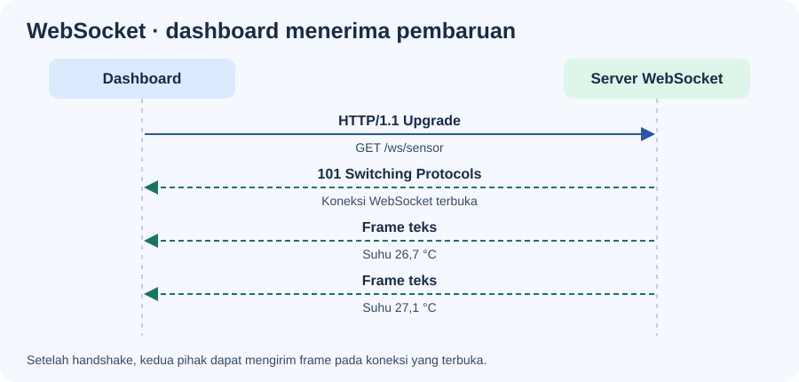
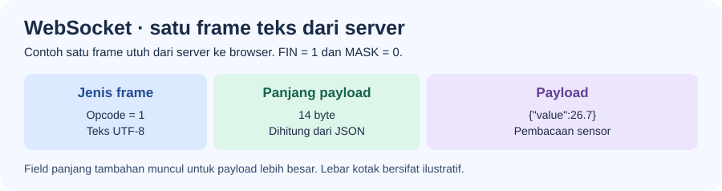
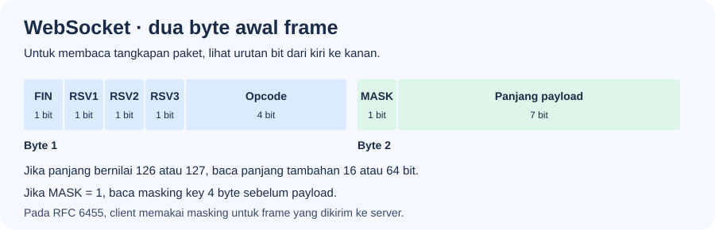

# WebSocket

!!! note "AI Generated"

    Revisi pembuka, sejarah, penjelasan struktur pesan, diagram, dan tautan lanjutan pada halaman ini disusun dengan bantuan AI.

WebSocket adalah protokol untuk bertukar pesan dua arah melalui satu koneksi yang tetap terbuka. Setelah client dan server membuka koneksi, masing-masing dapat mengirim pesan kapan saja selama koneksi itu aktif.

Di aplikasi percakapan, koneksi ini memungkinkan browser mengirim pesan dari pengguna. Server dapat meneruskan pesan masuk melalui koneksi yang sama saat pesan tersedia, sehingga browser tidak perlu berulang kali meminta daftar pesan terbaru.

Di proyek AIoT, panel pemantauan membuka koneksi WebSocket ke server. Ketika pembacaan suhu baru tersedia, server dapat langsung mengirimkannya lewat koneksi itu agar panel memperbarui tampilan.

## Sejarah singkat

RFC 6455 diterbitkan pada 2011 untuk aplikasi web yang membutuhkan komunikasi dua arah lewat koneksi yang tetap terbuka. Dalam alur yang dicontohkan di sini, browser membuka koneksi melalui handshake HTTP/1.1. Setelah server menyetujui perpindahan protokol, kedua pihak bertukar data dalam frame WebSocket. [RFC 6455 §1](https://datatracker.ietf.org/doc/html/rfc6455#section-1)

## Siklus komunikasi WebSocket dalam proyek AIoT

1. Client melakukan handshake ke endpoint WebSocket.
2. Server menerima koneksi dan melakukan autentikasi.
3. Client subscribe channel/topik logis (sesuai implementasi aplikasi).
4. Server push data sensor ke client secara real-time.
5. Client bisa kirim command kontrol ke server pada koneksi yang sama.

### Diagram alur komunikasi WebSocket

[](../assets/images/websocket-sensor-flow.svg)

## Struktur dasar komunikasi WebSocket

Secara umum, prosesnya terdiri dari:

- Handshake awal melalui HTTP (upgrade ke WebSocket).
- Koneksi persisten setelah handshake berhasil.
- Pertukaran message frame (text atau binary).

Contoh endpoint:

```text
ws://localhost:8000/ws/sensor
wss://iot.example.com/ws/sensor
```

Contoh payload JSON:

```json
{
  "type": "sensor_update",
  "device_id": "esp32-01",
  "suhu": 27.4,
  "kelembapan": 61.2
}
```

## Struktur dasar frame WebSocket

Setelah handshake, WebSocket membungkus data dalam *frame*. Header frame memberi tahu penerima jenis frame dan panjang payload. Pada contoh berikut, opcode `1` berarti teks, dan payload berisi pembacaan suhu dalam JSON.

[](../assets/images/websocket-frame-structure.svg)

### Lihat detail header frame

Dua byte pertama memuat `FIN`, bit `RSV`, opcode, `MASK`, dan panjang payload awal. Nilai `126` atau `127` menandai adanya field panjang tambahan. Dalam RFC 6455, frame dari client ke server memakai masking dan menyertakan kuncinya sebelum payload. [RFC 6455 §5.2](https://datatracker.ietf.org/doc/html/rfc6455#section-5.2)

[](../assets/images/websocket-frame-header.svg)

## Tipe data pada WebSocket

Berbeda dari HTTP, WebSocket tidak memakai method GET/POST untuk setiap pesan setelah koneksi aktif. Data dikirim sebagai message.

| Tipe | Fungsi |
| --- | --- |
| Text Message | Kirim data dalam format string (biasanya JSON). |
| Binary Message | Kirim data dalam format biner untuk efisiensi. |
| Event Message | Tambahkan field `type` untuk membedakan jenis pesan. Contoh: `sensor_update`, `alert`, `actuator_ack`. |

## Fitur WebSocket yang paling sering dipakai

### Real-time push

Server bisa mengirim data ke client tanpa harus menunggu request baru.

### Low-latency update

Cocok untuk dashboard monitoring, notifikasi, dan kontrol perangkat yang membutuhkan respons cepat.

### Heartbeat / ping-pong

Digunakan untuk mendeteksi koneksi yang putus agar client dapat reconnect otomatis.

## Tips praktik

- Gunakan `wss://` di production agar trafik terenkripsi.
- Definisikan skema payload event sejak awal agar konsisten.
- Tambahkan mekanisme reconnect otomatis di frontend.
- Batasi frekuensi update jika data sangat tinggi agar dashboard tetap ringan.
- Pisahkan channel untuk data sensor dan command kontrol.

## Apa yang tampil saat koneksi putus?

Jika pembacaan terakhir 28,5 °C, lalu koneksi putus, dashboard bisa tetap menampilkan 28,5 °C dengan keterangan “koneksi putus” dan waktu pembacaan. Saat tersambung lagi, perbarui nilai setelah menerima data baru. Dengan begitu, peserta bisa membedakan pembacaan lama dari sambungan yang sudah pulih.

Jika browser hanya perlu menerima pembaruan dan tindakan pengguna dapat dikirim lewat request HTTP terpisah, coba [Server-Sent Events (SSE)](http.md#server-sent-events-sse). Aliran SSE mengirim event dari server ke browser lewat satu respons HTTP.

## What's next

<div class="ai-resource-grid ai-practice-grid" markdown="1">

[<span class="ai-practice-icon" aria-hidden="true">:lucide-layout-dashboard:</span> **Integrasi API di frontend** <span class="ai-practice-description">Periksa cara dashboard menampilkan data dan pesan gagal. Gunakan pola tersebut saat menangani koneksi WebSocket yang putus.</span>](../frontend/api-integration.md){ .ai-practice-start }

</div>
