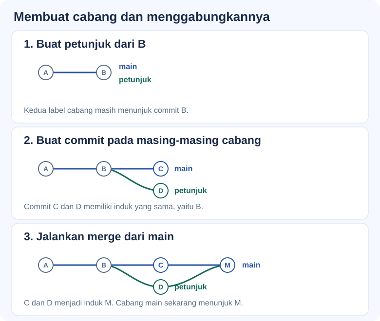

# Konsep Branching

!!! note "AI Generated"

    Penjelasan branching, contoh perintah, dan diagram pada halaman ini disusun dengan bantuan AI.

Saat tim ingin memperbarui petunjuk instalasi, perubahan dapat dikerjakan pada sebuah cabang. Cabang (*branch*) adalah nama yang menunjuk ke satu commit. Ketika commit dibuat di cabang aktif, Git menggeser penunjuk cabang itu ke commit baru, sehingga cabang lain dapat meneruskan pekerjaannya sendiri.

[](../assets/images/git-branch-merge.svg)

## Membuat Cabang Baru

Pada panel pertama, `main` menunjuk B. Buat cabang `petunjuk` dari titik itu dan langsung pindah ke sana dengan `git switch -c`. Sampai ada commit baru, kedua nama cabang masih menunjuk B.

```console
git switch -c petunjuk
```

## Berpindah Antar Cabang

Setelah commit pada `petunjuk` dibuat, pindah ke `main` untuk mengerjakan perubahan lain. Git memperbarui berkas di folder kerja sesuai cabang yang dipilih. Jika perpindahan akan menimpa perubahan lokal, Git dapat menolak, sehingga sebaiknya periksa `git status` dulu.

```console
git switch main
```

## Menggabungkan Cabang (Merging)

Pada panel kedua, `main` sudah memiliki C dan `petunjuk` memiliki D. Jalankan merge dari `main` untuk menggabungkan jalur tersebut. Jika kedua perubahan cocok, Git membuat commit merge M yang menghubungkan C dan D sebagai dua induk. [Dokumentasi git merge](https://git-scm.com/docs/git-merge)

```console
git merge petunjuk
```

Jika `main` masih di B, Git biasanya dapat langsung menggesernya ke D melalui *fast-forward*. Jika C dan D mengubah bagian berkas yang sama, Git dapat berhenti untuk meminta penyelesaian konflik.

## Menghapus Cabang

Setelah perubahan sudah digabung ke `main`, gunakan `git branch -d petunjuk` untuk menghapus label cabang lokal yang sudah selesai. Riwayat commit tetap dapat ditelusuri dari `main` karena hasil merge menghubungkan kedua jalur.

## What's next

<div class="ai-resource-grid ai-practice-grid" markdown="1">

[<span class="ai-practice-icon" aria-hidden="true">:lucide-git-merge:</span> **Konflik pada Git** <span class="ai-practice-description">Baca penanda konflik saat dua cabang mengubah bagian yang sama.</span>](git-conflict.md){ .ai-practice-start }

</div>
