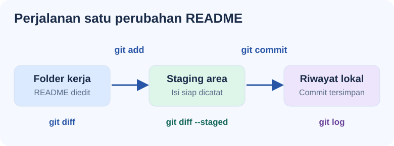

# Pengantar Version Control

!!! note "AI Generated"

    Penjelasan dan diagram alur commit pada halaman ini disusun dengan bantuan AI.

## Definisi Version Control System

Ketika petunjuk instalasi pada README berubah, tim mungkin perlu melihat apa yang tertulis sebelum revisi. Sistem kontrol versi menyimpan riwayat perubahan, sehingga anggota tim dapat membandingkan versi dan menelusuri kapan satu perubahan dicatat. [Tentang kontrol versi](https://git-scm.com/book/en/v2/Getting-Started-About-Version-Control)

### Cara Kerja Version Control System

Ruang kerja berisi berkas yang sedang diedit. Saat akan menyimpan satu versi, tentukan perubahan yang masuk dan beri pesan yang menjelaskan maksudnya. Dalam Git, versi yang dicatat bersama pesan itu disebut *commit*.

## Git

Git menyimpan riwayat pada repositori lokal sehingga commit dan pemeriksaan riwayat bisa dilakukan dari komputer sendiri. Git bermula pada 2005 untuk mendukung pengembangan kernel Linux. [Sejarah singkat Git](https://git-scm.com/book/en/v2/Getting-Started-A-Short-History-of-Git)

### Fitur Utama Git

Riwayat yang tersimpan dapat dipakai sebagai titik awal untuk pekerjaan berikutnya. Jika tim ingin memperbarui petunjuk pemasangan sambil memperbaiki contoh kode, Git dapat menyimpan dua jalur perubahan sebagai cabang. Kedua jalur dapat digabung lewat *merge* ketika hasilnya siap disatukan.

### Lingkungan Kerja Git

Saat README yang sudah dilacak diubah, versi yang terlihat di editor ada di **folder kerja**. Perintah `git add README.md` menyiapkan isi README pada saat perintah dijalankan. Git menyimpan isi yang dipilih itu di **staging area**, tempat menyiapkan isi commit berikutnya.

Saat `git commit` dijalankan, Git mencatat versi proyek sesuai isi staging area. Jika README diedit lagi setelah `git add`, perubahan lanjutan masih berada di folder kerja. Jalankan `git diff` untuk melihat bagian yang belum disiapkan dan `git diff --staged` untuk melihat isi yang siap dicatat. [Tiga keadaan Git](https://git-scm.com/book/en/v2/Getting-Started-What-is-Git%3F#_the_three_states)

## What's next

[:lucide-download: **Instalasi Git** Siapkan Git agar perintah bisa dijalankan dari terminal.](git-installation.md){ .ai-practice-start }

