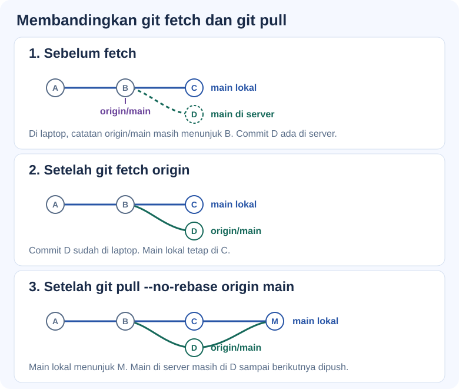
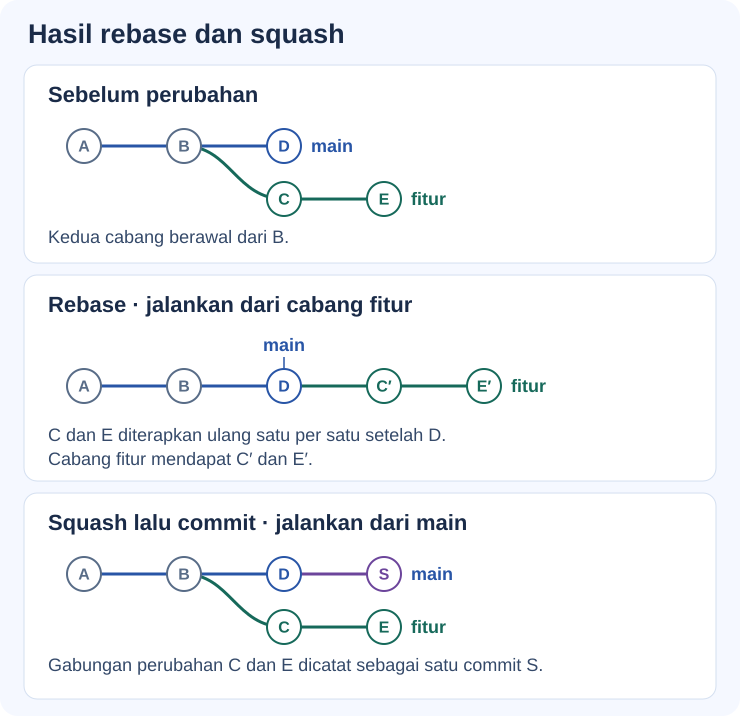

# Remote Repositories

!!! note "AI Generated"

    Penjelasan remote, diagram fetch, pull, rebase, dan squash, serta jalur latihan disusun dengan bantuan AI.

Tim yang bekerja dari komputer berbeda memerlukan tempat untuk berbagi commit. Git menyimpan alamat repositori yang dapat dihubungi dengan nama pendek, disebut *remote*. Saat kita menjalankan `git fetch origin`, Git tahu alamat yang harus diperiksa karena `origin` sudah dipasangkan dengan URL.

## Menambahkan Remote Repository

Jika repositori dimulai di laptop, gunakan `git remote add origin <url>` untuk menambahkan tujuan berbagi. Jika dimulai dengan `git clone`, Git biasanya menamai alamat sumber `origin` secara otomatis. Jalankan `git remote -v` untuk melihat URL yang dipakai untuk mengambil dan mengirim data. [Tentang repositori remote](https://docs.github.com/en/get-started/git-basics/about-remote-repositories)

Dalam latihan fork, `origin` mengarah ke fork di akun sendiri dan `upstream` mengarah ke repo organisasi. Nama itu mengikuti kebiasaan agar tujuan mudah dibaca pada setiap perintah. Jika URL berubah, gunakan `git remote set-url origin <url-baru>` untuk memperbaruinya.

## Bekerja dengan Remote Repository

| Perintah | Yang dilakukan |
| --- | --- |
| `git fetch origin` | Mengambil commit dan memperbarui catatan lokal seperti `origin/main`. |
| `git pull --ff-only origin main` | Mengambil commit dari `main` di remote dan mencoba memajukan cabang aktif jika riwayatnya sejalur. |
| `git push -u origin main` | Mengirim commit pada cabang `main` dan mengatur cabang remote yang dilacaknya. |

Opsi `-u` pada push mengatur cabang pelacakan untuk cabang lokal. Contoh ini mengatur `main` untuk melacak `origin/main`. Nama remote `upstream` pada skenario fork tetap menunjuk ke repositori organisasi.

## Menghapus Remote Repository

Gunakan `git remote remove <nama-remote>` jika alamat itu sudah tidak diperlukan dalam repositori lokal. Perintah tersebut menghapus catatan hubungan di laptop. Repo di server tetap tersedia lewat alamatnya.

## Perbedaan antara `git fetch` dan `git pull`

Anggap `main` lokal sudah mencapai C, sedangkan rekan satu tim mengirim D ke `main` di server. Kedua commit berasal dari B. Sebelum fetch, `origin/main` masih menunjuk B karena Git baru memperbarui catatan lokal saat berkomunikasi dengan remote.

[](../assets/images/git-fetch-pull.svg)

Setelah `git fetch origin`, catatan `origin/main` pindah ke D dan `main` lokal masih menunjuk C. Perubahan dari D sudah dapat dibaca dari laptop. Jalankan `git log --oneline --left-right main...origin/main` untuk melihat commit yang hanya ada pada masing-masing jalur.

Ketika `main` aktif, `git pull --no-rebase origin main` mengambil pembaruan lalu menggabungkan kedua jalur. Jika penggabungan berhasil, Git membuat commit merge M yang memiliki C dan D sebagai induk. Commit M masih ada di laptop sampai dikirim dengan push. [Dokumentasi git pull](https://git-scm.com/docs/git-pull)

Jika memilih `git pull --ff-only origin main`, Git hanya memajukan cabang aktif jika tidak perlu menggabungkan percabangan. Pada contoh C dan D, Git akan berhenti sehingga kedua jalur dapat diperiksa dulu. Jika merge berhenti karena isi berkas bertabrakan, ikuti [Konflik pada Git](git-conflict.md).

## Pendalaman rebase dan squash

Anggap cabang `main` sudah mencapai D, sedangkan cabang `fitur` memiliki dua commit, C dan E. Keduanya berawal dari B. Diagram berikut memakai kondisi awal itu untuk menunjukkan hasil rebase dan squash.

[](../assets/images/git-rebase-squash.svg)

### Rebase menerapkan ulang commit satu per satu

Saat `fitur` aktif, `git rebase main` menerapkan ulang perubahan dari C lalu E setelah D. Git membuat C′ dengan induk D, lalu E′ dengan induk C′, sehingga keduanya punya ID baru dan riwayat `fitur` menjadi lurus. Label `main` masih menunjuk D pada contoh ini. [Dokumentasi git rebase](https://git-scm.com/docs/git-rebase)

#### Menyelaraskan cabang dengan remote

Jika remote hanya mendapat commit baru dan cabang lokal juga punya commit yang belum dibagikan, jalankan `git pull --rebase origin fitur` dari cabang `fitur`. Git mengambil pembaruan lalu menerapkan ulang commit lokal di atasnya. Jika cabang lokal hanya tertinggal, `git pull --ff-only origin fitur` cukup untuk memajukannya. [Dokumentasi git pull](https://git-scm.com/docs/git-pull)

Jika riwayat cabang bersama sudah ditulis ulang dan dikirim ke remote, koordinasikan dengan rekan kerja. Beri tahu cabang mana yang berubah, karena commit lama pada cabang lokal kini bisa berbeda ID dari commit penggantinya di remote.

Untuk mengikuti riwayat baru, periksa `git status` dan simpan perubahan yang masih dikerjakan sebelum berganti cabang. Jalankan perintah berikut dari repositori lokal. Cabang `fitur-sinkron` dimulai dari versi terbaru `origin/fitur`, sementara `fitur` lokal tetap menjadi rujukan untuk riwayat lama. [Dokumentasi git switch](https://git-scm.com/docs/git-switch)

```bash
git fetch origin
git switch -c fitur-sinkron --track origin/fitur
```

Jika masih ada commit lokal yang perlu dibawa, periksa isinya dengan `git show <hash-commit>`. Dari `fitur-sinkron`, gunakan `git cherry-pick <hash-commit>` untuk menerapkan commit yang belum ada di riwayat baru. [Pemulihan setelah rebase di upstream](https://git-scm.com/docs/git-rebase#_recovering_from_upstream_rebase)

### Squash mencatat gabungan perubahan dalam satu commit

Jika ingin mencatat hasil akhir C dan E sebagai satu perubahan di `main`, jalankan `git merge --squash fitur` dari `main` untuk menyiapkan gabungan perubahan. Setelah `git commit`, terbentuk S dengan satu induk, yaitu D. Pada cabang `fitur`, C dan E tetap tercatat sebagai dua commit. Pilihan **Squash and merge** pada pull request GitHub juga menambahkan satu commit gabungan ke cabang tujuan. [Dokumentasi git merge](https://git-scm.com/docs/git-merge#Documentation/git-merge.txt---squash) · [Metode merge di GitHub](https://docs.github.com/en/pull-requests/reference/pull-request-merges#squash-and-merge-your-commits)

## What's next

<div class="ai-resource-grid ai-practice-grid" markdown="1">

[<span class="ai-practice-icon" aria-hidden="true">:lucide-terminal:</span> **Git Lokal dan Repositori Sendiri** <span class="ai-practice-description">Gunakan origin untuk mengirim commit ke akun sendiri.</span>](../hands-on/git-local-remote.md){ .ai-practice-start }

[<span class="ai-practice-icon" aria-hidden="true">:lucide-git-pull-request:</span> **Fork dan Pull Request di GitHub** <span class="ai-practice-description">Push ke fork dan periksa tujuan usulan di repo organisasi.</span>](../hands-on/git-fork-pull-request.md)

</div>

!!! tip "Takut salah atau masih bingung?"

    Serahkan pengecekannya ke AI agent dulu. :D Minta agent membaca `git status` dan menjelaskan langkah berikutnya sebelum menjalankan perintah.
